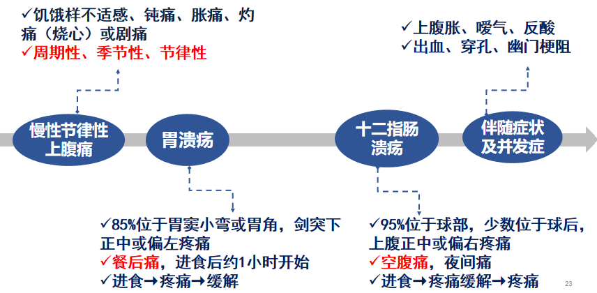
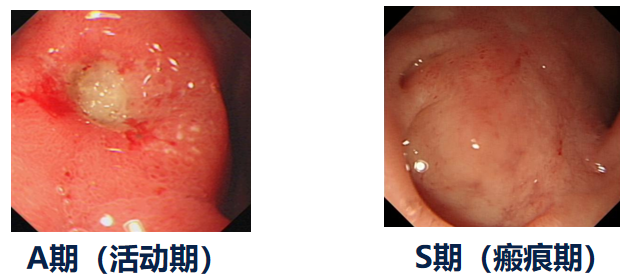
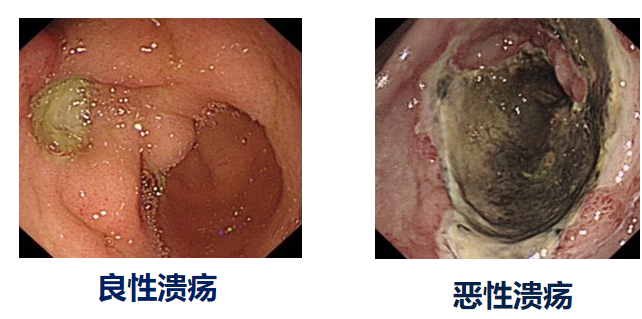
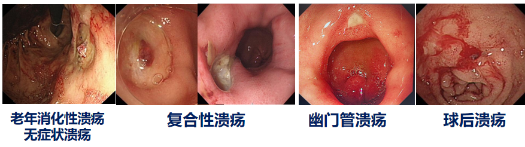
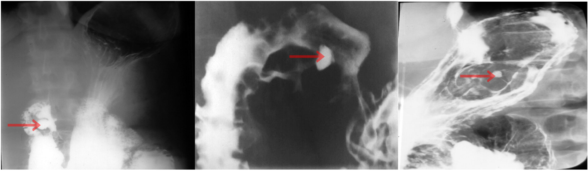
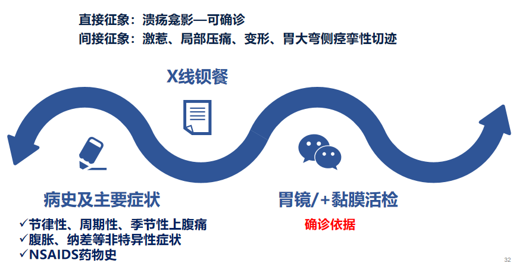

---
tags:
  - pathology
  - diagnosis
aliases:
  - 消化性溃疡
  - peptic ulcer
---
是指在各种致病因子的作用下，黏膜发生炎性反应与坏死、 脱落、 形成溃疡， 溃疡的黏膜坏死缺损<mark style="background-color: #1A4F10; color: white">穿透黏膜肌层</mark>， 严重者可达固有肌层或更深。
男性多于女性。
#### 发生部位
食管、胃、十二指肠、胃空肠吻合口、含胃粘膜的Meckel憩室
<mark style="background-color: #705A16; color: white">最常见：</mark>[胃溃疡](胃溃疡.md)（gastric ulcer）、[十二指肠溃疡](十二指肠溃疡.md)（duodenal ulcer）
流行病特点：常见病，患病率近1/10；
DU多见于青壮年，GU多见于中老年
##### 肠道溃疡

| 疾病                                    | 长轴方向         | 典型形态特征                                                                                                                                                                          | 好发部位                  | 伴随特征                                                                                  |
| :------------------------------------ | :----------- | :------------------------------------------------------------------------------------------------------------------------------------------------------------------------------ | :-------------------- | :------------------------------------------------------------------------------------ |
| [肠结核](肠结核.md) (Intestinal TB)         | 横行/环形（⊥ 肠长轴） | 边缘呈鼠咬状（潜行性），底部干酪样坏死                                                                                                                                                             | **回盲部**               | 易形成瘘管；愈合后瘢痕收缩致**肠腔环形狭窄**                                                              |
| **肠[伤寒](伤寒.md)** (Typhoid fever)      | 纵行/长形（∥ 肠长轴） | 边缘**整齐、隆起**，底部平坦，与集合淋巴滤泡形态一致                                                                                                                                                    | **回肠末段**              | 严重并发症为**肠出血**和**肠穿孔**                                                                 |
| **[克罗恩病](克罗恩病.md)** (Crohn's disease) | 纵行（∥ 肠长轴）    | **裂隙状纵行溃疡**，常与横行裂隙交叉形成<mark style="background-color: #1A4F10; color: white">“鹅卵石”征（铺路石样）</mark>                                                                                 | 回盲部及回肠末段              | 节段性分布（跳跃征），肠壁全层增厚，非干酪样肉芽肿        |
| [[溃疡性结肠炎]] (UC)                       | 无固定方向        | 溃疡**弥漫、浅表、连续性**，广泛糜烂，<mark style="background-color: #1A4F10; color: white">伴假性息肉形成</mark>；Crypt abscesses ( <mark style="background-color: #1A4F10; color: white">隐窝脓肿</mark> ) | **直肠、乙状结肠**（连续性向近端扩展） | 病变**局限于黏膜及黏膜下层**，少有深凿溃疡                                                               |
| **肠[阿米巴](阿米巴.md)病** (Amebiasis)       | 无固定方向        | **烧瓶状**（口小底大的深凿溃疡），溃疡间黏膜基本正常                                                                                                                                                    | **盲肠、升结肠**            | 溃疡较深，<mark style="background-color: #1A4F10; color: white">易引起肠穿孔</mark>；粪便中可检出阿米巴滋养体 |
[细菌性痢疾](细菌性痢疾.md)和[溃疡性结肠炎](溃疡性结肠炎.md)为浅溃疡
#### 病因病理
##### 消化性溃疡的病因与发病
一般 GU 的发病是因为防御-修复因素的损害，而 DU 的发病是由于侵袭性因素的增强。DU 病人多于 GU。
###### 损害因素
胃内消化液：胃酸，胃蛋白酶。
Hp：主要病因，超强的尿素酶活性。
[NSAIDs](NSAIDs.md)： 15～30% 服用 NSAIDs 的患者患有消化性溃疡，溃疡的出血及穿孔并发症发生率升高 4～6 倍；老年人中的溃疡并发症、死亡率直接和使用 NSAIDs 相关。
- 局部作用：直接损害胃黏膜，激活中性粒细胞介导的炎症反应；损害上皮细胞线粒体。
- 系统作用：抑制了 COX-1，导致前列腺素的合成减少，黏膜的供血减少，削弱了黏膜的保护作用。
###### 保护因素
胃的粘膜、黏液、碳酸氢盐屏障构成了胃的防御因素，防御功能的正常行使依赖于粘膜血流的支持，细胞更新的进行。
同时还需要注意前列腺素对消化道的保护作用。它可以扩展微血管，保护消化道粘膜的血供。
消化道的上皮细胞层更新快，每 2～4 天完全更新一次，表皮生长因子可以促进上皮修复。
###### 其他参与消化性溃疡的因素
遗传易感性：一些患者存在家族史，高胃酸。
胃排空障碍：十二指肠-胃反流。
激素：胃窦 G 细胞功能亢进。
血供不足或血流瘀滞：休克，肝硬化导致门脉高压。
浸润性疾病：克罗恩病，结节病。
术后状态：胃窦切除术后。
放射性治疗。
##### 病理
十二指肠溃疡（DU）发生主要是在十二指肠球部（95%），少数位于球后，称为球后溃疡。
胃溃疡（GU）主要是发生在（85%）<mark style="background-color: #1A4F10; color: white">胃窦小弯、胃角</mark>。
如果同一部位有 2 个以上的溃疡，就称为多发性溃疡；如果胃与十二指肠同时发生溃疡，称为复合型溃疡。直径大于 2 cm 的称为巨大溃疡。
###### 胃溃疡的分型
高胃酸型：
- II：胃十二指肠复合型溃疡。
- III：幽门前及幽门管溃疡。
低胃酸型：
- I：胃小弯溃疡，最为常见。
- IV：高位胃溃疡，位于贲门附近。
#### 诊断
##### 临床表现
[Open: Pasted image 20260924111830.png](attachments/207c9b5081bee08a7ccf8afad1336837_MD5.jpg)

在缓解期无不适感，在发作期上腹部存在稳定局限的压痛点。
- 胃溃疡：剑突下正中或者偏左，进食约 1 小时后出现餐后疼痛。疼痛性质为烧灼、痉挛感。
- 十二指肠溃疡：上腹部正中或者偏右疼痛，饥饿的时候感到疼痛，疼痛性质为饥饿烧灼感。
##### 内镜检查
是消化性溃疡的<mark style="background-color: #705A16; color: white">首选</mark>检查
多呈圆形或椭圆形
底部平整，覆盖有白色或灰白色苔膜
边缘整齐，周围黏膜充血，水肿
[Open: Pasted image 20260924111918.png](attachments/95154bd2b2458168e72342804097b4d2_MD5.jpg)

###### 良、恶性溃疡的鉴别
[Open: Pasted image 20260924111954.png](attachments/af7ef0dcc3ece8140d3ecdc8fa12ea43_MD5.jpg)

###### 特殊类型溃疡
| 类型            | 核心特点           | 疼痛/症状特点     | <mark style="background-color: #1A4F10; color: white">好发部位/并发症</mark> | 治疗反应    |
| ------------- | -------------- | ----------- | --------------------------------------------------------------------- | ------- |
| 老年消化性溃疡及无症状溃疡 | 不典型，无症状多见      | 症状轻微或无痛     | GU多位于胃体上部/胃底部，溃疡常较大                                                   | 需警惕，易漏诊 |
| 复合性溃疡         | 胃溃疡 + 十二指肠溃疡   | 症状叠加，规律改变   | 幽门梗阻发生率高                                                              | 疗程长，易复发 |
| 幽门管溃疡         | 症状不典型          | 餐后痛多见       | 易出现幽门梗阻、出血、穿孔                                                         | 对抗酸药反应差 |
| 球后溃疡          | 位置特殊（十二指肠球部以降） | 夜间痛及背部放射痛多见 | 易并发出血                                                                 | 疗效差     |
[Open: Pasted image 20260924112434.png](attachments/c1991c716fd0dc7cba8346b6f4bb550b_MD5.jpg)

##### X线钡餐：
适应症：了解胃的运动情况；胃镜禁忌者；不愿接受胃镜检查者；
溃疡的直接X线征象：<mark style="background-color: #1A4F10; color: white">龛影</mark>⭐️
溃疡的间接X线征象：胃大弯侧痉挛性切迹、十二指肠球部激惹及球部畸形等
[Open: Pasted image 20260924112957.png](attachments/ea3d64d0c7d7f53bd25131282be8627a_MD5.jpg)

##### 胃液分析
GU：胃酸分泌正常或低于正常
DU：部分DU胃酸分泌↑
对PU的诊断与鉴别诊断价值不大，主要用于胃泌素瘤的辅助诊断。
##### 血清胃泌素测定
血清胃泌素一般与胃酸分泌成反比：胃酸低，胃泌素高；胃酸高，胃泌素低
[胃泌素瘤](胃泌素瘤.md)时，两者同时升高,胃泌素>200pg/ml
PU时血清胃泌素稍高，无诊断意义
##### X线钡餐
通过影像观察到的溃疡龛影, 即可确诊胃溃疡. 这是直接的溃疡征象. 如果存在胃部激惹, 局部压痛, 并在胃大弯侧观察到痉挛性切迹, 也可以诊断.
[384Open: Pasted image 20260924113316.png](attachments/adcfd40bc8d09f062b2bce39e6af2f8d_MD5.jpg)

#### 并发症
##### 1. 出血
- 消化性溃疡是上消化道出血中最常见的病因。
- 临床常用 <mark style="background-color: #705A16; color: white">Forrest分型</mark> 评估出血风险。

##### 2. 穿孔
- 穿孔破溃入腹腔引起弥漫性腹膜炎。
- 破溃穿孔并受阻于毗邻实质性器官（称为穿透性溃疡）。
- 穿入空腔器官形成瘘管。
###### 消化性溃疡穿孔
**病史：**
空腹痛/夜间痛 + 制酸剂有效 → 十二指肠溃疡。
餐后突发剧烈上腹痛 + 腹肌紧张 → 溃疡穿孔
**诊断：**
<mark style="background-color: #1A4F10; color: white">穿孔后气体进入腹腔</mark> → 肝脏上方的气体使肝浊音界缩小或消失。这是诊断穿孔的最具特异性体征（90%以上阳性）。
认为腹部炎症重，选了“腹式呼吸消失”，但并非最有诊断意义
肠鸣音消失也可见于[[腹膜炎]]，但不特异。
##### 3. 幽门梗阻
- 多由十二指肠球部溃疡及幽门管溃疡引起。
- 呕吐隔夜酸臭食物。
- 可能是功能性的，如充血、水肿、痉挛，也可能是器质性的，如瘢痕、粘连。
- 体检可见胃蠕动波和振水音。
##### 4. 癌变
- **<1%** 的胃溃疡有可能癌变。
- 十二指肠球部溃疡**一般不发生癌变**。
#### 治疗
规律生活，劳逸结合，避免过劳与精神紧张，改变不良生活习惯。
合理饮食，避免对胃的刺激性食物、药物。
停用 NSAIDs。
戒烟戒酒。
##### 内科治疗
抑制胃酸分泌：用 [PPI](PPI)s，抑制 H⁺-K⁺-ATPase 的活性，使其不可逆的失去活性，导致壁细胞的 H⁺ 不能转移到胃腔当中而抑制胃酸分泌。DU 疗程 4～6 周，GU 6～8 周。
根除 Hp。
保护胃黏膜：
- 硫糖铝：不被胃肠吸收，极易黏附在溃疡的底面，形成抗酸、抗蛋白酶的屏障，防治 H⁺ 逆向弥散。
- 枸橼酸铋钾：沉淀在胃黏膜和溃疡的基底部，起到保护黏膜的作用，同时杀灭 Hp。
- 前列腺素类。
##### 外科治疗
外科治疗的适应症：
- 严重的并发症：出血，穿孔，梗阻。
- 内科治疗无效：巨大溃疡，慢性穿透，基底瘢痕，球后溃疡。
- 溃疡癌变。
非手术治疗：症状较轻，体征局限，空腹，穿孔时间已经超过 24 小时，腹膜炎体征已经局限，没有其他并发症或者难以耐受手术者。
手术治疗：对于症状十分明显的，或者饱食后穿孔的，顽固性溃疡者，伴有大出血、幽门梗阻、癌变者。
- 对症手术：
穿孔修补与大网膜填塞。
溃疡出血缝扎。
幽门成型与胃空肠吻合：针对胃流出道梗阻者。
- 根治手术：
胃大部切除术：减少胃酸分泌，去除了溃疡好发区域。
迷走神经切断术：阻断了胃酸胃相分泌。

> 穿孔单纯性修补与大网膜填塞
> 对溃疡穿孔单纯性修补，大网膜进行填塞，这是最常用的术式。
> 适用于：一般情况较差；无出血、幽门梗阻史；穿孔时间超过 8～12 小时；炎症及水肿较重者。

> 胃大部切除术
> 切除胃远侧的 2/3～3/4，包括了：胃体大部；胃窦；幽门；部分十二指肠球部。
> 因为切除了胃窦，消除了胃泌素引起的胃相胃酸分泌；切除了大部分胃体，减少了胃相和头相的胃酸分泌。同时溃疡本身及其好发部位也已经切除。
> 适用于：病史长，反复发作；溃疡穿孔时间 < 8 h 或者虽然时间已经超过，但是腹腔穿孔污染较轻且不明显水肿；伴有出血、幽门梗阻；怀疑癌变。
> 有两种术式，Billroth I 式十二指肠-残胃吻合，用于胃溃疡；Billroth II 式是残胃空肠吻合，用于十二指肠溃疡。

> 迷走神经切断术
> 该方法治疗 PU 的主要机制是消除了神经性胃酸分泌，消除了迷走神经兴奋引起的促胃液素分泌，降低了分泌胃酸的腺体对促胃液素和分泌，进而减少了分泌胃酸腺体的活动。
> 有以下术式：
> 迷走神经干切断合并引流术。
> 选择迷走神经切断术合并引流术。
> 高选择性迷走神经切断术。
> 迷走神经干切断加胃窦切除术或幽门成形术。
> 近年来，药物疗效好，所以迷走神经切除术已经很少应用。

###### 术后早期并发症
| 并发症 | 表现 | 原因 | 处理 |
|---|---|---|---|
| 术后胃腔内出血 | 如果术后不断引流出新鲜血液，那么有活动性出血 | 最常出现在吻合口，其次是胃、十二指肠残端。如果是术后 4～6 日出血，常因为吻合口黏膜坏死脱落 | 可以经内镜检査出血部位并处理。保守治疗无效者，积极手术治疗 |
| 胃排空障碍（胃瘫） | 进食后出现腹部饱胀、恶心、呕吐胃内容物，有时吐出胆汁 | 病人从禁食恢复到流食、半流食的过程 | 保守治疗，禁食，胃肠减压，营养支持，可以用胃动力药 |
| 十二指肠残端破裂 | 突发上腹部剧痛，腹腔穿刺抽出含有胆汁的液体 | Billroth II 的严重并发症，术后 2～5 日，常见于十二指肠残端处理不当或输入袢梗阻 | 确诊后立即手术，术中立即关闭十二指肠残端，行十二指肠造瘘和腹腔引流 |
| 胃壁缺血坏死、吻合口破裂、瘘 | | 胃小弯侧血管和胃大弯侧短血管离断过多。十二指肠残端和空肠袢供血不足，造成吻合口破裂或瘘 | 禁水禁食，胃肠减压，密切观察。如果穿孔，立刻手术处理 |
| 吻合口梗阻 | | 吻合口过小，吻合时内翻过多，术后吻合口水肿 | 胃肠减压，纠正低蛋白血症，必要可以手术 |
| 急性输入袢梗阻 | 上腹部剧烈疼痛、呕吐，呕吐物无胆汁，上腹部触及肿块 | 空肠袢过长，粘连、扭转、内疝也可以导致梗阻 | 立即手术 |
| 输出袢梗阻 | 上腹部饱胀不适，腹痛。严重者出现呕吐，呕吐物含有胆汁 | 术后肠粘连导致，也可以是吻合使得系膜压迫肠管 | 禁食、胃肠减压，无效者手术 |
###### 术后远期并发症
倾倒综合征 Dumping Syndrome：胃大部切除术后控制胃排空的幽门括约肌等结构被切除，导致<mark style="background-color: #1A4F10; color: white">胃排空过速</mark>，产生一系列的临床症状，称为倾倒综合征。
- 早期倾倒综合征：在餐后半小时内发生，恶心、呕吐、腹部绞痛，伴有心悸、出汗、无力等血容量不足表现。可能和高渗食物进入小肠导致大量肠源性血管活性物质和渗透作用使得细胞外液进入肠腔导致膨胀有关。少食多餐，低糖高脂高蛋白饮食。严重者可以用生长抑素。
- 晚期倾倒综合征：又名<mark style="background-color: #705A16; color: white">低血糖综合征</mark>。餐后 2～4h 发生，表现头晕、面色苍白、冷汗、晕厥。为食物大量快速进入小肠导致胰岛素大量分泌，反应性低血糖。同时低血糖导致肾上腺激素分泌，引发心悸、大汗。少食多餐，添加果胶延缓吸收。严重者皮下注射生长抑素。
碱性反流性胃炎：碱性胆汁和胰液反流到残胃，引起黏膜充血、水肿、糜烂，表现为剑突下持续烧灼感，胆汁性呕吐和体重减轻。胃镜观察到胃内胆汁，组织活检观察到炎症，排除输入袢扩张、梗阻即可确诊。用胃黏膜保护剂治疗，抑酸剂，胃动力药物治疗。内科治疗不满意也可以采用手术。
溃疡复发：多发生在吻合口边缘或其远端，常见原因是手术未能切除足够的胃组织或者迷走神经切断不完全，处理首选是内科正规抗溃疡治疗。
营养性并发症：胃大部切除术后，胃容量减少，摄入不足，消化吸收功能降低。主要包括营养不良、贫血、代谢性骨病。少食多餐，高蛋白，低脂肪，低钠，补充维生素、铁、微量元素。
残胃癌：因为良性疾病实施胃大部切除术后 5 年以上的残胃发生的癌变。可能与残胃黏膜萎缩，肠上皮化生有关，胃镜活检可以确诊。
##### 特殊情况下的消化性溃疡的诊疗
###### 瘢痕性幽门梗阻
诊断要点包括慢性溃疡病史，典型的胃潴留呕吐征（呕吐隔夜的餐食，<mark style="background-color: #1A4F10; color: white">不含有胆汁</mark>，有腐败酸臭味），蠕动波、振水音。如果进行胃肠减压操作会放出大量的酸臭胃液及食物残渣。行钡餐会发现食物排空延迟。
该类情况不行急诊手术，传统上认为的绝对手术指征为：空腹抽出胃液超过 300 ml；X 线钡餐检查 24 小时后胃内仍有钡剂残留。术前需要禁食并洗胃，纠正患者的水盐失衡，纠正贫血。
###### 胃十二指肠溃疡大出血
诊断要点：溃疡病史，突发大量的呕血或者黑便（50～80 ml），出现休克征，腹部体征轻微，HGB 和 RBC 进行性下降。如果每分钟出血量超过 1 ml 且速度较快，那么称为大出血。
治疗原则：止血，补充血容量，防治复发。80% 以上的溃疡型出血可以通过内科治疗好转。
非手术治疗：
	补充血容量：大多数有效，补液胶晶比 3∶1。
	给予氧气，放置胃管，以生理盐水洗胃，肾上腺素冰盐水胃内注入。
	急诊胃镜以确定出血部位并进行局部止血。
	抗酸：给予 H₂ 受体拮抗剂及生长抑素。
手术治疗的适应症：
	出血甚剧，短期内即出现休克。
	6～8 小时输血 600～800 ml 无好转或者停止输血后血压又降低。
	近期内曾发生过大出血。
	内科治疗期间发生大出血。
	年龄 > 60 岁或者伴有动脉硬化症。
	同时伴有穿孔或梗阻的出血。
