---
tags:
  - Proj
aliases:
  - TA
---
> [!PDF|rouge] [A preliminary integrated morphologic and transcriptomic analysis of denervation remodeling in rat laryngeal and hindlimb muscles, p.6](A%20preliminary%20integrated%20morphologic%20and%20transcriptomic%20analysis%20of%20denervation%20remodeling%20in%20rat%20laryngeal%20and%20hindlimb%20muscles.pdf#page=6&selection=0,0,1,39&color=rouge)
> > Fiber-type is a critical determinant of muscle metabolic properties, fatigue resistance, and regenerative capacity. 

> [!PDF|purple] [A preliminary integrated morphologic and transcriptomic analysis of denervation remodeling in rat laryngeal and hindlimb muscles, p.6](A%20preliminary%20integrated%20morphologic%20and%20transcriptomic%20analysis%20of%20denervation%20remodeling%20in%20rat%20laryngeal%20and%20hindlimb%20muscles.pdf#page=6&selection=1,40,3,30&color=purple)
> > Type I fibers are rich in mitochondria and support sustained aerobic activity.(20) 
> > Type II fibers primarily rely on anaerobic metabolism and are more prone to fatigue.(21)

> [!PDF|yellow] [A preliminary integrated morphologic and transcriptomic analysis of denervation remodeling in rat laryngeal and hindlimb muscles, p.5](A%20preliminary%20integrated%20morphologic%20and%20transcriptomic%20analysis%20of%20denervation%20remodeling%20in%20rat%20laryngeal%20and%20hindlimb%20muscles.pdf#page=5&selection=24,59,26,36&color=yellow)
> >  the human TA is composed of approximately 40% type I fibers and 60% type II fibers;(18) the rat TA consists entirely of type II fibers.

#### 病理切片
##### HE
> [!PDF|yellow] [单侧喉返神经切断后甲杓肌结构与酶学变化的实验性研究_何双八, p.12](单侧喉返神经切断后甲杓肌结构与酶学变化的实验性研究_何双八.pdf#page=12&selection=843,0,923,1&color=yellow)
> > 当失神经支配后肌肉在形态上首先表现为肌细胞浆丢失及直径减小 ‚ 然后出现肌丝断裂、变性以及结缔组织增生 l3] ‚ 也影响着肌肉收缩蛋白特性的变化

> [!PDF|green] [The Laryngoscope - 2026 - Bhatt - Novel Injectable Supports Long‐Term Recurrent Laryngeal Nerve and Partial Peripheral, p.3](The%20Laryngoscope%20-%202026%20-%20Bhatt%20-%20Novel%20Injectable%20Supports%20Long‐Term%20Recurrent%20Laryngeal%20Nerve%20and%20Partial%20Peripheral.pdf#page=3&selection=191,43,194,14&color=green)
> > Because the TA runs anteroposteriorly and slightly laterally, coronal sections of the trachea contain a mix of transverse, longitudinal, and oblique fibers

> [!PDF|rouge] [The Laryngoscope - 2026 - Bhatt - Novel Injectable Supports Long‐Term Recurrent Laryngeal Nerve and Partial Peripheral, p.6](The%20Laryngoscope%20-%202026%20-%20Bhatt%20-%20Novel%20Injectable%20Supports%20Long‐Term%20Recurrent%20Laryngeal%20Nerve%20and%20Partial%20Peripheral.pdf#page=6&selection=71,45,72,24&color=rouge)
> > TA adductor activity and muscle volume

> [!PDF|green] [Characteristics of Nerve Injury, Regeneration, and Vocal Fold Movement After Recurrent Laryngeal Nerve Electrocautery Injury, p.1](Characteristics%20of%20Nerve%20Injury,%20Regeneration,%20and%20Vocal%20Fold%20Movement%20After%20Recurrent%20Laryngeal%20Nerve%20Electrocautery%20Injury.pdf#page=1&selection=54,83,56,53&color=green)
> > The single muscle fiber diameter (SMFD) decreased to 56.16%, the muscle fiber area ratio (MFAR) decreased to 40.35%, and the motion range ratio (MRR) decreased to 12.2%. 
> [Open: d25e2cde1d5075295f4f39f0e5c29334.png](attachments/cd510f10596c913a603010d6444c27a1_MD5.jpg)
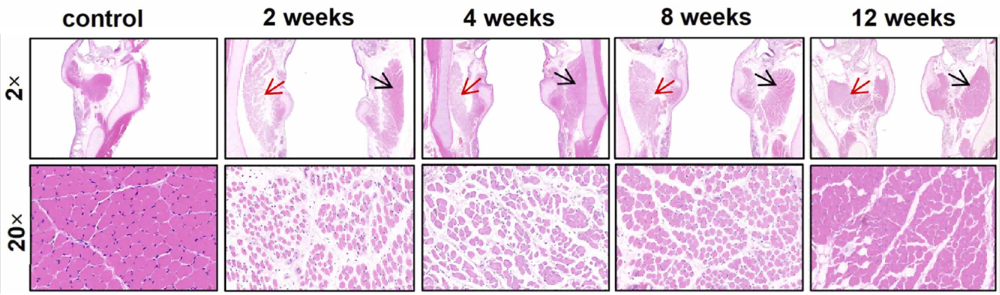

> [!PDF|green] [Effects of early local administration of high-dose bFGF on RLN injury——有些粗糙, p.6](Effects%20of%20early%20local%20administration%20of%20high-dose%20bFGF%20on%20RLN%20injury——有些粗糙.pdf#page=6&selection=50,0,71,16&color=green)
> > Representative microscopy images of coronal hematoxylin and eosin–stained thyroarytenoid (TA) muscle sections on day 28 after administration of different doses of basic fibroblast growth factor (bFGF) (200 and 2000 ng: low and high dose, respectively) or saline injection
> 
> [Open: Pasted image 20261010222651.png](attachments/827857ad448fc109c61469ed6c1f5a4e_MD5.jpg)
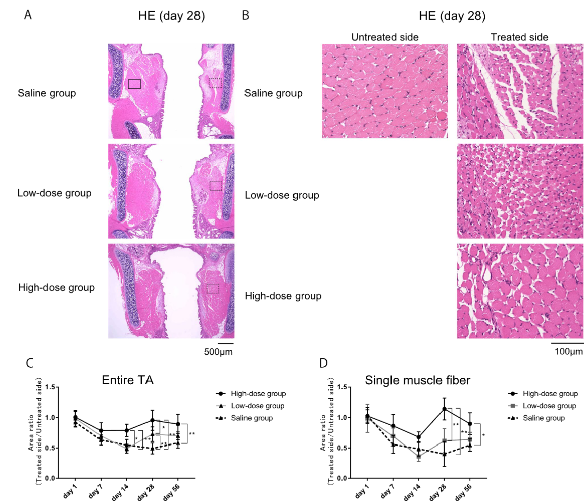

> [!PDF|green] [喉返神经损伤后喉肌病理生理研究_徐文, p.3](喉返神经损伤后喉肌病理生理研究_徐文.pdf#page=3&selection=328,0,332,1&color=green)
> > 肌纤维平均直径及肌束直径均随着损伤程度的减轻而增大、单位面积细胞核数逐渐减少。
> 
> [Open: Pasted image 20261011103552.png](attachments/4fdb5874e4d90466bbd8573bc9462c54_MD5.jpg)
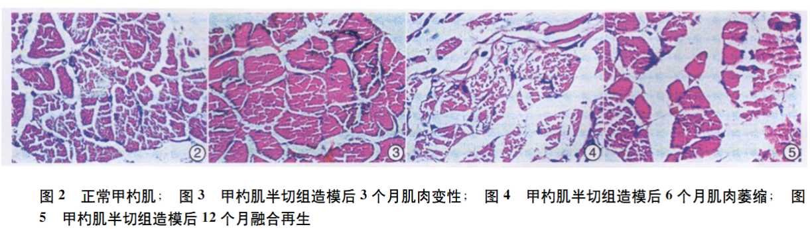

##### IHC
> [!PDF|green] [development-and-characterisation-of-an-experimental-recurrent-laryngeal-nerve-injury-model-for-the-study-of-viral-gene-therapy, p.3](development-and-characterisation-of-an-experimental-recurrent-laryngeal-nerve-injury-model-for-the-study-of-viral-gene-therapy.pdf#page=3&selection=36,0,39,40&color=green)
> > Motor endplates were stained for acetylcholinesterase, and neurofilament was stained using standard immunohistochemical methods previously described (see Figures 3 and 4).
> 
> [Open: Pasted image 20261011160736.png](attachments/548eb517f11250f5b55a86148a12e994_MD5.jpg)
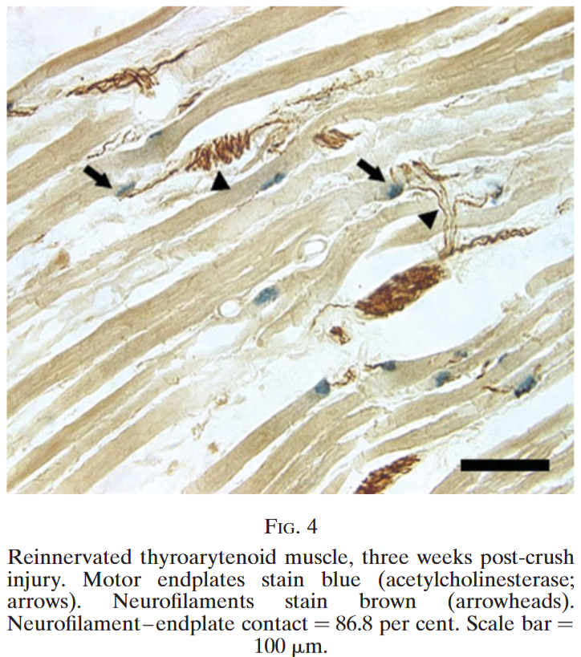

##### IF
> [!PDF|green] [CHANGES IN NEUROTROPHIC FACTORS OF ADULT RAT, p.47](CHANGES%20IN%20NEUROTROPHIC%20FACTORS%20OF%20ADULT%20RAT.pdf#page=4&selection=249,0,249,89&color=green)
> > Double labeling of the motor end plates (green fluorescence) and the axons (red fluorescenc
> 
> [Open: Pasted image 20261011115142.png](attachments/94fdff042d00a2a2a6e692bc9dbb54e7_MD5.jpg)
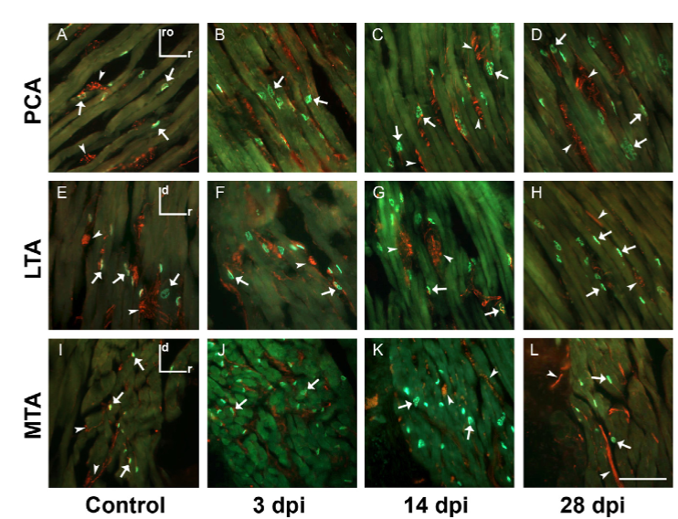

> [!PDF|green] [Enhancement of aging rat laryngeal muscles with endogenous growth factor treatment, p.6](Enhancement%20of%20aging%20rat%20laryngeal%20muscles%20with%20endogenous%20growth%20factor%20treatment.pdf#page=6&selection=73,66,74,7&color=green)
> > Representative glycogen (top) and Nav1.5 (bottom) stained section
> 
> [Open: Pasted image 20261011164142.png](attachments/e1bbb653cec25080f95ce5feaa071b4c_MD5.jpg)
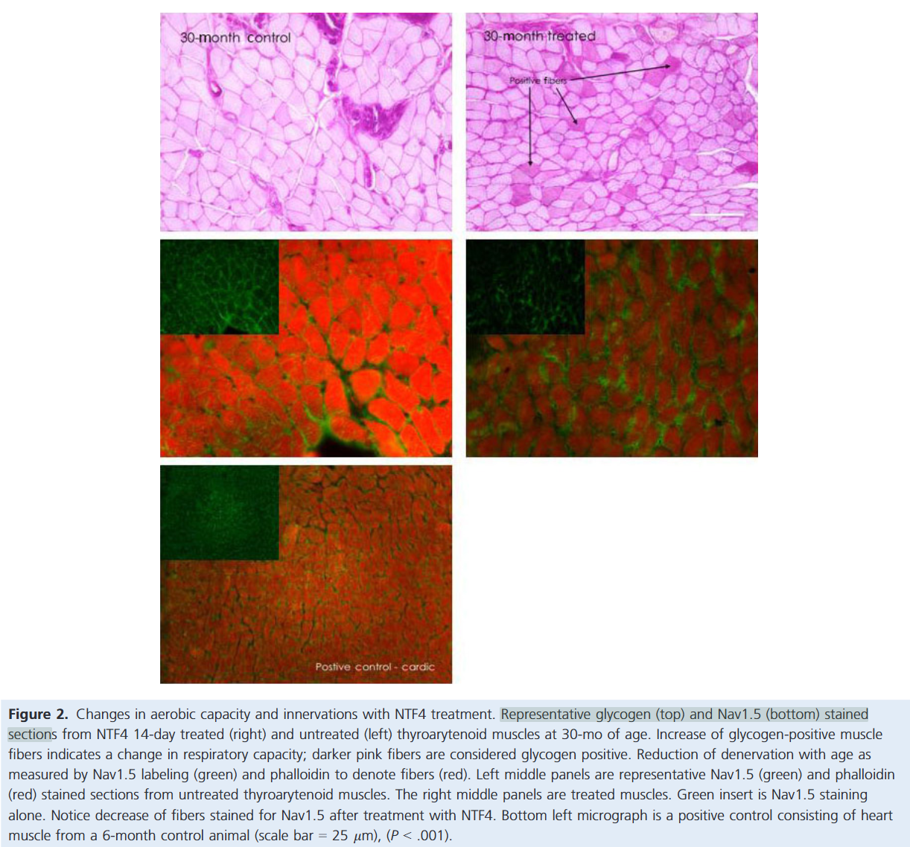

> [!PDF|green] [Enhancement of aging rat laryngeal muscles with endogenous growth factor treatment, p.7](Enhancement%20of%20aging%20rat%20laryngeal%20muscles%20with%20endogenous%20growth%20factor%20treatment.pdf#page=7&selection=126,66,129,42&color=green)
> >  a-bungarotoxin (green) and phalloidin (red)
> 
> [Open: Pasted image 20261011164216.png](attachments/b4aa467ca68447b42f234bb459d4be61_MD5.jpg)
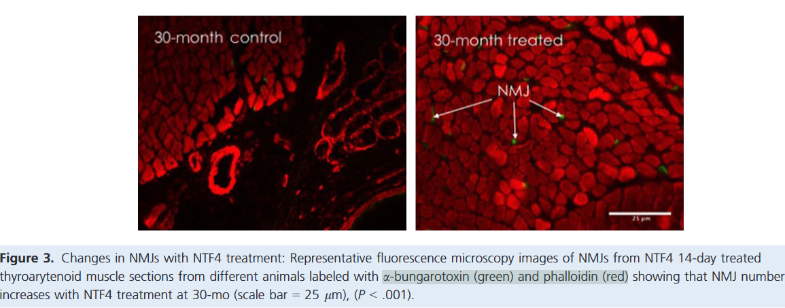

> [!PDF|green] [Enhancement of aging rat laryngeal muscles with endogenous growth factor treatment, p.7](Enhancement%20of%20aging%20rat%20laryngeal%20muscles%20with%20endogenous%20growth%20factor%20treatment.pdf#page=7&selection=111,109,112,15&color=green)
> > omorori’s trichrome image
> 
> [Open: Pasted image 20261011164247.png](attachments/56ad326a429cfa4f41d1298f19e27dd6_MD5.jpg)
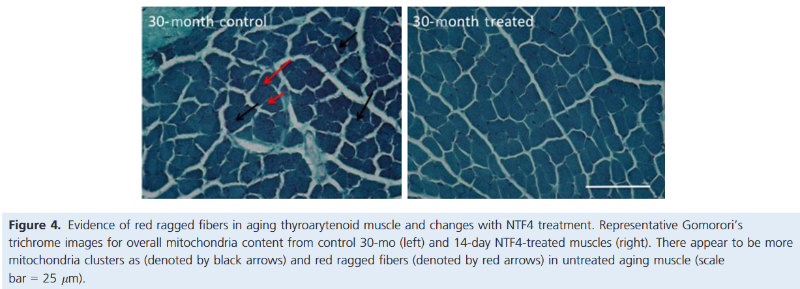

#### qPCR
> [!PDF|yellow] [CHANGES IN NEUROTROPHIC FACTORS OF ADULT RAT, p.45](CHANGES%20IN%20NEUROTROPHIC%20FACTORS%20OF%20ADULT%20RAT.pdf#page=2&selection=261,0,280,6&color=yellow)
> > Total RNA was isolated from each muscle using the TRIzol method
> 
> [Open: Pasted image 20261011111830.png](attachments/0aa954e879bc6e1ad70e0744947d58d8_MD5.jpg)
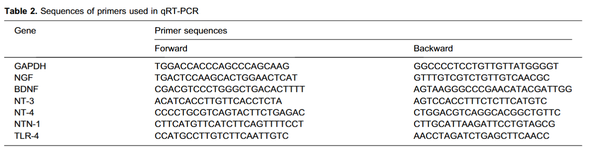
> > The mRNA expression of NT-3, NT-4 and TLR-4 compared to other trophic factors was minimal in all muscles and these values were statistically non significant. They were excluded from further analyses

#### 酶学
> [!PDF|green] [单侧喉返神经切断后甲杓肌结构与酶学变化的实验性研究_何双八, p.13](单侧喉返神经切断后甲杓肌结构与酶学变化的实验性研究_何双八.pdf#page=13&selection=405,0,442,1&color=green)
> > 当神经损伤后 ‚ 导致肌萎缩 ‚ 肌纤维 S D H 含量下降 ‚ 肌功能下降
> 
> [Open: Pasted image 20261011162525.png](attachments/2655a6383c09a7267b6454bbcb395639_MD5.jpg)
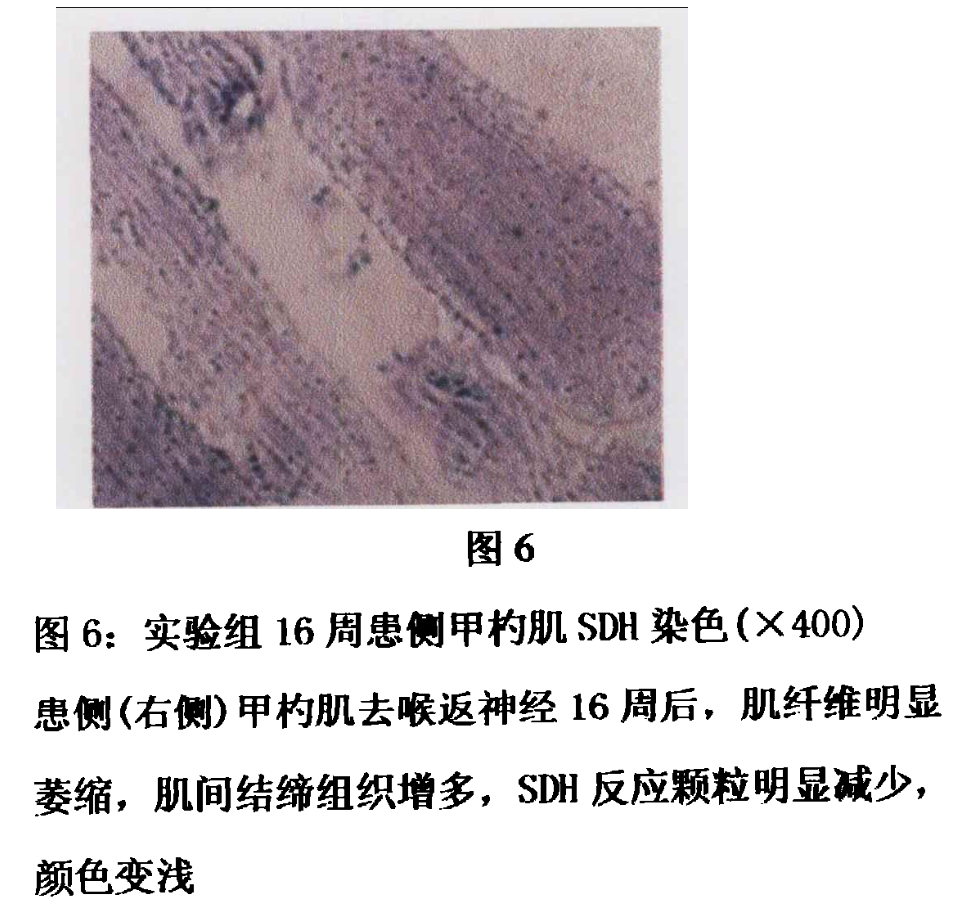

#### 组学
##### 1.
> [!PDF|rouge] [Microarray Analysis Gene Expression Profiles in Laryngeal Muscle After Recurrent Laryngeal Nerve Injury, p.2](Microarray%20Analysis%20Gene%20Expression%20Profiles%20in%20Laryngeal%20Muscle%20After%20Recurrent%20Laryngeal%20Nerve%20Injury.pdf#page=2&selection=67,19,68,4&color=rouge)
> >  At<mark style="background-color: #705A16; color: white"> 1 week</mark> following the denervation surgery
> 
> F344 male rat

> [!PDF|yellow] [Microarray Analysis Gene Expression Profiles in Laryngeal Muscle After Recurrent Laryngeal Nerve Injury, p.2](Microarray%20Analysis%20Gene%20Expression%20Profiles%20in%20Laryngeal%20Muscle%20After%20Recurrent%20Laryngeal%20Nerve%20Injury.pdf#page=2&selection=77,24,93,2&color=yellow)
> > <mark style="background-color: #705A16; color: white">The AC</mark> included the thyroarytenoid (TA) muscle (lateral and medial TA), the alar cricoarytenoid muscle (ACA), and the lateral cricoarytenoid muscle (LCA).

> [!PDF|yellow] [Microarray Analysis Gene Expression Profiles in Laryngeal Muscle After Recurrent Laryngeal Nerve Injury, p.1](Microarray%20Analysis%20Gene%20Expression%20Profiles%20in%20Laryngeal%20Muscle%20After%20Recurrent%20Laryngeal%20Nerve%20Injury.pdf#page=1&selection=104,35,105,53&color=yellow)
> > The mRNA was extracted from PCA and AC muscles bilaterally, and microarray analysis was performed using a full rat genome array.
> 
> [Open: Pasted image 20261011113908.png](attachments/2d940f6f6c602bc9c3b8919d9a43d74b_MD5.jpg)
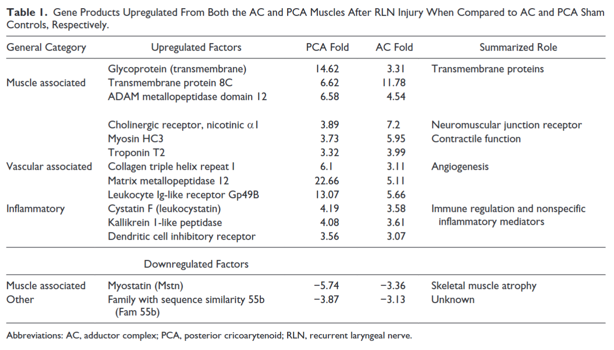
> [GEO Accession viewer](https://www.ncbi.nlm.nih.gov/geo/query/acc.cgi?acc=GSE72361)
> 转录组学
##### 2.
> [!PDF|green] [The Laryngoscope - 2026 - Gartling - Preliminary Transcriptomic Effects of Lateralized RLN Denervation in Rat Vocal Fold, p.1](The%20Laryngoscope%20-%202026%20-%20Gartling%20-%20Preliminary%20Transcriptomic%20Effects%20of%20Lateralized%20RLN%20Denervation%20in%20Rat%20Vocal%20Fold.pdf#page=1&selection=55,0,63,4&color=green)
> > Unilateral RLN transection was performed in five adult rats (Left RLN: 2-males, 1-female; Right RLN: 1-male, 1-female). 5-weeks post-injury, the medial thyroarytenoid (MTA) muscle and vocal fold mucosa were harvested for RNA sequencing.
> [Open: Pasted image 20261010210516.png](attachments/99d80daae4f89e7c5a7adb6d6f0f7154_MD5.jpg)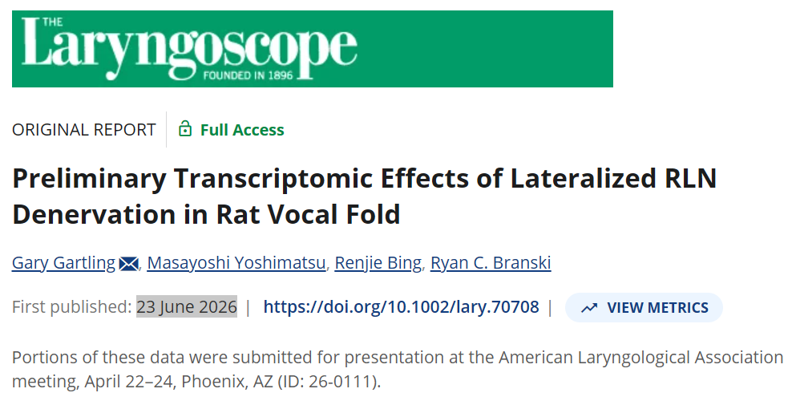
##### 3.
> [!PDF|rouge] [Transcriptome analysis of left versus right intrinsic laryngeal muscles associated with innervation, p.3](Transcriptome%20analysis%20of%20left%20versus%20right%20intrinsic%20laryngeal%20muscles%20associated%20with%20innervation.pdf#page=3&selection=54,30,55,86&color=rouge)
> > 80 Sprague Dawley rats distributed in 12 groups according to age (adult and P15), sex (male and female), and type of muscle (PCA, LTA, and MTA).
> 
> SD rats of both sex
> 
> > P15, post-neonatal rats 15 days after birth ( N = 56) 

> [!PDF|green] [Transcriptome analysis of left versus right intrinsic laryngeal muscles associated with innervation, p.1](Transcriptome%20analysis%20of%20left%20versus%20right%20intrinsic%20laryngeal%20muscles%20associated%20with%20innervation.pdf#page=1&selection=53,8,53,68&color=green)
> > ateral thyroarytenoid (LTA), and medial thyroarytenoid (MTA)

> [!PDF|yellow] [Transcriptome analysis of left versus right intrinsic laryngeal muscles associated with innervation, p.17](Transcriptome%20analysis%20of%20left%20versus%20right%20intrinsic%20laryngeal%20muscles%20associated%20with%20innervation.pdf#page=17&selection=2,0,2,53&color=yellow)
> > Key Gene Ontology pathways enriched in the LTA muscle
> 
> [Open: Pasted image 20261012110106.png](attachments/26783074fc2ed513a834e4c6e2c2f216_MD5.jpg)
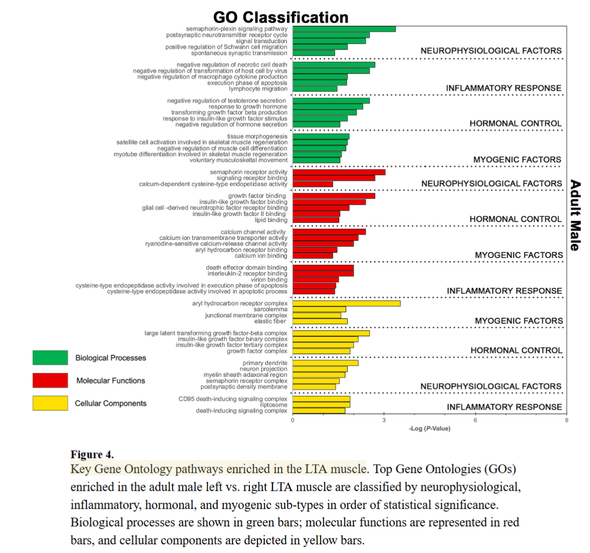

> [!PDF|green] [Transcriptome analysis of left versus right intrinsic laryngeal muscles associated with innervation, p.6](Transcriptome%20analysis%20of%20left%20versus%20right%20intrinsic%20laryngeal%20muscles%20associated%20with%20innervation.pdf#page=6&selection=21,0,22,49&color=green)
> > The<mark style="background-color: #1A4F10; color: white"> adult male LTA</mark> dataset was the only condition to exhibit significant differential gene expression in the left compared to the right

> [!PDF|yellow] [Transcriptome analysis of left versus right intrinsic laryngeal muscles associated with innervation, p.18](Transcriptome%20analysis%20of%20left%20versus%20right%20intrinsic%20laryngeal%20muscles%20associated%20with%20innervation.pdf#page=18&selection=2,0,2,53&color=yellow)
> > Key Gene Ontology pathways enriched in the MTA muscle
> 
> [Open: Pasted image 20261012110138.png](attachments/ab6c3a5521dddf9f86e5ee114026229e_MD5.jpg)
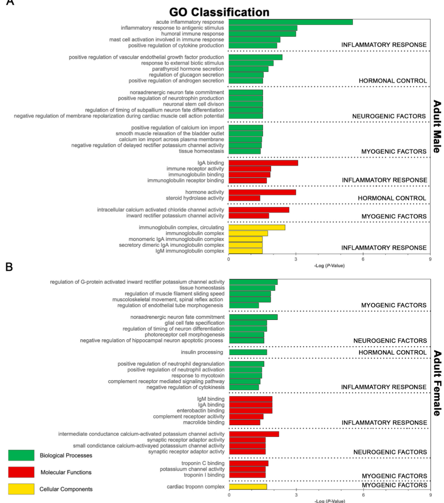
>
> **A. male; B. <mark style="background-color: #1A4F10; color: white">female</mark>**
> 
> [Open: Pasted image 20261012110511.png](attachments/d23d4405a1d3acda5b120ed57f6d35b4_MD5.jpg)
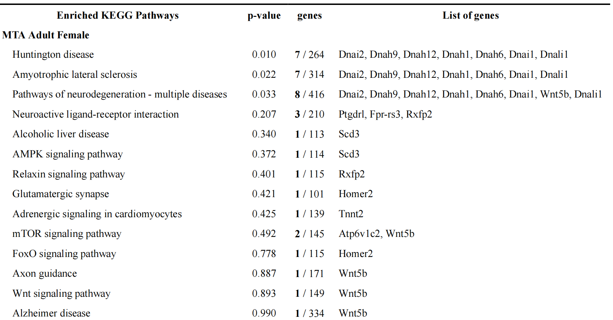

> [!PDF|229, 213, 143] [Transcriptome analysis of left versus right intrinsic laryngeal muscles associated with innervation, p.16](Transcriptome%20analysis%20of%20left%20versus%20right%20intrinsic%20laryngeal%20muscles%20associated%20with%20innervation.pdf#page=16&annotation=1978R)
> > Key Gene Ontology pathways enriched in the PCA muscl
> 
> [Open: Pasted image 20261012110032.png](attachments/51e10c3003f7bed148f72353ff218432_MD5.jpg)
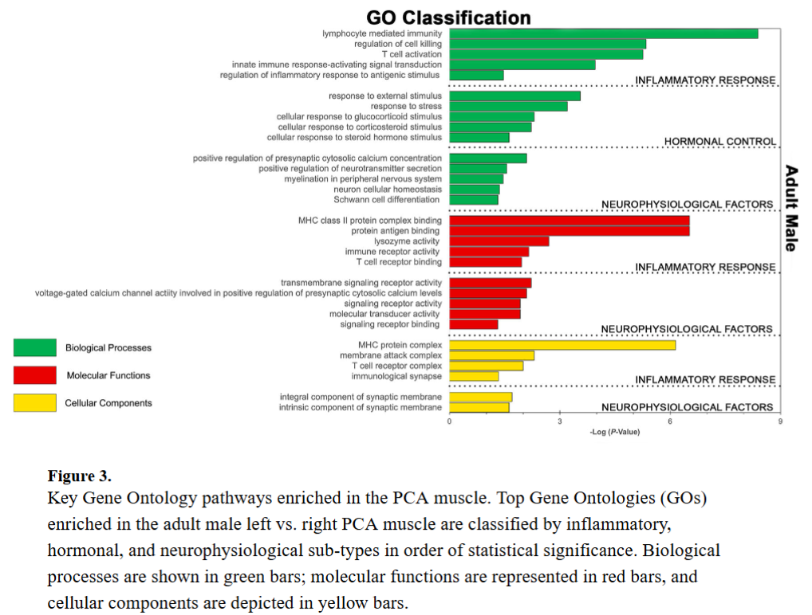
##### 4.
> [!PDF|yellow] [A preliminary integrated morphologic and transcriptomic analysis of denervation remodeling in rat laryngeal and hindlimb muscles, p.9](A%20preliminary%20integrated%20morphologic%20and%20transcriptomic%20analysis%20of%20denervation%20remodeling%20in%20rat%20laryngeal%20and%20hindlimb%20muscles.pdf#page=9&selection=27,0,28,83&color=yellow)
> > Recurrent Laryngeal Nerve Resection. A ~2cm incision was made from the sternum to the hyoid region and underlying muscle to expose the larynx and RLN. A ~8mm portion

> [!PDF|green] [A preliminary integrated morphologic and transcriptomic analysis of denervation remodeling in rat laryngeal and hindlimb muscles, p.3](A%20preliminary%20integrated%20morphologic%20and%20transcriptomic%20analysis%20of%20denervation%20remodeling%20in%20rat%20laryngeal%20and%20hindlimb%20muscles.pdf#page=3&selection=21,61,24,30&color=green)
> > three laryngeal muscles (medial thyroarytenoid (MTA), lateral thyroarytenoid (LTA), and posterior cricoarytenoid (PCA) and two hindlimb muscles (gastrocnemius, soleus). Bulk RNA-seq was performed on each muscle type 

> [!PDF|yellow] [A preliminary integrated morphologic and transcriptomic analysis of denervation remodeling in rat laryngeal and hindlimb muscles, p.7](A%20preliminary%20integrated%20morphologic%20and%20transcriptomic%20analysis%20of%20denervation%20remodeling%20in%20rat%20laryngeal%20and%20hindlimb%20muscles.pdf#page=7&selection=20,75,23,87&color=yellow)
> > Specifically, we compared atrophy after RLN transection in medial TA (MTA) (primarily IIX),(17) LTA (enriched IIB with IIB±EO/MYH13 hybrids (17) and PCA (enriched IIB/IIA/IIX)(29) with atrophy after tibial nerve transection in soleus (predominantly I with IIA) (30,31) and gastrocnemius (mixed IIB/IIX with some I/IIA)
 
> [!PDF|green] [A preliminary integrated morphologic and transcriptomic analysis of denervation remodeling in rat laryngeal and hindlimb muscles, p.22](A%20preliminary%20integrated%20morphologic%20and%20transcriptomic%20analysis%20of%20denervation%20remodeling%20in%20rat%20laryngeal%20and%20hindlimb%20muscles.pdf#page=22&selection=0,0,6,2&color=green)
> > In PCA, the TP53 network was significantly enriched (FDR=1.0×10⁻ ³; Figure 3).

> [!PDF|yellow] [A preliminary integrated morphologic and transcriptomic analysis of denervation remodeling in rat laryngeal and hindlimb muscles, p.26](A%20preliminary%20integrated%20morphologic%20and%20transcriptomic%20analysis%20of%20denervation%20remodeling%20in%20rat%20laryngeal%20and%20hindlimb%20muscles.pdf#page=26&selection=0,0,0,12&color=yellow)
> > GO analysis 
> 
> [Open: Pasted image 20261019205205.png](attachments/24777fe44d08f8b0eec61baf82e28f45_MD5.jpg)
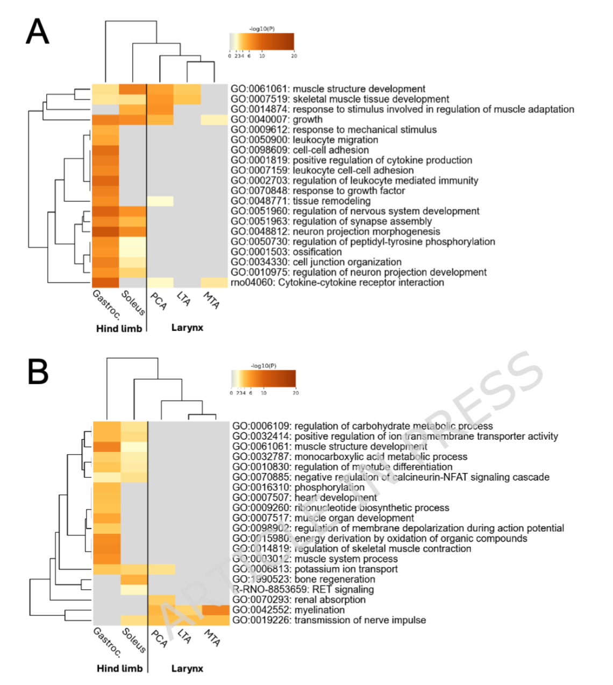

> [!PDF|green] [A preliminary integrated morphologic and transcriptomic analysis of denervation remodeling in rat laryngeal and hindlimb muscles, p.26](A%20preliminary%20integrated%20morphologic%20and%20transcriptomic%20analysis%20of%20denervation%20remodeling%20in%20rat%20laryngeal%20and%20hindlimb%20muscles.pdf#page=26&selection=12,55,20,1&color=green)
> > n contrast, laryngeal muscles showed more selective enrichment. MTA upregulated genes showed significant cytokine-cytokine receptor interaction enrichment, whereas PCA upregulated genes showed significant p53 signaling pathway enrichment. A compact visualization of FDRsignificant and exploratory KEGG/Enrichr terms is provided in Supplementary Figure 2.
> 
> [Open: Pasted image 20261019205421.png](attachments/e9403ae6a187542f35553d8b8f49ca7a_MD5.jpg)
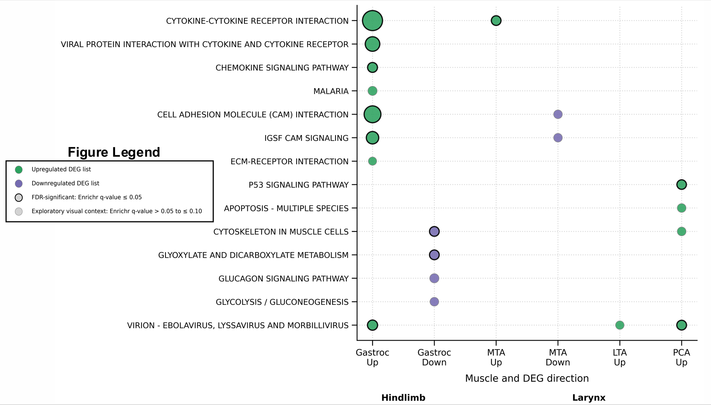

