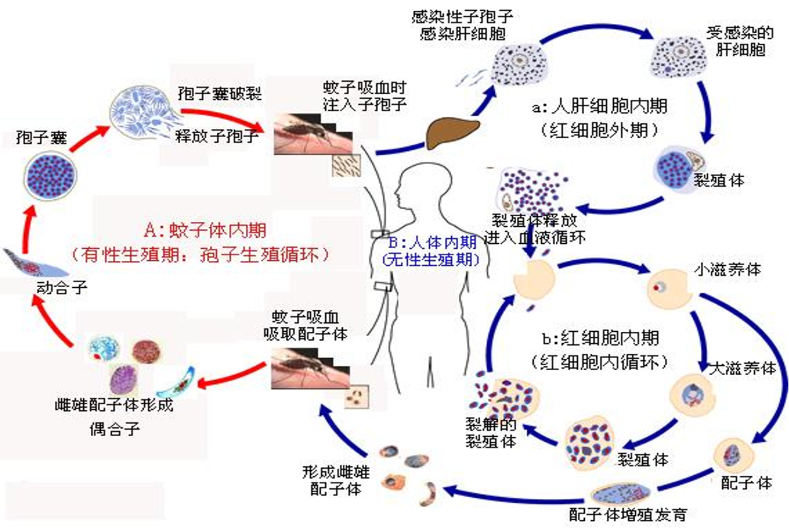

---
tags:
  - diagnosis
aliases:
  - malaria
  - Malaria
---
#### 流行病学
疟疾是人体被<mark style="background-color: #1A4F10; color: white">雌性按蚊</mark>（对有机磷杀虫剂耐药；主要是中华按蚊）叮咬而感染疟原虫所致的寄生虫病，为国家法定<mark style="background-color: #705A16; color: white">乙类</mark>传染病。
致死性寄生虫病居第一位。
疟疾复发仅见于间日疟及卵形疟。
尚未有确切有效的疟疾疫苗。
##### 传染源
现症患者及无症状带虫者。
当<mark style="background-color: #1A4F10; color: white">外周血液中存在配子体时</mark>才具有传染性。间日疟在第3～5天之后即有配子体存在。
- 多数恶性疟感染后3年内可自愈，少数感染可持续4年；
- 间日疟和卵形疟可持续感染3～5年；
- 三日疟可呈无症状持续携带原虫数十年。
##### 传播途径
传播媒介为雌性按蚊，经叮咬人体传播。主要是中华按蚊。
输血传播：少数病例输入带有疟原虫的血液传播。
母婴传播：先天性疟疾（congenital malaria）或经胎盘传播的疟疾（transplacental malaria）
##### 人群易感性
儿童、孕妇（特别是初产妇）、无免疫力者（旅游者等外来人员）为高危人群。
普遍易感，感染后免疫力不持久。高发区婴儿可从母亲获得先天性免疫力。
各型疟疾之间无交叉免疫性。
##### 流行特征
疟疾流行区与相应按蚊的地理分布一致。
<mark style="background-color: #1A4F10; color: white">主要流行于热带和亚热带</mark>，其次为温带。
我国：疟疾流行主要在南部地区（滇、黔、川、桂），以间日疟为主，其次为恶性疟，三日疟和卵形疟少见。
近年来输入病例增多。到非洲（恶性疟）或东南亚疟疾流行区劳务、经商回国人员。
#### 临床表现
典型表现为周期性发作寒战、[高热](发热.md)、继而大汗淋漓而缓解；反复发作者伴有[贫血](贫血.md)、肝脾肿大；
恶性疟易出现脑型疟凶险发作和并发黑尿热、急性肾功能衰竭。
#### 病原学
<mark style="background-color: #705A16; color: white">疟原虫</mark>
寄生人体的四种疟原虫
- 间日疟原虫 Plasmodium vivax，<mark style="background-color: #1A4F10; color: white">P.v</mark>
- 三日疟原虫 P．Malariae, <mark style="background-color: #1A4F10; color: white">P.m</mark>
- 恶性疟原虫 P．Falciparum,<mark style="background-color: #1A4F10; color: white">P.f</mark> —— 对氯喹耐药
- 卵形疟原虫 P．Ovale, <mark style="background-color: #1A4F10; color: white">P.o</mark>
同一地区可流行2种以上疟原虫；个体也可同时感染2种以上疟原虫。
我国主要是间日疟原虫和恶性疟原虫；另二种少见。
[Open: Pasted image 20261109080912.png](attachments/b4b61cd97946fd24888ca6c3c4089fc5_MD5.jpg)

有性生殖（蚊子体内）
无性生殖（人体内）
