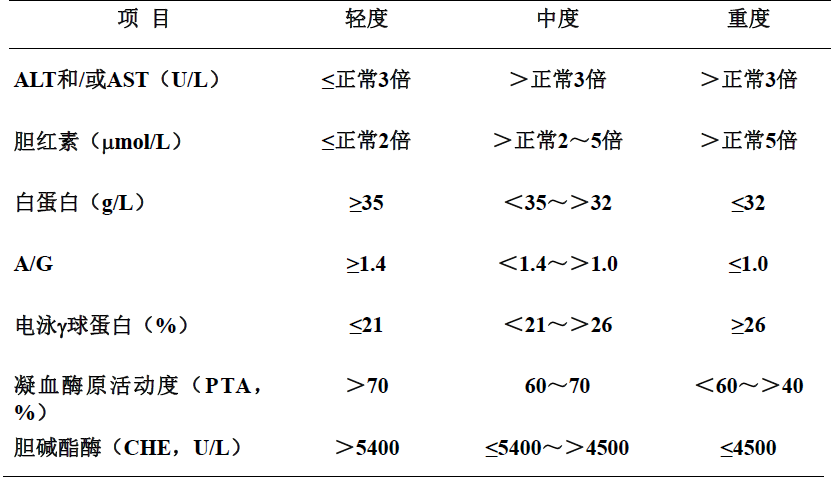

---
tags:
  - pathology
---
#### 病原学
除 HBV 外都是 RNA 病毒
#### 病理变化
病毒性肝炎以变质性炎症为典型 
[变性](变性.md)：细胞水肿（胞浆疏松化 气球样变性）、嗜酸性变（一般仅累及单个或数个肝细胞，胞质水分脱失浓缩）、脂肪变性（见于丙肝）。常见于[[急性普通型肝炎]]
溶解性[坏死](坏死.md)：
	点状坏死：单个或数个肝细胞的坏死，常见于[[急性普通型肝炎]]
	<mark style="background-color: #705A16; color: white">碎片状</mark>坏死：肝小叶周边部界板肝细胞的<mark style="background-color: #1A4F10; color: white">灶性</mark>坏死和崩解 常见于慢性肝炎 是所有慢性肝炎（[慢性普通型肝炎](慢性普通型肝炎.md)）的共同表现
	<mark style="background-color: #705A16; color: white">桥接坏死</mark>：累及相邻肝小叶的肝细胞坏死，指中央静脉与门管区之间，两个门管区之间，或两个中央静脉之间出现的相互连接的坏死带，常见于中重度慢性肝炎，为<mark style="background-color: #1A4F10; color: white">慢性肝炎的特征性病变</mark>
	亚大块坏死及大块坏死：肝细胞坏死几乎累及大部分（亚大块）或几乎占据整个肝小叶（大块） 常见于[[重型肝炎]]
[凋亡](凋亡.md)：嗜酸性小体（Coucilman 小体） 单个细胞凋亡 见于[[急性普通型肝炎]]
炎细胞浸润：淋巴细胞与单核细胞浸润于肝小叶内或汇管区
再生：[完全再生](完全再生.md)或结节状再生 
间质反应性增生(Kupffer细胞、间叶细胞、成纤维细胞)
胆小管增生：慢性且坏死较重的病例
纤维化：早期汇管区或中央静脉周围 后期包绕形成结节 引起[肝硬化](肝硬化.md)，见于肝脏的炎症反应和中毒性损伤

| 病毒            | 病毒性质                                                                  | 潜伏期 (周) | 传染途径                                                                 | 转成慢性肝炎                                                                         | 爆发性肝炎                                                        |
| ------------- | --------------------------------------------------------------------- | ------- | -------------------------------------------------------------------- | ------------------------------------------------------------------------------ | ------------------------------------------------------------ |
| HAV[[甲肝]]     | 27nm, 单链RNA                                                           | 2~6     | 肠道                                                                   | 无                                                                              | 0.1~0.4%                                                     |
| HBV[[乙肝]]     | 43nm, DNA        | 4~26    | 密切接触、输血、注射                                                           | 5~10%                     | <1%                                                          |
| HCV[[丙肝]]     | 30~60nm, 单链RNA                                                        | 2~26    | 同上                                                                   | >70%                      | 极少                                                           |
| HDV [[丁肝]] | <mark style="background-color: #1A4F10; color: white">复制缺陷性</mark>RNA | 4~7     | 同上                                                                   | 共同感染<5% 重叠感染80%；最易转为慢性 | 共同感染3~4% 重叠感染7~10%                                        |
| HEV[[戊肝]]     | 32~34nm, 单链RNA                                                        | 2~8     | 肠道                                                                   | 无；特异性IgG易消失               | 合并妊娠20% |
| HGV           | 单链RNA，似丙肝                                                             | 不详      | 主要为<mark style="background-color: #1A4F10; color: white">透析</mark>患者 | 无                                                                              | 不详                                                           |
#### 分类分级
[普通型肝炎](普通型肝炎.md)
[重型肝炎](重型肝炎.md)

| 炎症活动度（G） |            |                     | 纤维化程度（S） |                        |
| -------- | ---------- | ------------------- | -------- | ---------------------- |
| **G**    | **汇管区及周围** | **小叶内**             | **S**    | **纤维化程度**              |
| 0        | 无炎症        | 无炎症                 | 0        | 无                      |
| 1        | 汇管区炎症      | 变性及少数点，灶状坏死灶        | 1        | 汇管区纤维化扩大，局限窦周及小叶内纤维化   |
| 2        | 轻度PN       | 变性，点、灶状坏死或嗜酸小体      | 2        | 汇管区周围纤维化，纤维间隔形成，小叶结构保留 |
| 3        | 中度PN       | 变性、融合坏死或见BN         | 3        | 纤维间隔伴小叶结构紊乱，无肝硬化       |
| 4        | 重度PN       | BN范围广，累及多个小叶（多小叶坏死） | 4        | 早期肝硬化                  |
- **轻度慢性肝炎**：G1-2 S0-2
- **中度慢性肝炎**：G3 S1-S3
- **重度慢性肝炎**：G4 S2-S4
#### 临床表现
##### 共同表现
乏力纳差厌油、恶心[呕吐](呕吐.md)、腹胀、肝区痛；
黄疸、肝脾肿大、肝病面容、肝掌、蜘蛛痣、腹水；
TB、ALT/AST 波动或持续升高；
血清白蛋白降低/球蛋白增高；
凝血酶原活性降低。
##### 特殊人群的肝炎特点
1. 小儿肝炎 
多为无症状隐性感染；易成为携带者；
- 急性肝炎：多为<mark style="background-color: #1A4F10; color: white">无黄疸型</mark>/迁延型，以甲型肝炎为主。消化道症状和呼吸道症状较明显，早期易误诊为上呼吸道感染或消化道疾病。肝脾大较显著。
- 慢性肝炎：以乙型（HBV）和丙型（HCV）多见。 
2. 老年肝炎 
发病率低
- 黄疸表现：老年人（无论急性还是慢性）肝炎均<mark style="background-color: #1A4F10; color: white">易出现淤胆</mark>表现。
- 急性肝炎特征：尤其是急性戊型肝炎（HEV），典型表现为黄疸深、易出现淤胆，且发展为重症肝炎的比例较高。
1.  妊娠期妇女感染戊肝<mark style="background-color: #1A4F10; color: white">易转变为暴发性</mark>肝炎，消化道症状明显，产后大出血多见；以妊娠后期为重；对胎儿有影响；病死率较高。
##### 并发症
- [肝性脑病](肝性脑病.md)：引起脑水肿，原因包括氨中毒学说、GABA 学说、假性神经递质学说、氨基酸代谢失衡学说
- [淤胆型肝炎](淤胆型肝炎.md)：见于各型肝炎病毒感染，起病类似急性黄疸型肝炎，但症状较轻而黄疸重；胆汁淤积表现明显：皮肤搔痒、大便颜色变浅；化验表现为 ALT 轻度升高，TB 显著升高，以直接胆红素为主；γ-GT、ALP 及胆固醇明显升高。与肝外梗阻性黄疸不易鉴别，少数发展为胆汁性肝硬化
- 代偿性[肝硬化](肝硬化.md)：早期肝硬化，属 <mark style="background-color: #1A4F10; color: white">Child-Pugh A 级</mark>，无明显肝功能衰竭表现，无腹水、肝性脑病或上消化道出血
- 失代偿性肝硬化：中晚期肝硬化，属 <mark style="background-color: #1A4F10; color: white">Child-Pugh B、C 级</mark>，有明显肝功能异常及失代偿征象（血清白蛋白＜ 35g/L，A/G＜1.0，胆红素＞35μmol/L，凝血酶原活动度＜60%），有腹水、肝性脑病及上消化道出血
#### 诊断
“肝炎标志物”在国内教材和考试语境里特指病毒性肝炎的血清学标志物。
流行病学资料+临床表现+实验室检查
慢性肝炎：[Open: Pasted image 20261128170611.png](attachments/3f933a45eb5c589967129afc0cf7a32b_MD5.jpg)

#### 肝炎病例命名：
临床分型与病原学分型相结合，肝组织病理学检查结果附后
e.g. 病毒性肝炎，丙型，慢性（轻度），G2S0
### 治疗
#### 急性病毒性肝炎治疗
无特殊并发症，应以休息、营养等；<mark style="background-color: #1A4F10; color: white">一般治疗为主</mark>，避免滥用药物
##### 一般治疗：
休息、营养
##### 对症治疗
选用1-2种药物即可
###### 降黄疸药物
西药：熊去氧胆酸、腺苷蛋氨酸等
中药：苦黄注射液、黄疸茵陈冲剂、丹参等
###### 淤胆型肝炎
糖皮质激素、苯巴比妥等
###### 抗炎保肝
甘草酸制剂类、水飞蓟类或多烯磷脂酰胆碱等
###### 其他
改善纳差、腹胀、恶心等症状
##### 抗病毒治疗
根据需要决定
#### 慢性病毒性肝炎治疗
##### 一般治疗
休息营养治疗作为慢性肝炎治疗的基本辅助治疗
##### 对症治疗
抗纤维化、保肝降酶、免疫调节
##### 抗病毒治疗
抗病毒治疗是<mark style="background-color: #1A4F10; color: white">关键</mark>，只要有适应证且条件允许就应进行规范的抗病毒治疗
###### 慢性乙型肝炎
1. 总体目标：最大限度地长期抑制HBV；减轻肝细胞炎症坏死及肝纤维化；延缓和减少肝脏失代偿、肝硬化、HCC及其并发症的发生；改善生活质量和延长存活时间。在治疗过程中<mark style="background-color: #1A4F10; color: white">对于部分适合的患者应尽可能追求临床治愈（停止治疗后持续的病毒学应答+HBsAg消失+ALT恢复正常+肝细胞组织学改善）</mark>

| 治疗终点 | 标准                                                                        |
| ---- | ------------------------------------------------------------------------- |
| 理想   | HBeAg阳性与HBeAg阴性患者，停药后获得持久的HBsAg消失，可伴或不伴HBsAg血清学转换                         |
| 满意   | HBeAg阳性患者，停药后获得持续的病毒学应答，ALT复常，并伴有HBeAg血清学转换；HBeAg阴性患者，停药后获得持续的病毒学应答和ALT复常 |
| 基本   | 如无法获得停药后持续应答，抗病毒治疗期间长期维持病毒学应答（HBV DNA检测不到）                                |
2. 治疗指征：
对于血清HBV DNA阳性者无论ALT水平高低，只要符合下列情况之一，建议抗病毒治疗：
- 有乙型肝炎肝硬化或HCC家族史；
- 年龄＞30岁；
- 无创指标或肝组织学检查提示肝脏存在明显炎症(G≥2)或纤维化(F≥2)；
- HBV相关肝外表现（如HBV相关性肾小球肾炎等）
> 临床诊断为代偿期和失代偿期乙型肝炎肝硬化患者，无论其ALT和HBV DNA水平及HBeAg阳性与否，均建议抗病毒治疗。
2. 治疗药物：
1️⃣[干扰素](干扰素.md)：
普通IFNα（<mark style="background-color: #1A4F10; color: white">隔日一次5 MU</mark>皮下或肌肉注射 基本疗程<mark style="background-color: #1A4F10; color: white">1年</mark>）
聚乙二醇化干扰素α（PegIFNα）（2a 180μg/2b 1.5μg/kg <mark style="background-color: #1A4F10; color: white">每周一次皮下注射一年</mark>）
通过调节机体免疫力和直接抗病毒达到治疗目的
优点：疗程相对固定，耐药率低
缺点：为注射制剂，使用不便；降病毒能力弱；副作用较大，禁忌症较多
! 肝功能失代偿者不能使用干扰素
2️⃣核苷类似物：通过抑制HBV复制过程发挥治疗作用
优点：降病毒快速强效，口服制剂使用方便，不良反应较少
缺点：疗效不确定，可能发生耐药
①[拉米夫定](拉米夫定.md)<mark style="background-color: #705A16; color: white">LAM</mark>：快速持续抑制HBV复制，安全性良好，用药经验丰富，价格便宜，但早期耐药，耐药率高
②阿德福韦酯<mark style="background-color: #705A16; color: white">ADV</mark>：持续抑制HBV复制，耐药变异比拉米夫定晚，用于LAM ETV LdT耐药患者，但短期抑制病毒能力不如LAM EDT TDF LdT，长期使用存在较高耐药性、肾毒性和钙磷代谢不良影响
③替比夫定<mark style="background-color: #705A16; color: white">LdT</mark>：快速持续抑制HBV复制，安全性良好，<mark style="background-color: #1A4F10; color: white">可用于妊娠</mark>，价格居中，但长期治疗可出现耐药变异
④恩替卡韦<mark style="background-color: #705A16; color: white">ETV</mark>：✅快速持续抑制乙肝病毒复制，安全性良好，长期治疗罕见耐药变异，但价格较贵且对拉米夫定耐药患者使用后耐药率较高
⑤替诺福韦酯<mark style="background-color: #705A16; color: white">TDF</mark>：✅快速持续抑制乙肝病毒复制，安全性良好，可用于妊娠，长期治疗罕见耐药变异，可用于治疗LAM，LdT，ETV耐药患者，也可治疗ADV耐药的患者，但效果较差；长期使用应该注意对肾功能和钙磷代谢影响
⑥丙酚替诺福韦酯<mark style="background-color: #705A16; color: white">TAF</mark>：✅快速持续抑制乙肝病毒复制，安全性良好（肾脏安全性好），长期治疗罕见耐药变异，可用于治疗LAM，LdT，ETV，ADV耐药患者，但价格较贵。
⑦艾米替诺福韦<mark style="background-color: #705A16; color: white">TMF</mark>：快速持续抑制乙肝病毒复制，安全性良好（肾脏安全性好），长期治疗罕见耐药变异，可用于治疗LAM，LdT，ETV，ADV耐药患者，但价格较贵。
指南推荐：<mark style="background-color: #1A4F10; color: white">ETV+TDF+TAF</mark>

| α干扰素                                                         | 核苷（酸）类似物                                                       |
| ------------------------------------------------------------ | -------------------------------------------------------------- |
| 疗程相对固定                                                       | 口服给药                                                           |
| HBeAg血清学转换率较高                                                | 抑制病毒作用强                                                        |
| 疗效相对持久                                                       | 不良反应少而轻微                                                       |
| 耐药变异较少                                                       | 可用于肝功能失代偿者                                                     |
| 少数病人可出现HBsAg转阴                                               | 疗程相对不固定      |
| 需要注射给药     | HBeAg血清学转换率低 |
| 不良反应较明显    | 疗效不够持久       |
| 不适于肝功能失代偿者 | 长期应用可产生耐药变异  |
CHB患者应用ETV、TDF或TAF治疗48周，若HBVDNA>2000 IU/ml，排除依从性和检验误差后，可调整NAs治疗（应用ETV者换TDF或TAF，应用TDF或TAF者换ETV，或两种药物联合使用），也可以联合Peg-IFN治疗
乙型肝炎肝硬化患者，应用ETV、TDF或TAF治疗24周，若HBV DNA>2000 IU/ml，排除依从性和检验误差后，建议调整NAs治疗（应用ETV者换TDF或TAF，应用TDF或TAF者换ETV，或两种药物联合使用）
- 乙肝肝硬化代偿期患者：
> 只要存在均建议积极抗病毒治疗，优先推荐ETV/TDF/TAF，失代偿期禁用干扰素，代偿期慎用干扰素，坚持长期治疗
- 乙肝相关肝炎患者：
> HBV相关急性、亚急性、慢加急性和慢性肝衰竭病死率高，若HBsAg阳性建议应用ETV、TDF或TAF抗病毒治疗，强调抗病毒治疗中应注意监测血浆乳酸水平
- 乙肝相关肝癌患者：
> 若HBsAg阳性，推荐应用ETV、TDF或TAF抗病毒治疗
- 乙肝相关肝移植患者：
> 若HBsAg阳性，建议在肝移植前开始应用ETV、TDF或TAF抗病毒治疗，<mark style="background-color: #1A4F10; color: white">根据移植肝再感染风险采用分层方案</mark>：**A--** 移植前HBVDNA不可测，术前尽早使用ETV、TDF或TAF预防HBV再激活即可；**B--** 移植前HBVDNA阳性，术前尽早使用强效低耐药药物，术中无肝期应静脉注射HBlg，术后长期应用抗病毒药物外应联合应用低剂量HBIg，持续半年至1年后停药
- 儿童慢性乙肝患者：
> 需要考虑长期治疗安全性及耐药性问题
> 1岁以上：普通IFNα；
> 2岁以上：ETV或TDF（<mark style="background-color: #1A4F10; color: white">TDF要求体重≥10kg</mark>）；
> 5岁以上：Peg-IFNα-2a；
> 12岁以上且体重≥35kg：TAF
- 慢性肾病慢性乙肝患者：
> 慢性肾病患者、肾功能不全或接受肾脏替代治疗的患者，推荐ETV或TAF作为一线抗HBV治疗药物，或可根据患者情况选用替比夫定进行治疗，<mark style="background-color: #1A4F10; color: white">不建议应用ADV或TDF</mark>；对于存在肾脏损害高危风险的CHB患者，应用任何NAS抗病毒过程中均需监测肾功能变化；已应用ADV或TDF的患者发生肾脏或骨骼疾病、或存在其他高风险时，建议改用ETV或TAF
- 应用化疗和免疫抑制剂治疗的患者：
> 所有接受化疗、免疫抑制剂治疗的患者起始治疗前都应常规筛查HBsAg、HBcAb，对于HBsAg阳性者，在开始免疫抑制剂及化疗药物前一周或至少同时应用抗病毒治疗：ETV、TDF或TAF；对HBsAg阴性、抗-HBc阳性者，若使用B细胞单克隆抗体或进行造血干细胞移植，建议应用ETV、TDF或TAF抗病毒治疗

|检测项目|时间|
|-|-|
|生化学指标：肝功、肾功|治疗开始后每月1次，连续3次，以后随病情改善可每3个月1次|
|病毒学检测：HBsAg、HBeAg、抗-HBe、HBV DNA|治疗开始后每3个月检测1次|
|其它指标（如AFP、彩超等）|根据需要进行分析|
治疗结束后，不论是否有无应答，<mark style="background-color: #1A4F10; color: white">半年内至少每2月随访一次</mark>，之后每3-6月随访一次，如有病情变化应缩短随访间隔。
###### 慢性丙型肝炎
1. 治疗目标：
<mark style="background-color: #1A4F10; color: white">清除HCV病毒</mark>（病毒学治愈：停药后随访12周检测不到HCV RNA），预防肝硬化、肝癌、死亡等并发症的发生
2. 治疗选择：
只有确证为血清HCV RNA阳性的丙型肝炎患者才需要抗病毒治疗，对于ALT正常或轻度升高患者，只要HCV RNA阳性也应抗病毒治疗，目前建议在抗病毒治疗之前检测基因型，以选择治疗方案。
3. 治疗方法：
PR方案（利巴韦林联合PEG IFNα）仍是我国现阶段HCV感染者接受抗病毒治疗的首选推荐方案，可应用于所有基因型HCV感染，同时无治疗禁忌症的患者
以DAAs为基础的抗病毒方案可涵盖几乎所有类型的HCV感染者，尤其适用于PR治疗复发或是对PR治疗无应答或不耐受的患者

|项目|P/R|DAAs(IFN-free)|
|-|-|-|
|慢性丙型肝炎|清除体内HCV，改善或减轻HCV相关的肝病，阻止减轻肝硬化，肝衰竭和肝癌，改善患者的长期生存期，提高患者的生活质量|清除体内HCV，改善或减轻HCV相关的肝病，阻止减轻肝硬化，肝衰竭和肝癌，改善患者的长期生存期，提高患者的生活质量|
|代偿期硬化|降低肝硬化失代偿的发生，降低HCC的发生|降低肝硬化失代偿的发生，降低HCC的发生|
|失代偿肝硬化||降低肝移植的需求，提高生存率|
|肝移植||预防移植后复发，治疗移植后复发|
|更多特殊人群||治疗涵盖更多特殊人群|
重型病毒性肝炎：
病情能否逆转取决于存活肝细胞的数量及其再生能力
治疗原则：及早发现与治疗；对症支持治疗；防治并发症；维持机体内环境的稳定；给肝细胞以再生的机会
治疗措施：
早期诊断，及早卧床休息，加强病情监护
维持水电解质热量平衡（高碳水、低脂、蛋白适量，纠正低白蛋白血症，限制水钠摄入）
知情同意下使用抗病毒及免疫调节治疗
防治肝细胞坏死，促进肝细胞再生：HGF（肝细胞生长因子）、人工肝、肝移植等
改善微循环：654-2、丹参等
预防和控制出血（降低门脉压力（生长抑素类，内镜治疗或手术治疗）；酌情补充凝血因子）
预防和治疗肝性脑病（去除诱因，限蛋白、酸化肠道，BCAA纠正氨基酸失衡，降氨药物，人工肝支持治疗）
防治肝肾综合征（大剂量利尿剂冲击、限制液体入量、人工肝支持治疗，灌注不足可用白蛋白扩容或加用特利加压素（急性肝衰竭慎用））
预防和控制感染（注意消毒隔离，加强口腔护理，预防医院内感染发生）
人工肝：是指通过体外的机械、理化或生物装置清除各种有害物质，补充必需物质，改善内环境，暂时替代衰竭肝脏的部分功能的治疗方法，为肝细胞再生及肝功能恢复创造条件或等待机会进行肝移植
肝移植：治疗晚期肝衰竭的有效治疗手段，适用于各种原因所致的中晚期肝衰竭和终末期肝硬化，全身感染、恶性肿瘤、精神疾病、心肺器质性病变禁用
淤胆型肝炎：
腺苷蛋氨酸（如：思美泰）：通过转甲基改善肝细胞膜流动性而促进胆汁分泌；熊去氧胆酸（UDCA）：激素治疗可用于难治性患者
#### 预后
甲型肝炎预后良好，戊型肝炎次之
急性乙型肝炎大多预后良好（5%—10%发展成CHB）
慢性HBV感染者如果不积极治疗约25%—40%发展成肝硬化、原发性肝癌或肝功能衰竭
重型肝炎如果不积极治疗病死率为50%—80%
急性丙型肝炎患者约50%—80%进展成慢性肝炎，20—30年后约20—30%发展成肝硬化，1%—5%发展成原发性肝细胞肝癌
丁型肝炎协同感染预后优于重叠感染
#### 预防
控制传染源：患者、病毒携带者
切断传播途径：消化道隔离（HAV HEV）血液/体液隔离（HBV HCV HDV）
保护易感人群：
甲肝的预防：被动免疫：人丙种球蛋白；主动免疫：基因工程疫苗已应用于临床
乙肝的预防：被动免疫：人乙肝高效价免疫球蛋白；主动免疫：基因工程蛋白疫苗——已推广，基因疫苗——在研究中
丙肝、丁肝的预防：疫苗基础研究中
戊肝的预防：基因工程疫苗已应用于临床
乙型肝炎疫苗预防
我国于1992年将乙型肝炎疫苗纳入计划免疫管理（新生儿，免费）
接种对象：主要是新生儿；其次为婴幼儿和高危人群；目前，15岁以下的儿童免费接种
全程接种：共3针，按照0、1、6个月程序，新生儿接种越早越好（出生后24 h内）
预防母婴传播：乙型肝炎免疫球蛋白（HBIG）联合加强的乙肝疫苗
