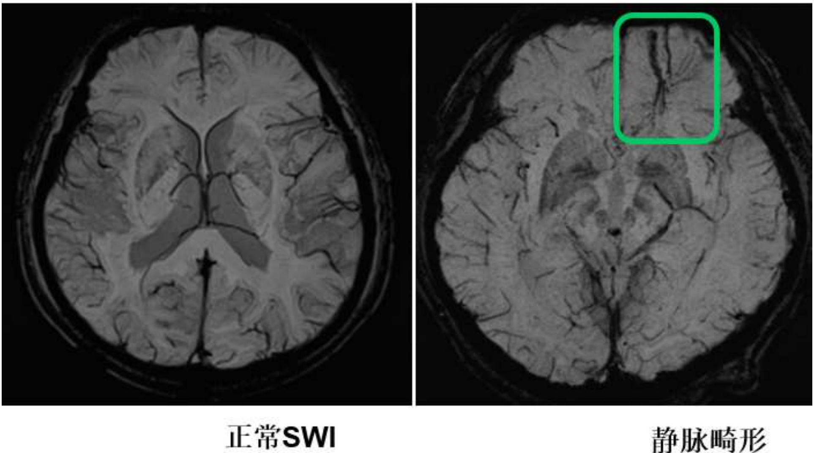
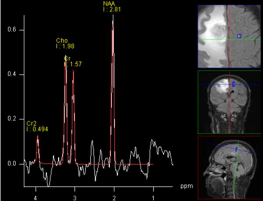
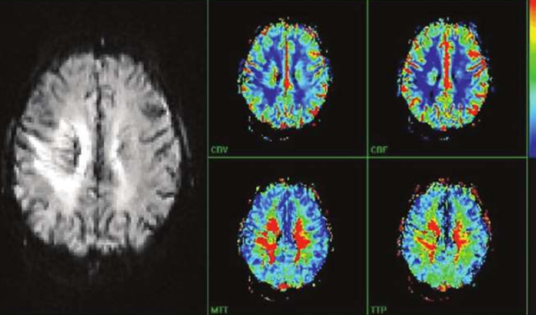
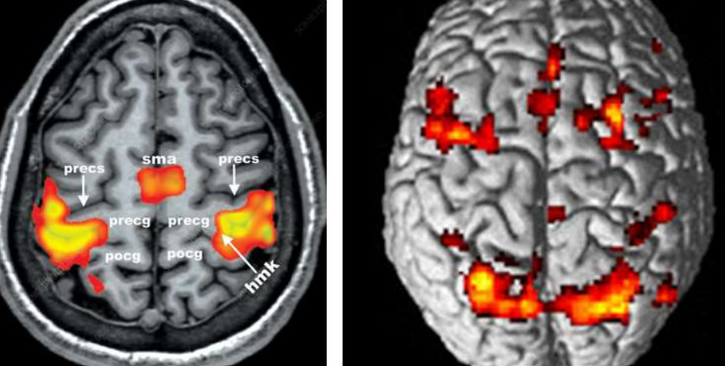

---
tags:
  - imaging
aliases:
  - MRI
---
### 与 CT 比较：
- 清晰显示软组织、颅后窝；MRI 清晰显示细微解剖结构；
- <mark style="background-color: #1A4F10; color: white">对钙化不敏感</mark>：绝大多数钙化在T1WI和T2WI上都表现为低信号（黑色）或无信号（流空影）。

### 平扫
短T1长T2是MRI影像中描述组织弛豫时间的特征组合
分别对应T1加权像中的<mark style="background-color: #8B0000; color: white">高信号（短T1）</mark>和T2加权像中的<mark style="background-color: #8B0000; color: white">高信号（长T2）</mark>
#### T1加权（T1WI）
水的信号为低信号（黑色），适合显示解剖结构。
灰白分界清晰
[黑色素瘤](黑色素瘤.md)：含有黑色素。<mark style="background-color: #1A4F10; color: white">黑色素也是一种顺磁性物质</mark>，能缩短T1，导致T1WI呈高信号
#### T2加权（T2WI）
水的信号为高信号（白色，长T2），有利于病变显示。
> T1、T2 窗位的皮肤都是亮的，本质上是脂肪在 T1、水在 T2 的高信号

### 特殊MRI平扫
#### FLAIR序列
抑制脑脊液信号（黑色），突出脑灰质病变，常用于神经系统成像。
容易误判为T1，但FLAIR<mark style="background-color: #1A4F10; color: white">灰白分界不清楚</mark>
#### STIR/SPAIR序列：
脂肪抑制序列，用于关节及软组织病变成像。
#### 磁敏感加权成像（SWI）：
弥漫性轴索损伤小灶性出血、小静脉异常、铁沉积。
[Open: Pasted image 20261012111420.png](attachments/781cb5b32c429cdcb03a662753a7f962_MD5.jpg)

### 增强检查（仅T1WI）
<mark style="background-color: #1A4F10; color: white">短T1</mark>。在 T1WI 上，增强后钆剂缩短 T1，让摄取了造影剂的组织<mark style="background-color: #1A4F10; color: white">变亮</mark>。
典型表现： #AI 
- 血管亮：静脉窦、大血管、头皮血管在平扫 T1 上通常流空为黑，增强后变成高信号。
- 正常强化结构亮：鼻甲黏膜、头皮、硬脑膜、大脑镰、小脑幕、垂体、脉络丛、海绵窦等明显强化。
- 脂肪抑制线索：如果是 T1 fs post（注射钆对比剂后采集的 T1 加权脂肪抑制序列），皮下脂肪被压黑，而血管、黏膜、病灶却很亮，这几乎就是增强 T1 脂肪抑制。
- 病灶比平扫亮：同一位置，平扫 T1 是等/低信号，增强后信号增高，说明强化。
### MRA
<mark style="background-color: #1A4F10; color: white">无创</mark>，不及CTA。
磁共振自带特殊物理效应（流空效应），可直接显示血管，故磁共振血管成像（MRA）<mark style="background-color: #1A4F10; color: white">无需注射造影剂</mark>即可清晰显示血管结构。
### 1H磁共振波谱检查（1H-MRS）：
病变组织内代谢物的变化
[Open: Pasted image 20261012112610.png](attachments/faa7af36fc000d5af0ac2016b974951a_MD5.jpg)

### 功能性MR检查（fMRI）
#### [[DWI]]（弥散加权成像）
反映水分子扩散情况，常用于急性期[脑梗死](脑梗死.md)早期诊断
#### PWI灌注加权
[脑缺血](缺血性脑病.md)性病变、肿瘤良恶性
[Open: Pasted image 20261012112844.png](attachments/1b0916931b8d9eeea79309880395724e_MD5.jpg)

#### BOLD：
对脑皮质功能区定位
[Open: Pasted image 20261012112940.png](attachments/350b33ee9394aff8c4b4e4c2de684b27_MD5.jpg)

## 位面
轴位即水平位
冠状位
矢状位

