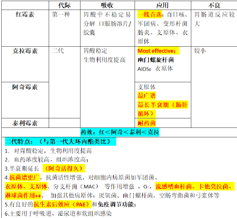
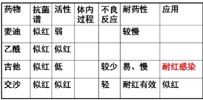

---
tags:
  - pharmacology
---

---
#AI
### 一． <u>[[红霉素]](erythromycin)、阿奇霉素、克拉霉素等</u>

#### [[红霉素]]（Erythromycin）
#####  概论说的主要就是它 
##### 胃酸中不稳定易分解口服肠溶片/胶囊
[[红霉素]]<mark style="background-color:#fef3c7;">是</mark><mark style="background-color:#fef3c7;"> 百 </mark><mark style="background-color:#fef3c7;">日咳 </mark><mark style="background-color:#fef3c7;"> 军团 </mark><mark style="background-color:#fef3c7;">病 </mark><mark style="background-color:#fef3c7;"> 变形 </mark><mark style="background-color:#fef3c7;">杆菌肠炎 </mark><mark style="background-color:#fef3c7;"> 支原体衣原体 </mark><mark style="background-color:#fef3c7;">的首选用药</mark>
##### 胃肠道反应较大
##### 一代大环内酯系列

二代大环内酯：克拉霉素（Clarithromycin）、阿奇霉素（Azithromycin）
##### 更容易被吸收，生物利用度更高
##### 抗菌活性更高：更长的 PAE 和更明显的免疫调节作用
##### 不良反应：胃肠道反应比红霉素低
 罗红  霉素（Roxithromycin）：生物利用度高  血药浓度更高 
克拉霉素（Clarithromycin）：抗菌活性 <mark style="background-color:#fef3c7;"> 最强， </mark>  对胃酸最稳定（用于治疗幽门螺旋杆菌）  ；对军团菌、 衣 原体效果最好。肺、扁桃体中蓄积；生物利用度略低。 联用时：先使用阿莫西林，后使用克拉霉素 
<mark style="background-color:#fef3c7;">治疗HP引起消化性溃疡：克拉克星，克拉霉素、克林霉素、沙星</mark>
阿奇霉素（Azithromycin）： <mark style="background-color:#fef3c7;"> 最广谱 </mark>的大环内酯类抗生素半衰期最长对 支  原体肺炎是大环内酯最强；明显的PAE，肠肝循环，吃三天停三天
泰利霉素（Telithromycin）： <mark style="background-color:#fef3c7;"> 适用于耐药菌。 </mark>吸收度好，比阿奇霉素效果更好

#### [[红霉素]]（Erythromycin）
#####  概论说的主要就是它 
##### 胃酸中不稳定易分解口服肠溶片/胶囊
[[红霉素]]<mark style="background-color:#fef3c7;">是</mark><mark style="background-color:#fef3c7;"> 百 </mark><mark style="background-color:#fef3c7;">日咳 </mark><mark style="background-color:#fef3c7;"> 军团 </mark><mark style="background-color:#fef3c7;">病 </mark><mark style="background-color:#fef3c7;"> 变形 </mark><mark style="background-color:#fef3c7;">杆菌肠炎 </mark><mark style="background-color:#fef3c7;"> 支原体衣原体 </mark><mark style="background-color:#fef3c7;">的首选用药</mark>
##### 胃肠道反应较大
##### 一代大环内酯系列

二代大环内酯：克拉霉素（Clarithromycin）、阿奇霉素（Azithromycin）
##### 更容易被吸收，生物利用度更高
##### 抗菌活性更高：更长的 PAE 和更明显的免疫调节作用
##### 不良反应：胃肠道反应比红霉素低
 罗红  霉素（Roxithromycin）：生物利用度高  血药浓度更高 
克拉霉素（Clarithromycin）：抗菌活性 <mark style="background-color:#fef3c7;"> 最强， </mark>  对胃酸最稳定（用于治疗幽门螺旋杆菌）  ；对军团菌、 衣 原体效果最好。肺、扁桃体中蓄积；生物利用度略低。 联用时：先使用阿莫西林，后使用克拉霉素 
<mark style="background-color:#fef3c7;">治疗HP引起消化性溃疡：克拉克星，克拉霉素、克林霉素、沙星</mark>
阿奇霉素（Azithromycin）： <mark style="background-color:#fef3c7;"> 最广谱 </mark>的大环内酯类抗生素半衰期最长对 支  原体肺炎是大环内酯最强；明显的PAE，肠肝循环，吃三天停三天
泰利霉素（Telithromycin）： <mark style="background-color:#fef3c7;"> 适用于耐药菌。 </mark>吸收度好，比阿奇霉素效果更好
