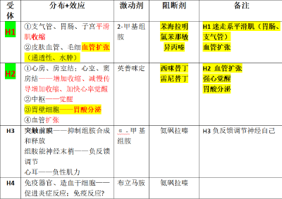
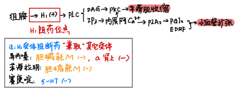
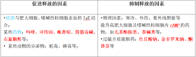
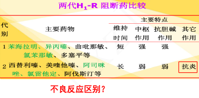
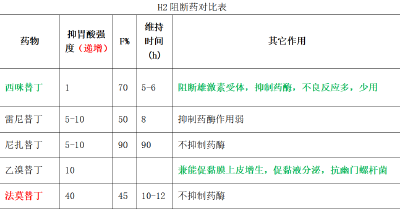

---
tags:
  - pharmacology
---
### 组胺（1）
> 记忆的时候，我应该试着从它的药理作用去推导它的临床应用和不良反应。
> @万古霉素红人综合征
### 一．组胺
### <u>1. 组胺受体的类型及其效应</u>

### 2. 组胺作用
#### 在组织损伤、炎症、神经刺激、某些药物、抗原-抗体反应的条件下，以活性形式（游离型）释放
#### 心血管系统
> “矛盾对抗”
##### 1. 心肌 正性肌力 ：H2受体
2. 血管扩张  ，回心血量↓（ 大剂量时，强而持久的  降压、水肿  ，甚至发生休克 ） ：H1、H2受体
##### 3.血小板： 对抗平衡~to聚or not to聚 
H1受体：激活PLA2，介导花生四烯酸的释放，引起血小板的聚集；
###### H2受体：增加血小板中cAMP水平，对抗血小板的聚集
#### 平滑肌收缩，呼吸困难、腹痛：H1受体
#### 胃酸分泌： H2受体 
#### 中枢觉醒失眠：H1受体
神经末梢： 红斑-红晕-丘疹三联反应 ，即毛细血管扩张（红斑）、毛细血管通透性↑（丘疹）、轴索反射（红晕）
#### 3. 组胺合成释放
与肝素、蛋白质结合（结合型，无活性），存在于肥大细胞、嗜碱性粒细胞中

### <u>二．抗组胺药</u>
### <u>H1受体阻断药</u>
> [[苯海拉明]]（Diphenhydramine）、[[异丙嗪]]（Promethezine）、氯苯吡胺（Chlorpheniramine，扑尔敏） 、西替利嗪、阿司咪唑、氯雷他定
第一代：[[苯海拉明]]、[[异丙嗪]]、氯苯吡胺（氯苯那敏 / 扑尔敏）、曲吡那敏（扑敏宁） ；有明显  镇静、抗胆碱  作用
第二代：西替利嗪、阿司咪唑、阿伐斯汀、左卡巴斯汀、咪唑斯汀；大多 长效，无嗜睡 作用，对喷嚏、清涕、鼻痒效果好， 对鼻塞效果差 
### <u>1. 药理作用</u>
#### ①阻断H1-R
完全对抗 平滑肌的收缩（如支气管、胃肠道平滑肌）；
强大抑制组胺直接引起的局部毛细血管扩张、水肿；
但 仅部分抵抗 血压降低（ *因H2-R也参与心血管活动的调节，故需同时应用H1、H2受体阻断药才能完全抵抗降压作用* ）
#### ② 中枢抑制
###### 镇静、嗜睡等，以 [[苯海拉明]]、异丙嗪作用最强（第一代） 
###### 阻断中枢H1受体，阻断中枢内源性组胺介导的觉醒反应
#### ③ 其他：抗胆碱止吐防晕

 [[苯海拉明]]、[[异丙嗪]]  兼具阿托品样抗胆碱作用 ， 止吐、防晕 效果较强
### <u>2. 临床应用</u>
####  （1）皮肤黏膜变态反应性疾病 
###### 皮肤Ⅰ型变态反应： 荨麻疹、过敏性鼻炎 等，疗效较好
###### 昆虫咬伤所致皮肤瘙痒、水肿、药疹、血管神经性水肿，也有一定疗效
####  （2）对支气管哮喘、过敏性休克等 <mark style="background-color:#fef3c7;"> 严重 </mark> 血管神经性水肿无效  ——<mark style="background-color:#fef3c7;">应选用</mark><mark style="background-color:#fef3c7;"> 肾上腺素 </mark>
#### （3）防晕动病、止吐：  [[苯海拉明]]、[[异丙嗪]] 
#### （4）失眠：  [[苯海拉明]]、[[异丙嗪]] 。尤其是一些皮肤黏膜变态反应引起的失眠
### <u>3. 不良反应</u>
#### （1）中枢抑制现象：尤其第一代（镇静、嗜睡）
> 服药期间应避免驾车、高空作业
#### （2）抗胆碱作用
###### 口干、便秘
######  青光眼、尿潴留患者禁用 
#### （3）其他反应
###### 粒细胞减少、溶血性贫血
 阿斯咪唑、特非那定 可导致尖端扭转性心律失常
#### <u>两代H1阻断药对比</u>

### <u>H2受体阻断药</u>
> <u>西米替丁（Cimetidine）、[[雷尼替丁]]</u> (Ranitidine)——抗胃酸分泌
### <u>西米替丁（Cimetidine）</u>
##### 1. 药理作用：竞争性拮抗 胃壁细胞H2-R ，抑制胃酸分泌
##### 2. 临床应用
##### 消化性溃疡
##### 胃酸分泌过多疾病（反流性食管炎etc）
##### 3. 不良反应
##### 一般反应：[便秘](便秘.md)、[腹泻](腹泻.md)、腹胀（胃肠），[头痛](头痛.md)、头晕、[皮疹](皮疹.md)、瘙痒等
长期服用西咪替丁：抗雄激素；老人幻觉、癫痫；肝功能损害；
 [[西咪替丁]]——肝药酶抑制剂 ：影响香豆素类、[[苯巴比妥]]、[[地西泮]]、[[苯妥英钠]]、[[茶碱]]、普萘洛尔的代谢
##### <u>[[雷尼替丁]]</u> (Ranitidine)等的作用特点
#### <mark style="background-color:#fef3c7;"> 强弱比较：[[西咪替丁]]＜[[雷尼替丁]]、尼扎替丁＜法莫替丁 </mark>

### 三、其他影响自体活性物质的药物：白三烯受体拮抗药：扎鲁斯特（zafirlukast）、孟鲁斯特（montelukase）
### 过敏性鼻炎治疗专题
#### 糖皮质激素
• 鼻用（局部）糖皮质激素：最有效的药物，中重度持续性变应性鼻炎的首选药物，如丙酸倍氯米松或布地奈德鼻喷剂。曲安奈德、曲安西龙、糠酸莫米松、糠酸氟替卡松、丙酸氟替卡松、氟尼缩松等。
#### • 口服糖皮质激素：二线治疗，其他治疗方法无效时可短期口服
#### 抗组胺药
口服抗组胺药： 首选第二代 ，为一线治疗药物。氯雷他定、西替利嗪、咪唑斯汀
鼻用抗组胺药：一线治疗药物，疗程不少于2周，比口服起效快，可用于“按需治疗”
白三烯受体阻断剂：孟鲁斯特，一线治疗药物，也可与氯雷他定或鼻用糖皮质激素联用
肥大细胞膜稳定剂：二线治疗药物，色甘酸钠、尼多酸钠、四唑色酮、奈多罗米钠、吡嘧司特和曲尼司特
鼻用减充血剂：二线用药，伪麻黄碱、去氧肾上腺素、羟甲唑啉。使鼻黏膜血管收缩缓解鼻塞
#### 鼻腔盐水冲洗：辅助治疗
特异性免疫治疗（SIT）：注射特异性的变异原来减轻AR患者对过敏原的敏感性。 SIT能够使嗜酸性粒细胞聚集减少，使鼻黏膜的嗜酸性粒细胞钝化和鼻黏膜对组胺的反应降低，还能降低嗜碱性粒细胞释放组胺，使过敏症状缓解。
