---
tags:
  - pharmacology
---
### 肾上腺皮质激素（3）
> [[可的松]]（Cortisone）、氢化可的松(Hydrocortisone)、地塞米松（Dexametinasone）、倍他米松（Betamethasone）、泼尼松（prednisone）、泼尼松龙（prednisonelone）
### 一、肾上腺皮质激素：分类；构效关系；体内过程（熟悉）
肾上腺皮质从外向内：球状带（ 盐皮质激素 ）—束状带 （糖皮质激素）— 网状带 （性激素）
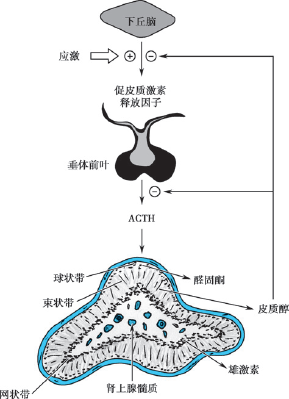
 自然GC ：[[可的松]]（cortisone）、氢化可的松（hydrocortisone）
#### 构效关系（甾核）
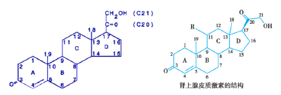
#### 基本结构：甾核（21碳4环）
#### <u>天然与合成激素的结构差异与功能增强</u>
<u>天然激素</u> ：如氢化可的松，第1、2位碳原子之间为单键。
<u>人工合成激素</u> ：C1–2、C4–5不饱和双键。
<u>不饱和双键</u> 减少加氢还原灭活反应，使激素在体内作用更强，药效更显著。
#### <u>糖皮质激素的特征基团</u>
<u>D环C17上的</u>  <u>α-羟基</u>  <u>：</u> 糖代谢、抗炎作用。
<u>C环C11的</u>  <u>氧或羟基</u>  <u>：</u> 抗炎作用强、水盐代谢弱。
#### <u>盐皮质激素的特征基团</u>
 <u>C17无α-羟基</u> 是盐皮质激素的关键结构差异。
##### <u>C11位置的氧变化：</u>
去氧皮质酮：C11无氧。
[[醛固酮]]：C11有氧且与18位碳结合。
这些结构使盐皮质激素具有强烈的 <u>水盐代谢作用</u> ，但对糖代谢影响较小。
#### 盐皮质vs糖皮质
#### 结构差别：主要的差异在C-11位和C- 17位
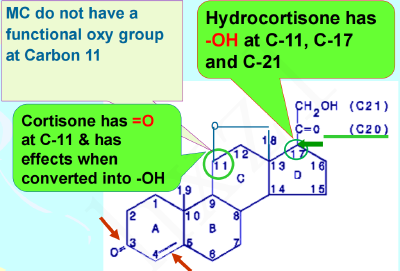
#### 盐皮质激素：对水盐代谢较强，对糖代谢很弱
#### 糖皮质激素：对糖代谢和  抗炎 较强，对水盐代谢作用较弱
#### 常用糖皮质激素类药化学结构特点
[[可的松]]（Cortisone）。氢化可的松(Hydrocortisone)、强的松/泼尼松(Prednisone)、强的松龙/泼尼松龙（Prednisolone）、地塞米松（Dexametinasone）、倍他米松（Betamethasone）
双键的引入： 1-2位C之间改成不饱和双键—— 泼尼松、泼尼松龙 （氢化泼尼松） ，抗炎和糖代谢作用增强 4-5倍
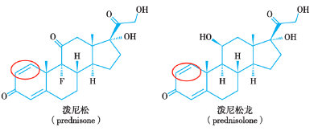
#### 氟的引入：提高抗炎和水钠潴留能力 （氟轻松）
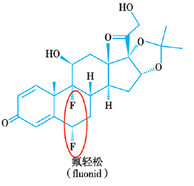
甲基的引入： 抗炎作用增强体内分解延缓（ 甲泼尼龙倍他米松地塞米松 ）
#### 羟基的引入： 抗炎作用加强而水钠潴留无变化 （曲安西龙）
### <u>体内过程</u>
#### 吸收  良好 
口服、注射、皮肤、眼结膜均可。可的松和氢化可的松吸收快且完全，1~2h内达峰，一次用药持续8~12h；
#### 分布：考虑  CBG——皮质激素运载蛋白 
10%游离（有生物活性）；90%与血浆蛋白结合（其中80%与皮质激素运载蛋白CBG结合。10%白蛋白。）；
CBG：肝合成 ——肝肾病患者减少GC用量；
[[雌激素]]、甲亢增加CBG ：怀孕、用雌激素、甲亢时，CBG↑，游离糖皮质激素减少。
###### 甲减、低蛋白血症、肝肾疾病减少CBG：游离糖皮质激素增多
#### 代谢 ：肝脏。考虑  （氢化）[[可的松]]、泼尼松（龙）、肝药酶诱导剂 
[[可的松]]、泼尼松需要在肝内转化为 氢化 [[可的松]]、泼尼松 龙，才有活性 
##### 肝肾功能不全时不用可的松、泼尼松
##### 合用 肝药酶诱导剂（[[苯巴比妥]]、[[苯妥英钠]]、[[利福平]]） 时，增加用量
甲亢时酶活性↑且CBG↑，肝灭活皮质激素加速，增加用量
#### 排泄
90%以上在48小时内出现于尿中，尿中代谢产物17-羟皮质素、17-羟酮皮质素可反映肾上腺-垂体功能
 根据作用时间长短，CG可分为：短效（＜12h）；中效（12~36h）；长效（＞36h）。注意地塞米松最强！！！ 
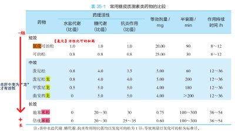
### <u>二、糖皮质激素作用：五代谢，三抗，三系统，骨退热</u>
> 神奇的GC。代谢上体现为应激，三抗上体现为“舒适”，兴奋中枢但退热，促进分解消化骨质疏松。
### <u>五代谢</u>  <u>*（& 允许作用）*</u> 
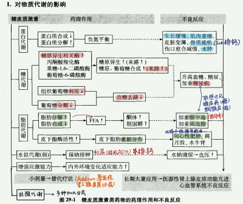
####  增强应激能力 
#### 1.糖代谢——升高血糖
机制：促进糖原异生酶，减少组织葡萄糖利用，减少葡萄糖分解——血糖合成↑ 去路↓
##### 不良：诱发、加重 糖尿病 
#### 2.蛋白质代谢——分解蛋白
合成↓，分解↑，负氮平衡
不良：长期用药引起肌肉消瘦、骨质疏松、皮肤变薄、伤口愈合延缓、成长缓慢、淋巴组织萎缩等
#### 3.脂肪代谢——分解（FFA↑）、重分布（向心肥）
#####  皮下脂酶活性 增加，皮下脂肪分解
游离 FFA↑ —→ 酮体、血浆胆固醇↑—→加重酸中毒、高血脂
脂肪 重新分布 （胰岛素分泌++，促进脂肪堆积→四肢不敏感，面、背部敏感）——向心性肥胖（面圆、背厚、躯干部发胖而四肢消瘦）
#### 4.水盐代谢（弱）——低钾水钠潴留碱中毒
##### 保钠排钾：弱的盐皮质激素作用
##### 水钠潴留，血压↑
##### 利尿作用：拮抗ADH减少水重吸收
促进尿钙排泄：抑制肾小管对钙的重吸收，长期用药骨质脱钙。
#### 5.核酸代谢——影响三大物质代谢的基础
##### 诱导合成多种RNA，总体合成代谢抑制、分解代谢增强
####  6.  ※  允许作用 
##### 对某些组织细胞无直接作用，但可 给其他激素发挥作用创造有利条件 
##### 增强  儿茶酚胺的缩血管  作用、  胰高血糖素  的升血糖作用
### <u>三抗（及作用原理）</u>
> 抗炎、抗免 *（过敏）* 、抗休克 *（内毒）*
#### 1.抗炎作用

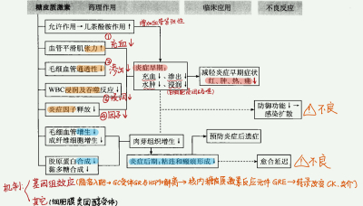
##### 特点：强大、非特异性、炎症各个阶段、降低防御
炎症早期：增加血管紧张性；减轻充血、通透性、渗出和水肿；抑制白细胞浸润与吞噬反应；减少炎症因子释放 →减轻红、肿、热、痛
###### 炎症后期：抑制毛细血管和成纤维细胞的增生，防止粘连和瘢痕
注意：抗炎同时降低了机体的防御功能—→防御功能↓、组织修复↓——感染扩散阻碍创面愈合
#####  ※机制：  基因组效应（基本机制） 、非基因组机制
作为脂溶性分子进入细胞，结合胞浆内的GC受体（GR），与热休克蛋白HSP90分离，GCs-GR复合体进入细胞核；
GCs-GR与靶基因启动子序列的糖皮质激素反应元件（GRE）结合；
转录增加或减少——改变炎性介质和细胞因子水平——抗炎
*对炎症抑制蛋白及某些靶酶的影响：脂皮素-1↑；抑制PLA2（PG、白三烯↓）；抑制iNOS、COX-2的表达；*
*对细胞因子及黏附因子的影响：促炎因子↓（TNF-α↓、IL-1↓、IL-6↓）；ICAM↓；*
###### *诱导炎症细胞凋亡*
###### *抑制成纤维细胞DNA的合成*
其它——非基因快速效应（与细胞膜类固醇受体结合）
*稳定溶酶体膜和肥大细胞膜；*
###### *增强血管对儿茶酚胺的敏感性*
#### 2.免疫抑制与抗过敏作用
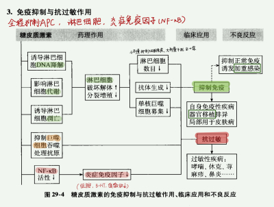
##### 免疫抑制
###### 小剂量时抑制细胞免疫
###### 抑制体液免疫：大剂量时干扰B细胞转变为浆细胞
抑制免疫反应全过程：抑制巨噬细胞抗原呈递、淋巴细胞增殖（促进淋巴细胞凋亡、抑制淋巴细胞DNA复制）、抗体产生
抗过敏：GCs抑制过敏介质的产生（减少组胺、5-HT、缓激肽）；能抑制器官移植排异反应。
#### 3.抗毒、抗休克作用
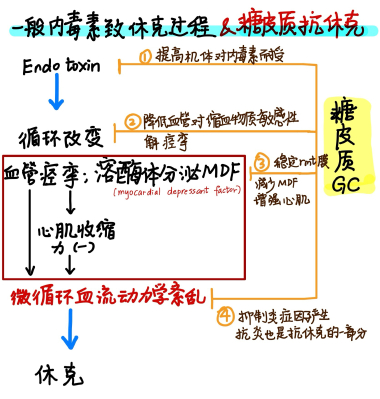
##### ① 提高机体对细菌内毒素的耐受力
###### 减少内源性致热源的释放、抑制下丘脑体温调节中枢的反应性
不能中和内毒素；
不能保护机体免受外毒素的损害。
② 稳定溶酶体膜，减少心肌抑制因子（MDF）形成，加强心肌收缩力
##### ③ 扩张痉挛收缩的血管，降低对缩血管物质的敏感性
④ 抗炎：抑制某些炎症因子的产生，改善微循环血流动力学障碍
### <u>其它：血液、中枢、消化、骨骼、退热</u>
#### 1.血液与造血系统
“ 三升一降”  —— 红细胞和血红蛋白↑、血小板↑、中性粒细胞↑（功能↓），淋巴细胞↓
###### 增加：红细胞白细胞血小板多核细胞血红蛋白纤维蛋白原
######  减少：淋巴细胞  单核细胞嗜酸性&嗜碱性粒细胞
 中性粒细胞双重作用： 刺激骨髓的中性粒细胞释放入血但降低中性粒细胞的功能
#### 2.中枢神经系统——兴奋
##### 精神失常、癫痫、儿童惊厥
#### 3.消化系统——酸酶 ↑ 黏液↓
##### 胃酸、胃蛋白酶↑
##### 胃黏液分泌↓，诱发溃疡
#### 4.骨骼——  骨质疏松 <mark style="background-color:#fef3c7;"> （停药指征） </mark>
##### 长期大剂量使用
抑制成骨细胞活力，减少骨中胶原的合成，促进胶原和骨基质的分解，使骨质形成发生障碍
#### 5.退热作用
##### 用于严重的中毒性感染，有迅速而良好的退热作用
### <u>三、临床应用</u>
> 替代疗法、严重感染或炎症、自身免疫性疾病及过敏性疾病、抗休克治疗、血液病、局部应用
####  {代谢}——替代疗法  、晚期肿瘤： <mark style="background-color:#fef3c7;">原发性肾上腺皮质功能减退症（Addison’s disease）</mark>；恶性肿瘤晚期控制
####  {抗炎}  ——严重感染、炎症、纤维增生
用于中毒性感染或同时伴有休克。 <mark style="background-color:#fef3c7;"> 病毒性感染不宜用激素！ </mark> （ 降低机体防御能力加速扩散但可用于严重的乙脑腮腺炎喉炎麻疹 ）
##### 小剂量用于结核病的急性期，减少愈合过程中纤维增生和粘连
##### 眼科：防止角膜浑浊和瘢痕黏连的产生
####  {抗免疫抗过敏}—  —自免，器官移植，过敏
自身免疫性疾病： <mark style="background-color:#fef3c7;"> 多发性皮肌炎（polymosititis） </mark><mark style="background-color:#fef3c7;">首选用药；</mark>在风湿性及类风湿性关节炎中与NSAID联用； 按照皮质激素分泌的节律性给药 
器官移植排斥反应：可以抑制免疫性排斥反应
##### 过敏性疾病：用于严重的过敏性疾病<mark style="background-color:#fef3c7;">（</mark><mark style="background-color:#fef3c7;"> 倍氯米松用于过敏性哮喘 </mark><mark style="background-color:#fef3c7;">）</mark>
####  {抗休克}  ——脓毒性休克、辅助治疗其它休克
> 静脉早期大剂量注射治疗
####  {血液病} 
> 急性淋巴细胞白血病 （注意！对急性非淋巴细胞白血病效果不好）粒细胞减少再生障碍性贫血血小板减少性紫癜
####  局部应用 
> 皮肤：湿疹接触性皮炎（eczema）银屑病（psoriasis）
> 眼：结膜炎，虹膜炎
### <u>四、不良反应、</u>  <u>禁忌症</u> 
> 禁忌症是重点；注意一般和抗菌抗感染药物合用。用后炎症、感染易扩散。
### 1、停药反应
> 记住有哪些就可以了，不用点开看细节
#### （1）药源性肾上腺皮质功能不全
长期应用GCs，反馈性抑制下丘脑-垂体-肾上腺皮质轴→ ACTH分泌↓ →肾上腺皮质功能↓
恢复时间长： ~~*停用激素后垂体分泌ACTH功能需要3-5月恢复；肾上腺素皮质对ACTH起反应需要更久*~~
处理：缓慢减量，隔日给药，停药数月后遇应急情况，要给予足量的GC
#### （2）反跳现象 ——突然停药或减量过快时原有疾病复发或恶化
##### 处理：先缓解症状（加大剂量再治疗），再缓慢减量
#### （3）糖皮质激素抵抗——大剂量疗效差
### 2、长期大量应用
> 我没展开的就不用点开看了
#### （1）{代谢}  类肾上腺皮质功能亢进综合征 <mark style="background-color:#fef3c7;"> （库欣Cushing syndrome </mark><mark style="background-color:#fef3c7;">）</mark>
表现：糖、蛋白质、脂肪、水盐代谢紊乱，类似肾上腺皮质功能亢进综合征
治疗：一般不作特殊治疗，必要时加用抗高血压药、抗糖尿病药，采用低盐、低糖、高蛋白饮食，补钾
#### （2）{代谢}  糖尿病；骨质疏松、肌肉萎缩、伤口愈合延迟
#### （3） {抗炎、抗免疫}  诱发和加重感染
抑制免疫功能→体内潜在感染灶扩散，静止病灶复染。 结核病人必须合用抗结核药 
##### 无有效药物控制的感染需慎用
#### （4） {三系统} 消化、心血管、中枢系统并发症
##### 诱发、加重溃疡病  ※溃疡患者禁用 
#####  水钠潴留（高血压） 、血脂升高（动脉粥样硬化）
##### 失眠、幻觉甚至精神失常、癫痫
#### <mark style="background-color:#fef3c7;"> （5）糖皮质激素型青光眼（GIG） </mark>
#### （6）妊娠禁用
增加胎盘功能不全、新生儿体重减少或死胎发生率
### 3、禁忌证
##### 肾上腺皮质功能亢进禁用
##### 严重糖尿病、高血压
##### 孕妇禁用
##### 抗菌药物不能控制的感染 ：水痘、带状疱疹、真菌感染禁用
##### 严重精神病癫痫禁用
活动性消化溃疡，新近胃肠吻合术；角膜溃疡禁用
骨折、创伤恢复期禁用；儿童、绝经期妇女使用后易导致骨质疏松、自发性骨折
药物互作：糖皮质激素加快水杨酸盐的消除降低口服抗凝血药作用
### <u>疗程和用法（了解）</u>
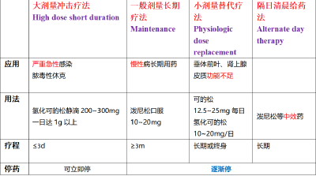
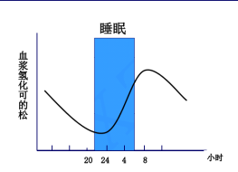
### 复习思考题
➢ Glucocorticois的生理作用与其临床应用时的不良反应有何关联？这些不良反应可否避免？
➢ 在glucocorticoid众多的药理作用中，哪些是临床应用中最重要的？为什么？
➢ 目前对glucocorticoid的抗炎作用机制的认识有哪些？这些作用机制对其临床应用有何影响？
### PPT题目
1. 儿科:变应性鼻炎（即过敏性鼻炎）—— 泼尼松片？×！抗组胺√ 
2. 儿科:急性化脓性扁桃体炎——地塞米松磷酸钠注射液5mg，静推，st
 化脓性×。 无指征使用糖皮质激素。不建议仅以退热为目的使用糖皮质激素。
3. 男，71岁，下肢浮肿，胸闷、气急，诊断为慢性心功能不全
##### 地高辛片 √，金三角新四联强心
##### 氢氯噻嗪片 √，水肿
 泼尼松片   ×！加剧缺钾，水钠潴留 
4.Of the following mechanisms of anti-inflammatory and immunosuppressive effects of glucocorticoids, which one is uniformly observed?
a. Increased influx of leukocytes to the site of inflammation
b. Reduced formation of lipocortins
<mark style="background-color:#fef3c7;">c. Reduced capillary permeability and edema at the inflammatory site</mark>
d. Increased prostaglandin formation
e. Enhanced formation of interleukins (IL-1,IL-2)
5. Glucocorticoids are powerful anti-inflammatory agents. Which of the following is not an anti- inflammatory mechanism of action of glucocorticoids?
a. lncreased the production of lipocortin, which inhibits the enzyme phospholipase A2
b. Reduction in the release of cytokines, such as IL-1 and IL-6
<mark style="background-color:#fef3c7;">c. Decreased number of circulating neutrophils</mark>
d. Impairment of prostaglandin and leukotriene synthesis
6.Of the following, which is always not associated with the abuse of anabolic steroids by athletes?
a. Retention of fluid
b. Feminization in males
c. Decreased spermatogenesis
d. Depression
<mark style="background-color:#fef3c7;">e. Anorexia</mark>—— 增强代谢 
7. A 27-year-old female is diagnosed with hypercortisolism. To determine whether cortisol production is independent of the pituitary gland, you decide to suppress ACTH production by giving a  high-potency glucocorticoid . Which glucocorticoid is the best for this indication?
a. Triamcinolone
b. Prednisone
c. Hydrocortisone
<mark style="background-color:#fef3c7;">d. Dexamethasone</mark> （最强） 
e. Methylprednisolone
#### 8. 下面哪项不是糖皮质激素抗炎作用的机制
A.影响花生四烯酸代谢的连锁反应
B.抑制一氧化氮合酶和环氧化酶-2的表达
C.抑制炎性细胞因子的表达
 D.增加肝、肌糖原含量 
E.非基因快速效应
#### 9. 可用糖皮质激素治疗的是:
A.严重哮喘伴有高血压
B.水痘病毒感染
C.精神病人服用苯巴比妥引起的过敏性皮炎
 D.急性淋巴细胞性白血病 
E.带状疱疹
#### 10.下面哪项不是糖皮质激素的药理作用
A.抗炎作用
B.免疫抑制
C.抗过敏
 D.降血脂 
E.抗休克
#### 11. 下面哪项不是糖皮质激素抗休克作用的机制
A.抑制某些炎症因子的产生
B.稳定溶酶体膜，减少心肌抑制因子的形成
C.降低血管对某些缩血管活性物质的敏感性
D.提高机体对细菌内毒素的耐受力
 E.降低心脏收缩力，缓解心肌缺血状态 
#### 12.经<mark style="background-color:#fef3c7;">体内转化后才具有药理活性</mark>的糖皮质激素是:
 A.泼尼松 
B.氢化可的松
C.地塞米松
D.倍他米松
E.氟轻松
13. 长期用糖皮质激素，突然停药产生反跳现象的原因:
A.ACTH分泌增多
B.甲状腺功能亢进
C.肾上腺功能亢进
 D.患者对激素产生了依赖性或病情尚未完全控制 
E.患者对激素产生了成瘾性
