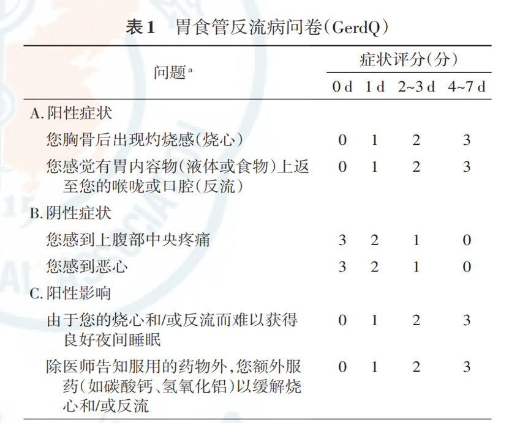
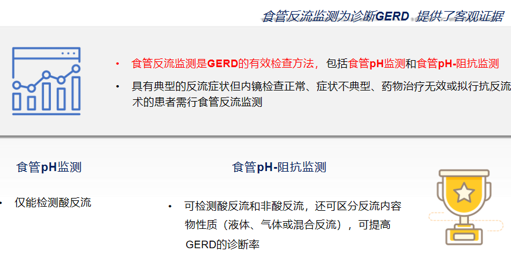
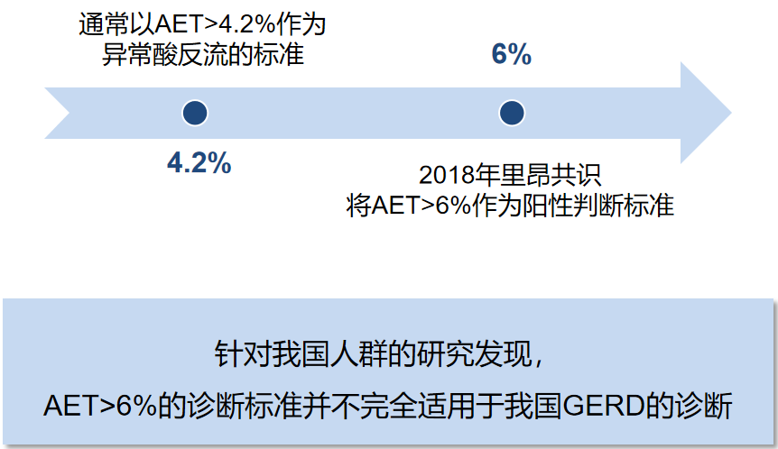
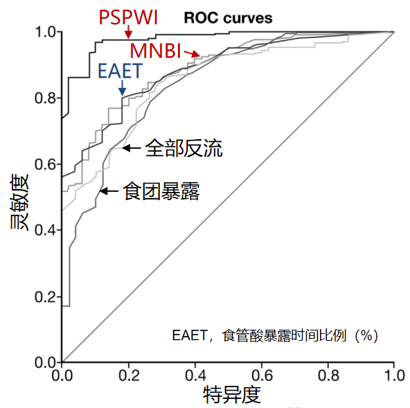
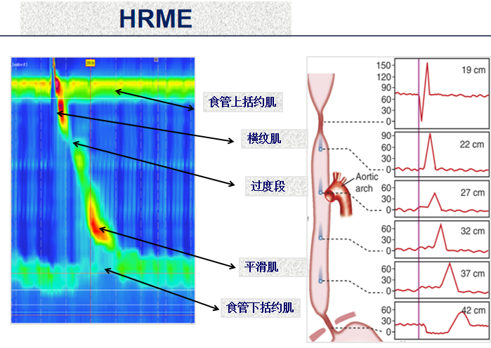
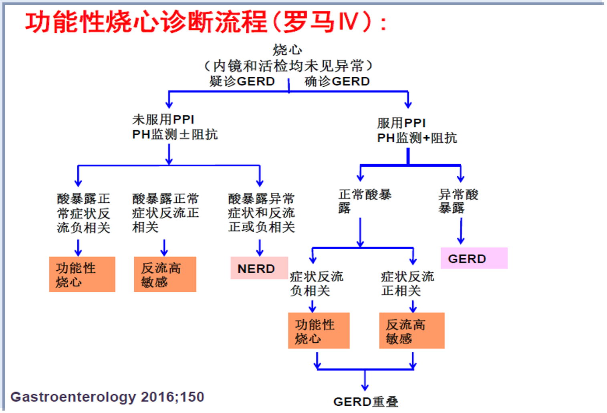
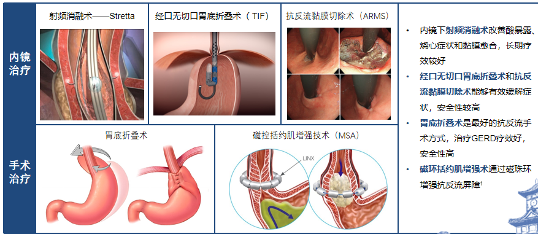

---
aliases:
  - GERD
---
## 分类
#### 内镜下分类
三种类型相对独立，相互之间不转化或很少转化
###### 非糜烂性反流病NERD
60~70%中国人
有反流症状，但<mark style="background-color: #1A4F10; color: white">内镜下食管黏膜无破损</mark>。
###### 糜烂性食管炎EE erosive esophagitis=[[反流性食管炎]]（RE）
胃镜下能看到食管黏膜的破损、糜烂或溃疡
###### [Barrett 食管](Barrett%20食管.md)=BE

---
## 临床表现

<mark style="background-color: #1A4F10; color: white">烧心和反流</mark>是 GERD 最常见的典型症状。
- **烧心**：胸骨后疼痛、灼烧感。
- **反流**：胃内容物向咽部或口腔方向流动的感受。
不典型症状包括：腹痛（上腹痛、上腹部烧灼感）、消化不良（腹胀、早饱、嗳气）、吞咽困难、癔球症等。
对于不典型症状患者，尤其需要先排除心脏因素，再进行 GERD 评估；其中[胸痛](胸痛.md)患者需先排除心脏因素后才能进行 GERD 评估。
#### 食管症状
###### 症状综合征
典型反流综合征
反流胸痛综合征

###### 伴食管损伤的综合征
反流性食管炎
反流性狭窄
[Barrett 食管](Barrett%20食管.md)
食管腺癌
#### 食管外症状
###### 已证实相关
反流性咳嗽综合征
反流性喉炎综合征
反流性哮喘综合征
反流性蛀牙综合征➡️牙蚀症
###### 可能相关
咽炎
鼻窦炎
特发性肺纤维化
复发性中耳炎

---
## 诊断
#### 主观诊断
- 典型症状拟诊
- 反流<mark style="background-color: #705A16; color: white">问卷</mark>辅助：胃食管反流病问卷（GerdQ）是诊断及评估 GERD 最简单有效的工具。问卷设计基于患者就诊前1周内的症状，诊断精确性高。RDQ 可作为备选问卷
[Open: Pasted image 20260901195516.png](attachments/8e154dcc613567e05b0eb7e61d0c5423_MD5.jpg)

- ⭐️![[PPI试验性治疗]]
#### 客观诊断
##### 1.内镜检查：确定类型，活检，色素；放大内镜；治疗
有警报症状（包括：[吞咽困难](吞咽困难.md)、吞咽疼痛、[出血](出血.md)、[贫血](贫血.md)、消瘦、频繁[呕吐](呕吐.md)）、筛查发现并发症高风险（如 Barrett 食管）者，或有症状的初诊患者，推荐内镜检查。

<mark style="background-color: #705A16; color: white">LA分级</mark>为RE在内镜下表现和严重程度分级⭐️
（洛杉矶分级法，Los Angeles， 1994年）
> 正常：食管黏膜没有破损；
> A级：一个或一个以上食管黏膜破损，长度小于5 mm；
> B级：一个或一个以上食管黏膜破损，长度大于5 mm，但没有融合性病变；
> C级：黏膜破损有融合，但小于75%的食管周径；
> D级：黏膜破损融合，至少达到75%的食管周径；

内镜检查如果正常，不推荐进行常规食管活组织检查；但需对于有报警症状的患者做鉴别性诊断，排除其他原因引起的反流/烧心，如嗜酸性粒细胞性食管炎。

##### 2.食管反流监测：GERD可导致食管溃疡、狭窄和食管腺癌等食管并发症；我国[Barrett 食管](Barrett%20食管.md)患者近一半表现为GERD的非典型症状
> <mark style="background-color: #705A16; color: white">食管pH-阻抗监测</mark>是目前诊断GERD的“金标准”
> [Open: Pasted image 20260912164202.png](attachments/542e665c12b8a4f8c7b0c006572e9098_MD5.jpg)

###### 1️⃣24 h食管pH检测：确定反流存在的界限点。
> pH<4的时间称为反流时间，pH＜4的时间＞4%；
> ——2018里昂共识

！！！食管反流监测的主要指标是<mark style="background-color: #1A4F10; color: white">AET</mark>，<mark style="background-color: #1A4F10; color: white">PSPWI和MNBI</mark>是辅助诊断的新指标。
食管反流监测的主要指标为酸暴露时间百分比（AET），定义为<mark style="background-color: #3F4B5E; color: white">24 h内食管pH值小于4的时间百分比</mark>。
[Open: Pasted image 20260914082918.png](attachments/b1b9b550bdf0aff7005a9ddc263847ce_MD5.jpg)

###### 2️⃣多通道腔内阻抗技术（Multichannel intraluminal impedance，MII）
> 于上世纪80年代后期诞生于德国，其应用于胃食管监测的工作原理为：通过记录食管腔内食团通过所引起的阻抗值变化来反映食团的性质和运动情况。
> 联合阻抗和pH监测能克服单独使用pH监测所不能识别的pH≥4的反流，从而全面评估胃食管反流事件，提高诊断GERD的敏感性和特异性，对GERD的治疗有重要的指导意义。

反流后吞咽诱导蠕动波指数（PSPWI）和夜间基线阻抗（MNBI）能够有效区分GERD患者和健康受试者：
[Open: Pasted image 20260914083000.png](attachments/de2f6932cff3bd39667521f3978b3046_MD5.jpg)

##### 3.食管<mark style="background-color: #705A16; color: white">高分辨率测压</mark>（High Resolution Manometry，HRM）
> 食管高分辨率测压可检测GERD患者的食管动力状态，并作为抗反流内镜下治疗和外科手术前的常规评估手段。
> （推荐级别：A+，62.1%；A，34.5%。证据等级：中等质量）
> [343Open: Pasted image 20260914091346.png](attachments/d46c46cbabd9d128e8e2ff0f8ddd3313_MD5.jpg)
> 

##### 4.食管吞钡X线检查
> 敏感性不高
> 排除食管癌、贲门失弛缓症等
> 观察食管的运动情况，可注意到有无反流征象

##### 5.新技术
食管黏膜阻抗技术和EndoFlip技术
#### 诊断标准
里昂共识要点：①病史和问卷是 GERD 诊断与疗效评估的首选；②PPI 试验无效时建议内镜检查；③阻抗-pH 监测是 GERD 诊断金标准。

> 内镜下观察到食管黏膜的破损，诊断金标准是<mark style="background-color: #705A16; color: white">内镜</mark>检查结果。非糜烂性或者内镜阴性反流病, 以 <mark style="background-color: #705A16; color: white">24h pH 监测</mark>结果作为诊断金标准。

符合以下任何一条可确诊GERD:
- 具有典型的<mark style="background-color: #1A4F10; color: white">反流症状</mark>（烧心和/或反酸），抑酸剂试验性治疗有效；
- 上消化道<mark style="background-color: #1A4F10; color: white">内镜</mark>检查提示B级及以上RE、反流性狭窄或BE（<mark style="background-color: #1A4F10; color: white">病理</mark>证实）；
- 非典型上消化道症状，上消化道内镜检查未见食管黏膜破损或LA-A级食管炎，<mark style="background-color: #1A4F10; color: white">食管反流监测</mark>提示存在病理性反流（<mark style="background-color: #1A4F10; color: white">AET </mark> 4%）。
##### 鉴别诊断
###### 烧心的鉴别诊断
---功能性烧心（functionalheartburn， FH）
[354Open: Pasted image 20260914091829.png](attachments/66679bbf98488aaa934e2bed0e7ea401_MD5.jpg)

###### 胸痛的鉴别诊断
---非心源性胸痛（non-cardiac chest  pain, NCCP）

---
- GEJ 是 GERD 发生的初始部位，也是导致反流的最主要的解剖部位
LES：下食管括约肌； 
TLESR：下食管括约肌一过性松弛；  
GEJ:胃食管交界区

- 汪忠镐院士自2007年提出了“胃食管喉 气管综合征”的概念，之后提出胃食管气道反流性疾病（gastroesophageal airway reflux disease，GARD）。

---
## 病因病理
### 抗反流机制减弱
<mark style="background-color: #1A4F10; color: white">LES、膈肌脚、膈食管韧带、食管与胃底之间的锐角 (His 角) </mark>共同构成了抗反流屏障。
#### TLESR (Transit LES relaxation) 
全称 “<mark style="background-color: #705A16; color: white">一过性下食管括约肌松弛</mark>”
在生理情况下，吞咽的食物经过时，食管下括约肌（LES）松弛，食物得以进入胃内。
如果在非吞咽情况下 LES 自发性松弛，<mark style="background-color: #1A4F10; color: white">并且松弛时间明显长于吞咽时的 LES</mark>，那么就称为 TLESR。这是人生理性胃食管反流的主要原因，也是 LES 静息压正常的胃食管反流患者的主要病因。
减弱 LES 的因素包括：胆囊收缩素、胰升血糖素、血管活性肠肽、[地西泮](地西泮.md)
#### 正常生理功能改变
如果食管的蠕动异常、胃内压升高、胃排空异常（如幽门失弛缓），或者腹内压升高（如外力压迫、过紧的牛仔裤等）。
#### 胃酸分泌过多
Zollinger-Ellison 综合征患者，其胰腺、十二指肠发生的胃泌素肿瘤导致高胃泌素血症，大量分泌胃酸，进而导致消化性溃疡。
### 反流物对食管黏膜的损害
反流的内容物主要是<mark style="background-color: #1A4F10; color: white">胃酸</mark>，有时还可以出现十二指肠液。后者主要出现在<mark style="background-color: #3F4B5E; color: white">胃大部切除术后或食管肠吻合术后</mark>。
对于肠液导致的病人，其中的<mark style="background-color: #1A4F10; color: white">非结合胆盐以及胰酶</mark>是主要的攻击因子，参与损害食管黏膜。
### 胃食管反流病的危险因素
1. **年龄与性别**：老年人 EE 检出率高于青年人；男性 GERD 患者比例明显高于女性。
2. **肥胖及生活方式**：肥胖、高脂辛辣饮食、吸烟、饮酒、饮用浓茶、咖啡、可乐等碳酸饮料、长期便秘等因素与 GERD 的发生呈正相关；体育锻炼和高纤维饮食可能为 GERD 的保护因素。
3. **药物**：如钙离子通道阻滞剂、抗胆碱能药物（[阿托品](阿托品)、筒箭毒碱）、[NSAIDs](NSAIDs.md)。
4. **[妊娠](妊娠.md)**。
5. **相关疾病**：[糖尿病](糖尿病.md)、代谢综合征、心血管疾病、睡眠呼吸暂停综合征、骨质疏松伴椎体骨折、脊柱后凸。
### 病理改变
1. 观察到食管黏膜充血水肿，质脆易出血。
2. 食管黏膜上层坏死脱落形成糜烂、溃疡、纤维化，进而瘢痕性缩窄。
3. Barrett 食管：在齿状线 3 cm 以上的部位出现鳞状上皮的柱状化生。发生在 Barrett 食管的溃疡称为 Barrett 溃疡。

---
## 治疗
#### 生活方式调整
基础治疗手段，包括减肥、戒烟、抬高床头等
#### 药物治疗
- 抑酸药物 PCAB, PPI⭐️, H2RA。拉生类，拉唑类，替丁之类
- 抗酸药物（胃舒平，硫糖铝，铝碳酸镁）
- 黏膜保护剂（替普瑞酮，膜固思达，麦滋林-s颗粒，殊奇）
- 促动力药物：多巴胺受体拮抗剂（多潘立酮）、5-羟色胺受体激动剂（莫沙必利、伊托必利及替加色罗）和胃动素受体激动剂（红霉素）等
- 降低TLESR药物：γ-氨基丁酸β受体激动剂（巴氯芬）和亲代谢谷氨酸盐受体5拮抗剂

> PPI或P-CAB是治疗GERD的首选药物，单剂量治疗无效可改用双倍剂量，一种抑酸剂无效可尝试换用另一种。疗程为4~8周。
> （推荐级别：A+，58.6%；A，27.6%。证据等级：中等质量)

> 维持治疗方法包括按需治疗和长期治疗。抑酸剂初始治疗有效的NERD和轻度食管炎（洛杉矶分级为A和B级）患者可采用按需治疗，PPI或P-CAB为首选药物。
> （推荐级别：A+，63.3%；A，30.0%。证据等级：高质量）

> PPI或P-CAB停药后症状复发、重度食管炎（洛杉矶分级为C和D级）患者通常需要长期维持治疗。
> （推荐级别：A+，80.0%；A，13.3%。证据等级：中等质量)

维持治疗 (PPI/P-CAB)
1. 按需治疗
→初治有效NERD
→轻度食管炎 (LA A/B)
2. 长期维持
→停药后复发者
→重度食管炎 (LA C/D)

> 抗酸剂可快速缓解反流症状
> 更新：取消抗酸剂可用于维持治疗的推荐，明确用于GERD对症治疗，不主张长期使用
> 促动力药联合抑酸药物对缓解GERD患者的症状可能有效
> 更新：日本和欧洲指南不推荐单独使用，美国指南明确指出不推荐使用
> ➡️抗酸剂仅限短期使用，促动力药需联合抑酸药物用于改善症状

| 抗动力药种类                 | 常用药物    |
| ---------------------- | ------- |
| 多巴胺D2受体拮抗剂             | 甲氧氯普胺   |
| 胃动素受体激动剂               | 红霉素和类似物 |
| 外周性多巴胺D2受体拮抗剂          | 多潘立酮    |
| 选择性 5-羟色胺4受体激动剂        | 莫沙必利    |
| 多巴胺D2受体阻滞和乙酰胆碱酯酶抑制双重作用 | 伊托必利    |
| 5-羟色胺4受体激动剂和多巴胺受体拮抗剂   | 西尼必利    |

#### 内镜手术治疗
内镜和抗反流手术可有效治疗GERD
- 内镜下射频消融术
- 胃底折叠术
[Open: Pasted image 20260914093103.png](attachments/527cd43db0ac3a174afe9cb18d332bb7_MD5.jpg)

符合以下条件者可考虑手术治疗：
1. 内科治疗失败，如症状未得到理想控制、药物副作用严重；
2. 药物治疗有效，但患者不愿意终生服药；
3. 存在 GERD 并发症，如 Barrett 食管、消化性狭窄；
4. 存在食管外胃食管反流病症状，如哮喘、声音嘶哑、咳嗽、胸痛、误吸。
