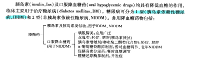
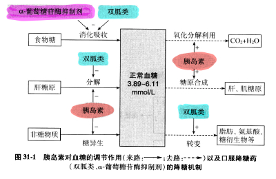
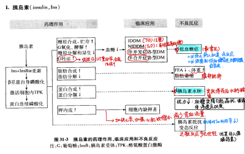
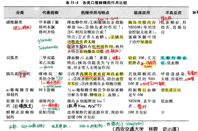
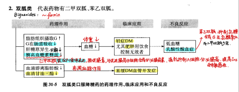
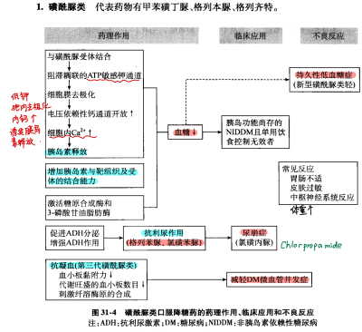
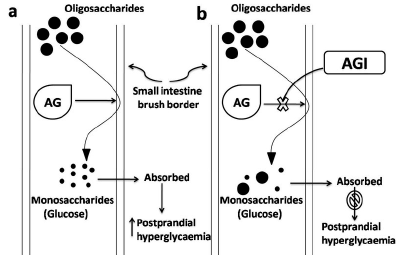

---
tags:
  - pharmacology
---
### 胰岛素及口服降血糖药（2自学）
#### 降血糖药概述

胰岛素 及其类似物的作用原理、临床应用和应用注意。

#### 人胰岛素类似物
#### 速效胰岛素类似物
可以迅速起效，快速恢复；与人类似；药物吸收稳定
<mark style="background-color: #3F4B5E; color: white">门冬</mark> 胰岛素（insulin aspart）、 <mark style="background-color: #3F4B5E; color: white">赖脯</mark> 胰岛素（insulin lispro）
#### 超长效胰岛素类似物
##### 作用时间更长，与速效胰岛素类似物联用可更好模拟生理过程
<mark style="background-color: #3F4B5E; color: white">甘精</mark> 胰岛素（insulin glargine）、 <mark style="background-color: #3F4B5E; color: white">地特</mark> 胰岛素（insulin detemir）
#### 口服降糖药：仅用于控制 II型糖尿病的早期

#### 分类、机制及特点
#### 双胍类（Biguanides）
> 二甲双胍（met formin ）苯乙双胍（phen formin）
##### 二甲双胍（metformin）苯乙双胍（phenformin）
##### <mark style="background-color: #705A16; color: white">T2DM患者控制血糖的一线用药与基础用药</mark>

体内过程稳定，口服，不与血浆蛋白结合，不代谢，原形尿中排出
#### 磺酰脲类（Sulfonylureas） ：格列吡嗪等

> Tolbutamide甲苯磺丁脲，Chlorpropamide氯磺丙脲，Glyburide (glibenclamide, 格列本脲, 优降糖)，Glipizide (格列吡嗪)，Glimepiride (格列美脲)，Gliclazide (格列齐特, 达美康)

Tolbutamide甲苯磺丁脲，Chlorpropamide氯磺丙脲，Glyburide (glibenclamide, 格列本脲, 优降糖)，Glipizide (格列吡嗪)，Glimepiride (格列美脲)，Gliclazide (格列齐特, 达美康)
##### T2DM患者的主要用药之一
##### 药理机制
##### 刺激胰岛B细胞释放胰岛素
增加胰岛素与受体的结合能力；增加胰岛细胞对葡萄糖敏感性
##### Ins效应：促进葡萄糖利用、糖原和脂肪合成
##### 抗利尿作用：促进ADH分泌并加强ADH作用
##### 第三代磺酰脲类可抗凝血：减轻糖尿病微血管并发症
##### 特点
##### 仅对正常人、胰岛功能尚存的糖尿病患者有降血糖作用
##### 对T1DM、严重T2DM无效
##### 可引起持久性低血糖
##### 抗利尿作用：尿崩症<mark style="background-color: #1A4F10; color: white">（氯磺丙脲）</mark>
格列奈类（Glinide）——非磺酰胺类 促胰岛素分泌 剂， 餐时 血糖调节剂
> Repaglinide瑞格列奈 & Nateglinide那格列奈

Repaglinide瑞格列奈 & Nateglinide那格列奈
##### 作用快、可以模仿胰岛素的生理性分泌
##### 控制餐后高血糖的餐时血糖调节剂
##### <mark style="background-color: #705A16; color: white">高血浆蛋白结合率</mark>
可用于饮食与体育锻炼难以控制的T2DM患者；对夜间或空腹血糖水平的影响最小
##### 不良反应轻，低血糖
噻唑烷酮类（Thiazolideinediones, TZD） ：吡格列酮
> Rosiglitazone罗格列酮。Pioglitazone吡格列酮。Ciglitazone环格列酮，Englitazone恩格列酮
##### 胰岛素增敏剂
##### 作用机制
##### 增强靶组织对胰岛素的敏感性，减轻胰岛素抵抗
##### 改善脂质代谢紊乱
减轻血管并发症（内皮；血小板；炎症）
##### 临床应用：胰岛素抵抗T2DM
##### 仅在胰岛素存在时有效，对T1DM无效
##### 不良反应
##### 易骨折
##### 体重增加
##### 水肿
潜在心血管事件发生 (罗格列酮)；肝毒性（曲格列酮）
#### zGLP-1受体激动剂
> 胰高血糖素样肽-1（GLP-1）受体激动剂，依克那肽（exenatide）
##### 依克那肽（exenatide）
GLP-1是肠促胰素，可以促进胰岛B细胞合成分泌胰岛素，刺激胰岛B细胞增殖分化 ，增加胰岛素的敏感性；并强烈抑制胰岛A细胞分泌胰高血糖素。
依克那肽可以长效激动GLP-1受体，在不引起低血糖和增加体重的基础上治疗T2DM
##### 注射用药
#### DDP-4抑制剂
> 二肽基肽酶（DPP-4）抑制剂：西格列汀 （sitagliptin）
##### 西他列汀 （sitagliptin）
##### DPP-4是降解GLP-1的酶
西他列汀耐受性良好发生低血糖风险低并可使体重减轻
西他列汀的作用依赖于内源性GLP-1的分泌，不适于GLP-1分泌障碍患者
#### α-葡萄糖苷酶抑制剂：阿卡波糖（acarbose）
> 阿卡波糖（acarbose）

竞争性抑制抑制 α-葡萄糖苷酶，抑制寡糖分解为单糖，减少小肠吸收。仅用于辅助治疗

#### 胰淀粉样多肽类似物：醋酸普兰林肽
延缓葡萄糖的吸收，抑制胰高血糖素的分泌。降低糖尿病患者体内血糖波动频率与波动幅度
可用于T1DM&T2DM，胰岛素治疗的辅助治疗 不能替代胰岛素
##### 不可用于胰岛素治疗依从性差、自我检测血糖依从性差的患者
#### SGLT-2抑制剂：恩格列净
