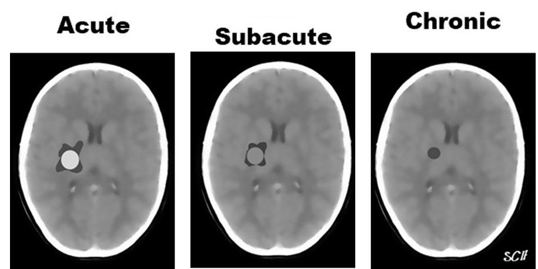
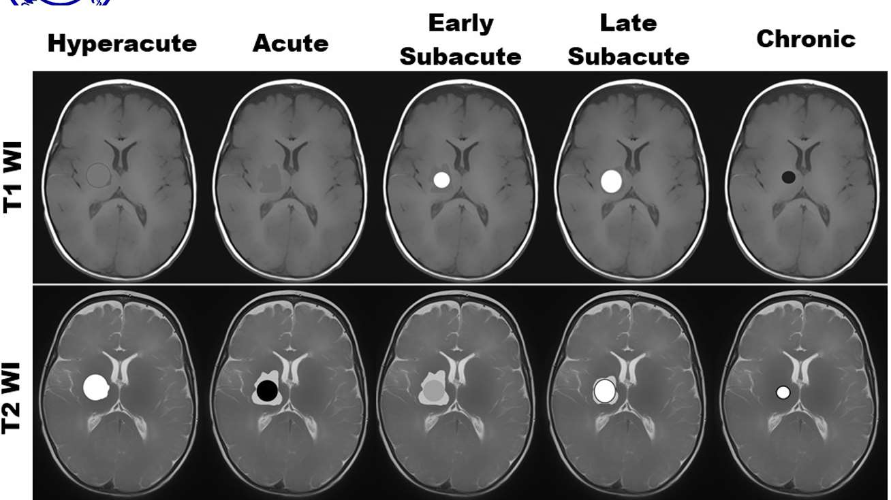
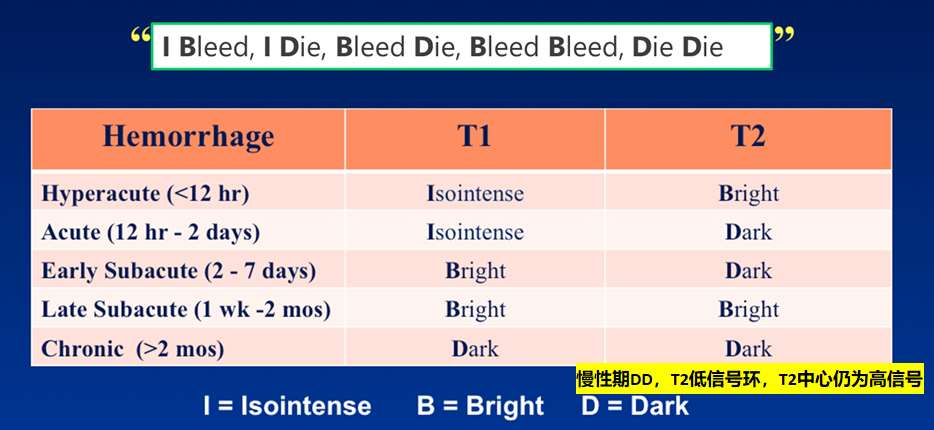

---
tags:
  - pathology
  - Neurology
  - imaging
aliases:
  - 脑溢血
  - Intracerebral Hemorrhage
  - 脑内出血
  - ICH
---
#### 概念
定义：大脑内（不是表面）非外伤性（自发性）血管破裂引起的出血。
#### 流行病学
最常见的脑卒中类型之一，约占全部脑卒中的10% - 30%。
##### 高危人群与病因
- <mark style="background-color: #1A4F10; color: white">高血压</mark>（**最常见的原因**）。[高血压](高血压.md)
- 脑血管畸形、[动脉瘤](动脉瘤.md)<mark style="background-color: #1A4F10; color: white">破裂</mark>、血管炎、脑淀粉样血管病、静脉窦血栓形成。
- 使用抗凝或抗血小板等药物。
- <mark style="background-color: #1A4F10; color: white">血液系统疾病</mark>、颅内原发性或转移性肿瘤等。
#### 临床表现
大块型脑出血常起病急骤。
患者突感剧烈[[头痛]]，随即频繁[[呕吐]]、意识模糊（[意识障碍](意识障碍.md)），进而昏迷。
> 脑内出血的直接死亡原因多为并发脑室内出血或严重的[[脑疝]]。
#### 影像学检查
常见部位：基底节、丘脑、脑桥和小脑
血肿演变：（超急性期➡️急性期）➡️（亚急性早期➡️亚急性晚期）➡️慢性期
> 括号内的时期CT不区分

<mark style="background-color: #705A16; color: white">急性</mark>脑内出血的病例可首选<mark style="background-color: #1A4F10; color: white">CT</mark>检查；
对于<mark style="background-color: #705A16; color: white">亚急性或慢性</mark>血肿，MRI检查比CT更为敏感，对出血原因的判断也优于CT，<mark style="background-color: #1A4F10; color: white">MRI</mark>可作为首选。
##### CT
[Open: Pasted image 20261014083004.png](attachments/db13177d28c7f724e2c06412563917a1_MD5.jpg)

###### 急性期
①. 血肿呈均匀高密度，边界清楚，
②. 肾形、类圆形或不规则形；
③. 周围水肿带宽窄不一，局部脑室受压移位。
④. 破入脑室可见脑室内
###### 亚急性期
（始于出血后2-7天）
①. <mark style="background-color: #1A4F10; color: white">血肿缩小并密度减低</mark>，血肿周围变模糊；
②. 水肿带增宽；
③. 小血肿可完全吸收。
④. ★<mark style="background-color: #705A16; color: white">环形强化</mark>（血肿周围炎症反应、新生毛细血管）——非血肿上而是周边强化
###### 慢性期
（大于2个月）
①. 较大血肿吸收后常遗留大小不等的囊腔；
②. 伴有不同程度的脑萎缩。
##### MRI
[Open: Pasted image 20261014083520.png](attachments/f3e18e951a07d7d3f8391a615d53851c_MD5.jpg)

> 血肿期龄变化：
> 血液-氧合血红蛋白T1等或略低，T2高
> →脱氧血红蛋白T2变低
> →胞内高铁血红蛋白顺磁性物质T1高T2低
> →细胞溶破，释出变为低蛋白血肿液T1、T2均高（同含蛋白囊肿）
> →血肿液被血红蛋白吞噬成囊腔-液体T1低T2高，低信号环为巨噬细胞吞噬后形成的含铁血黄素沉积。
###### 超急性期
T1W1呈等信号，T2W1呈稍高信号。
###### 急性期
T1W1呈等信号，T2W1呈<mark style="background-color: #3F4B5E; color: white">低</mark>信号。
###### 亚急性早期
早期：血肿T1W1信号由周边到中心逐渐<mark style="background-color: #8B0000; color: white">增高</mark>，T2W1呈<mark style="background-color: #3F4B5E; color: white">低</mark>信号。
###### 亚急性晚期
晚期：T1W1和T2W1均呈<mark style="background-color: #8B0000; color: white">高</mark>信号，周围可出现含铁血黄素沉积形成的低信号环。
###### 慢性期
T1W1呈<mark style="background-color: #3F4B5E; color: white">低</mark>信号，T2W1呈<mark style="background-color: #8B0000; color: white">高</mark>信号。周围T2低信号环更加明显
[Open: Pasted image 20261014084217.png](attachments/ad1025c7c28a9f23ffcd93e991991ec8_MD5.jpg)

#### 治疗
##### 1.急诊外科治疗
###### 手术指征：
- 小脑出血压迫脑干生命中枢和（或）梗阻性脑积水：尽快手术清除[脑内血肿](脑内血肿.md)。
- 脑叶出血超过30 ml且距脑表面1 cm范围内：可考虑标准开颅术清除幕上血肿。
- 脑疝形成：采用脑室外引流、血肿清除术及去骨瓣减压术。
###### 治疗原则：
<mark style="background-color: #3F4B5E; color: white">多数脑出血患者采用内科治疗</mark>。
##### 2.内科综合治疗
- 防治颅内高压：头位抬高30度；轻度镇静；药物治疗（甘露醇、高渗氯化钠注射液等）。
- 对症支持治疗：保持安静卧床休息；严密观察生命体征；注意瞳孔和意识变化；保持呼吸道通畅；维持水电解质平衡、营养及血糖。
- 高血压的管理：急性期血压升高常见（与应急、疼痛、颅内压增高、高血压病史有关）；高血压与血肿增大、残疾和死亡等不良预后有关；一般将收缩压控制在150/90mmHg左右。
- 止血药物：凝血因子严重缺乏或严重血小板减少者，予替代治疗或输注；因华法林导致INR升高者，应停用华法林，接受维生素K依赖因子替代治疗，并静脉使用维生素K。
- 防治并发症：预防肺部感染；预防心肌梗死、心力衰竭、心律失常、心跳骤停；预防痫性发作。
- 早期康复治疗：在专业医师指导下，在医院尽早进行康复训练，并在社区内坚持持续进行。

---
#comparison  [蛛网膜下腔出血](蛛网膜下腔出血.md)
#comparison 混合型出血
	常由动静脉畸形（arteriovenous malformations, AVMs）引起
	[[脑血管畸形]]
	AVMs是指走向扭曲，管壁结构异常，介于动脉和静脉之间的一类血管，其管腔大小不一，可以成簇成堆出现。约90%AVMs分布于<mark style="background-color: #1A4F10; color: white">大脑半球浅表层</mark>，因此破裂后常导致脑内和蛛网膜下腔的混合性出血。