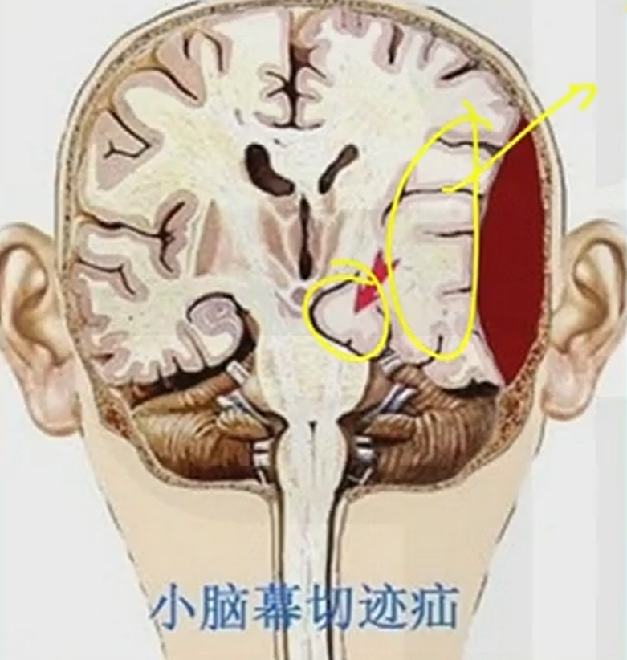
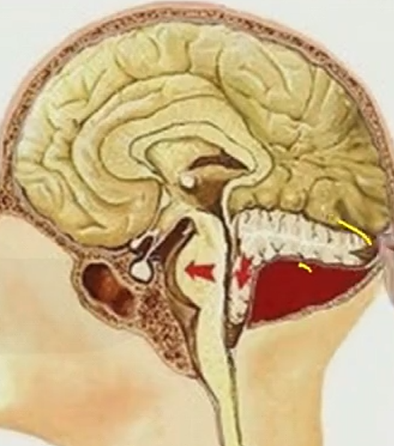
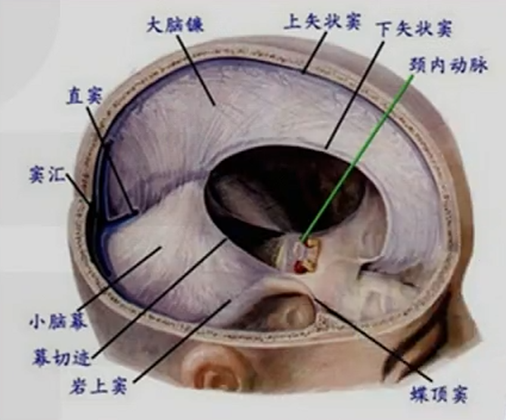

---
tags:
  - diagnosis
---
#### 分类
##### 按脑疝的部位分
###### 小脑幕切迹/裂孔疝（=颞叶疝）：
为<mark style="background-color: #1A4F10; color: white">颞叶的海马回、钩回</mark>通过小脑幕切迹被推移至幕下。
<mark style="background-color: #705A16; color: white">颞部硬脑膜外血肿</mark>易导致
[Open: Pasted image 20261005102300.png](attachments/6cc1e05057746f584833471719d8b60f_MD5.jpg)

1. 早期
- 颅内压增高：头痛、呕吐、视乳头水肿（三主征）。
- <mark style="background-color: #705A16; color: white">瞳孔</mark>：患侧瞳孔<mark style="background-color: #1A4F10; color: white">先缩小</mark>（[动眼神经](眼球运动神经.md)受刺激）。
- 意识：嗜睡、浅昏迷。
2. 中期（进展期）
- <mark style="background-color: #705A16; color: white">瞳孔</mark>：患侧瞳孔<mark style="background-color: #1A4F10; color: white">逐渐散大、光反射消失</mark>（动眼神经麻痹）。
- 运动：对侧肢体偏瘫。
- 意识：昏迷加深。
3. 晚期（终末期）
- <mark style="background-color: #705A16; color: white">瞳孔</mark>：双侧瞳孔<mark style="background-color: #1A4F10; color: white">散大固定</mark>（脑干受压）。
- 生命体征：出现[库欣反应](库欣反应.md)（血压升高、脉搏减慢、脉压增大），继而失代偿（血压下降、脉搏细弱、潮式呼吸），最终呼吸心跳停搏。
###### 枕骨大孔疝（=小脑扁桃体疝）：
为<mark style="background-color: #1A4F10; color: white">小脑扁桃体</mark>及延髓经枕骨大孔推挤向椎管内。
<mark style="background-color: #705A16; color: white">后颅凹肿瘤</mark>易导致。
- 由于<mark style="background-color: #1A4F10; color: white">脑脊液循环通路被堵塞</mark>导致颅内压增高，病人剧烈[头痛](头痛.md)、频繁[呕吐](呕吐.md)、颈项强直、强迫头位；
[Open: Pasted image 20261005102728.png](attachments/a92653769e980119bb69b5a19ff11255_MD5.jpg)

1. 运动障碍
- 肢体肌力减弱
- 肌张力增高
- 病理征阳性
→ 去脑干强直状态（脑干严重受损的信号）
2. [意识改变](意识障碍.md)
- 嗜睡 → 浅昏迷 → 深昏迷
3. 生命体征紊乱
- 脑干受压 → 脑干内生命中枢功能紊乱或衰竭
- 生命体征紊乱出现<mark style="background-color: #1A4F10; color: white">较早</mark>，意识障碍出现较晚；由于延髓的呼吸中枢受损，早期可突发呼吸停止而死亡。
> 如难以确诊或虽确诊而病因无法去除时，可选用下列姑息性手术：
> 1.侧脑室体外引流术；
> 2.脑脊液分流术；
> 3.减压术。
###### 大脑镰下疝
[Open: Pasted image 20261005101537.png](attachments/117602b6477f516cbbee16090ce3534c_MD5.jpg)

##### 按疝入的内容物分
###### 颞叶海马回、钩回疝
###### 小脑扁桃体下疝
###### 扣带回疝

#### 临床表现
① [意识障碍](意识障碍.md)（昏迷进行性加重）；
② 同侧瞳孔散大（动眼神经受压）；
③ 对侧肢体偏瘫（大脑脚受压）；
④ 最终呼吸循环衰竭（死亡）
（特别是小脑幕切迹疝）的危重表现/结局：<mark style="background-color: #1A4F10; color: white">偏瘫、昏迷、死亡</mark>；