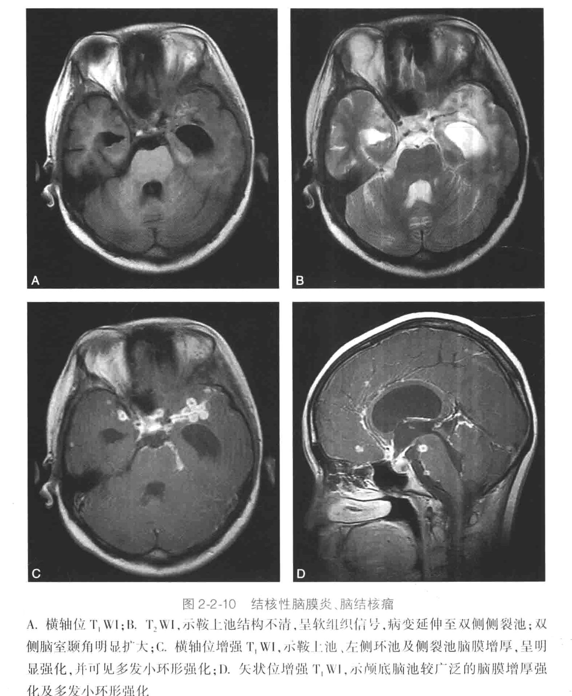

### [流脑](流脑.md)
### [真菌病](真菌病.md)新型隐球菌感染
（一般查艾滋病[HIV](HIV.md)）
### 结核性脑膜炎
见于[血源性结核病](血源性结核病.md)
#### 影像学
基底池脑膜强化
[266Open: Pasted image 20261016092017.png](attachments/e7f7c8815b3ce70ed386b121dac628b4_MD5.jpg)

#AI #comparison TBM的硬脑膜结核瘤（En-plaque tuberculoma） 在影像上可以完美模拟脑膜瘤，表现为硬膜基底、均匀强化、甚至出现“脑膜尾征”。
关键鉴别点在于内部信号和临床背景：
- T2信号：脑膜瘤通常在T2WI上呈等或稍高信号。而<mark style="background-color: #3F4B5E; color: white">结核瘤的核心（干酪样坏死）在T2WI上常呈现特征性的低信号</mark>，这是鉴别的重要线索。
- DWI信号：脑膜瘤通常无扩散受限。而结核瘤的DWI表现多样，如果内部发生液化坏死，也可出现扩散受限。
- 磁共振波谱（MRS）：结核瘤可出现特征性的脂质-乳酸峰，这有助于与脑膜瘤区分。
