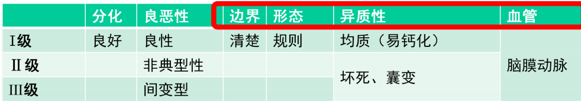
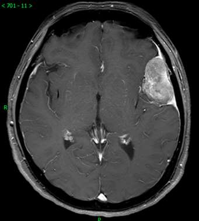

---
tags:
  - imaging
---
脑膜瘤是中枢神经系统中<mark style="background-color: #8B0000; color: white">唯一在女性中更常见的</mark>原发性肿瘤，其发病特征与体内激素水平密切相关。
#### 病理特点
脑外肿瘤（轴外），起源于<mark style="background-color: #1A4F10; color: white">蛛网膜粒帽细胞</mark>
好发于矢状窦旁、大脑凸面、蝶骨嵴、嗅沟、桥小脑角、大脑镰或小脑幕
少数在脑室内
边界清楚，包膜完整，多由脑膜动脉供血，常有钙化
##### 分级
Ⅰ~Ⅲ级
[Open: Pasted image 20261013203908.png](attachments/4ee2a6b6e5e2af227419b8621aabbe80_MD5.jpg)

##### 镜下：
漩涡状排列、[砂粒体](砂粒体.md)
#### 影像学：
<mark style="background-color: #8B0000; color: white">脑膜尾征</mark>（肿瘤细胞沿着硬膜浸润扩散，或者硬膜因附着牵拉产生反应性增厚与充血，在增强扫描时表现为肿瘤附着处硬膜增厚并明显强化，形似“尾巴”）、邻近骨质增生
[Open: Pasted image 20261013203737.png](attachments/aa785672fb3349f43ba0b8f4c4a779b9_MD5.jpg)

##### CT
①. 平扫肿块呈等或略高密度，常见<mark style="background-color: #1A4F10; color: white">斑点状钙化</mark>（沙粒体钙化：肿瘤细胞同心圆排列并逐渐钙化）。
②. 类圆形，边界清楚；
③. 多以广基底与硬膜相连；（这是脑外肿瘤的标志性特征）
④. 瘤周水肿轻或无，静脉或静脉窦受压时可出现中或重度水肿。（生长缓慢，脑组织有时间代偿适应）
⑤. 颅板受累引起<mark style="background-color: #1A4F10; color: white">骨质增生或破坏</mark>。肿瘤刺激邻近的骨膜，引发骨质增生（骨肥厚），这是脑膜瘤的典型特征；少数侵袭性强的脑膜瘤则直接破坏颅骨。
⑥. 增强扫描呈大多数均匀性显著强化：缺乏血脑屏障（脑膜血管本身就没有屏障）
##### MRI
①. 多位于脑实质外，T1WI呈等或稍高信号，T2WI呈等或高信号（细胞密集导致），高级别脑膜瘤出现坏死、囊变；
②. I级脑膜瘤均一性明显强化，非典型、间变型脑膜瘤可见斑片状不均匀强化并侵犯正常脑组织；可见<mark style="background-color: #705A16; color: white">★脑膜尾征</mark>（邻近脑膜增厚并强化）。
③. <mark style="background-color: #705A16; color: white">MRV（磁共振静脉成像）</mark>（脑膜瘤常侵犯静脉窦，导致管腔狭窄或血栓形成）能明确肿瘤对静脉(窦)的压迫程度及静脉(窦)内有无血栓
#### 鉴别诊断
①.根据上述CT和MRI表现，结合脑膜瘤的好发部位、性别和年龄特征，容易诊断。
②.少数表现非典型的脑膜瘤，需与星形细胞肿瘤、转移瘤和脑脓肿等鉴别。