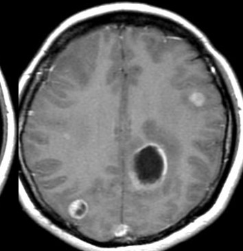

---
aliases:
  - 转移性脑肿瘤
tags:
  - Neurology
  - imaging
---
#### 流行病学
多发于中老年
#### 病理特点
顶枕区常见皮髓质交界区，血行转移
常多发，易出血坏死囊变（恶性肿瘤特征），瘤周水肿明显
#### 影像学
[Open: Pasted image 20261013205915.png](attachments/0939e7248679ea6a61982de4147a2635_MD5.jpg)

该MRI增强扫描图像展示了典型的“小病灶大水肿”特征，以及多发结节状、环形强化灶，高度符合脑转移瘤的表现。
##### CT表现
①. 位于皮髓质交界区；  
②. 脑内<mark style="background-color: #1A4F10; color: white">单发或多发结节，单发者较大</mark>；  
③. 常呈等或低密度灶，出血时密度增高；  
④. 瘤周水肿较重，特征为“小病灶大水肿”；  
⑤. 结节状或环形强化，多发者可呈不同形式强化。
##### MRI表现
①. 转移瘤<mark style="background-color: #1A4F10; color: white">一般T1低信号和T2高信号</mark>，瘤内出血则T1和T2均呈高信号（与出血期龄有关）；  
②. MRI更易发现脑干和小脑的转移瘤，增强扫描更敏感地发现小转移瘤。
##### 鉴别诊断
①. 多发性脑肿瘤；  
②. 多发性脑脓肿。