---
tags:
  - pharmacology
---
### 药物代谢动力学是研究药物在体内变化规律的学科
### （一）转运方式 ——脂溶扩散的规律与意义、pKa(pH的影响)。
#### 1. 滤过 ：
直径小于膜孔的水溶性极性或非极性药物借助膜两侧的流体静水压或渗透压而进行的跨膜转运，又称水溶扩散
#### 2. 简单扩散 ：脂溶性药物溶于脂质膜的跨膜转运是药物最常见的转运形式
##### (1)简单扩散的决定因素
##### 药物的 油水分配系数（脂溶性）
##### 膜两侧药物 浓度差
##### (2)主要影响因素：溶解性、解离性
##### 药物的溶解性：药物在水和脂质中的溶解度（药物的油水分配系数）
-脂溶性强的药物易于转运水溶性强的药物难以转运 <mark style="background-color: #705A16; color: white">油水分配系数大的药物易于转运</mark>
##### 药物的解离性
-大多数药物属于弱酸性或弱碱性药物。水溶液中非离子型药物解离为离子型药物，解离程度取决于溶液的 酸碱性。解离的药物水溶性更强、难以跨膜，未解离的药物脂溶性更强、易于跨膜
解离程度取决于—— 药物的解离常数（Ka）和溶液的酸碱度（pH）
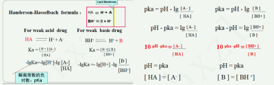
<mark style="background-color: #705A16; color: white">药物的解离度（pKa）</mark>：药物解离常数的负对数值即<mark style="background-color: #3F4B5E; color: white">药物解离程度为50%时所在溶液的pH</mark> 药物的解离度是药物的固有属性与药物本身的酸碱性无关（弱酸性pKa可以大于7.0，弱碱性药物pKa可以小于7.0）
##### <mark style="background-color: #705A16; color: white">“酸酸碱碱易吸收”</mark>
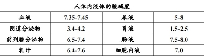
> 酸性药物解离度一般<7，在酸性环境中解离更少、容易吸收
> 碱性药物解离度一般>7，在碱性环境中解离的更少、容易吸收
> 减轻[[弱酸性药物]] [[苯巴比妥]] <mark style="background-color: #705A16; color: white">的中枢毒性—碱化细胞外液—小苏打</mark>
> 离子障：解离型药物被阻挡在细胞外，非解离型脂溶性可透过细胞膜
#### 3. 载体转运
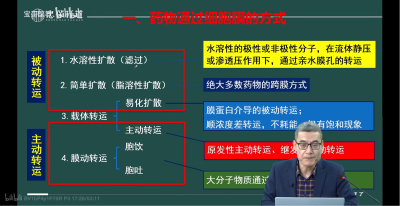
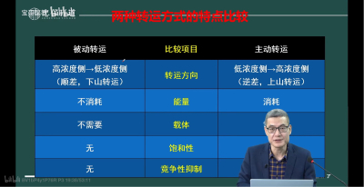
##### 主动转运
##### 易化扩散
##### 膜动转运（cytosis）胞吞胞饮
### （二）体内过程（Intracorporal Process）
#### 定义
<mark style="background-color: #705A16; color: white">注意四步体内过程并非按顺序发生，可能是同时发生。</mark>
#### 吸收
##### 药物的 吸收 ：药物从给药部位 <mark style="background-color: #705A16; color: white">进入血液循环</mark> 的过程
##### 药物吸收的速度和效率取决于转运的路径
一般来说： ~~静脉注射/静脉滴注~~ ＞吸入＞ 舌下 ＞直肠＞肌内注射＞皮下注射＞口服 （最方便经济） ＞透皮
> 静脉注射/血管内给药不存在“吸收”过程。

<mark style="background-color: #3F4B5E; color: white">各吸收途径特点——</mark>
##### 消化道吸收
包括口腔吸收（经口腔黏膜吸收）、胃吸收（弱酸性药物易吸收） 、小肠吸收（口服药物的主要吸收部位）、直肠吸收（ <mark style="background-color: #1A4F10; color: white">减轻药物首过消除</mark> ）
##### 消化道吸收才存在首过消除现象
##### 消化道吸收的影响因素：
##### 药物本身因素：药物的脂溶性 、药物的离子化程度 、药物的分子量
药物的剂型：片剂 / 胶囊 / 分散片 / 液体剂型 / 气雾剂粒径
##### 内环境的pH
##### 药物与消化道的接触时间和接触面积
消化道的蠕动 、排空 、内容物 （<mark style="background-color: #3F4B5E; color: white">四环素与肠道内Ca2+络合</mark>）、血流量
首过消除（First-Pass Elimation） 及其 影响因素
某些药物在首次通过肠黏膜 和 肝脏时部分被 <mark style="background-color: #705A16; color: white">代谢灭活</mark>而使得进入体循环的药量减少的现象
如Nitroglycerin首过消除可达90% 因此口服效果差而改用<mark style="background-color: #705A16; color: white">舌下含服</mark>等方式
> 硝酸甘油
#### 分布
药物吸收（进入血液循环）后，随血液循环分配到各组织中的过程称为分布。
大部分被动转运；分布是药物自血浆消除的方式之一
<mark style="background-color: #705A16; color: white">再分布（Redistribution）</mark>：药物先向<mark style="background-color: #705A16; color: white">血流量</mark>较大的器官组织分布然后向血流量相对小的组织器官<mark style="background-color: #705A16; color: white">转移</mark>的过程。
如麻醉药 [[Thiopental]] 先向血流量较大的脑组织分布后迅速产生麻醉效应然后又向脂肪组织转移后效应迅速消失。

> 药物与血浆蛋白结合的意义
> 白蛋白主要结合弱酸性药物；
> α1酸性糖蛋白主要结合弱碱性药物；
> 脂蛋白结合脂溶性强的药物

白酸结合（白醋）；酸碱结合；脂-脂结合
可逆；动态平衡
结合药：不具有效能、不能穿过膜、作为潜在的药物储备库、（不参与分布？），易发生更强的药物互作
结合时相对不具有选择性—— <mark style="background-color: #3F4B5E; color: white">*联合用药竞争排挤的结构基础*</mark>：高结合型的药物之间可能会竞争相同的血浆蛋白使得未结合药物的浓度、毒性增加。如Warfarin与Butazodine同时服用会导致竞争使得华法林血药浓度增高易发生出血；

> [[华法林]] [[保泰松]]
> 新生儿使用 [sulfonamide](磺胺药.md) 会与<mark style="background-color: #705A16; color: white">胆红素</mark>竞争血浆蛋白，引起<mark style="background-color: #705A16; color: white">新生儿黄疸</mark>；
> 当人体血浆蛋白含量变低时，药物的血药浓度↑ 更容易中毒

##### 影响药物分布的因素
##### 1.药物-血浆蛋白结合 （见上文）
##### 2.特殊屏障
机体中部分组织对药物的通透性具有特殊的屏障作用，主要是胎盘屏障、血眼屏障、血脑屏障（仅有脂溶性强、分子量小的药物可以穿过屏障进入中枢神经系统）
发生炎症时，屏障作用可能会下降，例如 [penicillin](青霉素.md)<mark style="background-color: #1A4F10; color: white">无法通过血脑屏障但在发生脑膜炎时，大剂量的青霉素有效</mark>
3.其他因素：血流量；毛细血管的通透性；所处环境的酸碱度；组织亲和性：药物在高亲和性的组织中分布更广，具有选择性、平衡性；脂溶性
#### 代谢
（1）定义：药物作为外源性物质在体内经酶或其他作用发生化学结构改变称为代谢/生物转化（biotransformation）。
（2）部位：大多为肝脏 ；胃肠道，肺，皮肤，肾脏等部位也可
（3）意义：药理活性或毒性改变——降低/升高
##### ①灭活（inactivation）：大多数药物经转化后失去活性
②激活：少数药物经过生物转化后出现药理活性，称为前药（pro-drug）
> 可的松，依那普利

因此，生物转化不能称之为“解毒过程”。
eg Codeine经过肝脏去甲基后变成吗啡而生效
③药物排出的重要方式：可以产生极性，增强水溶性，减弱活性，更易排出。
##### 某些药物经转化后生成的代谢产物仍具有药理活性或毒性：
[Propranolol](心得安.md) 的代谢产物4-OH Propranalol仍具有活性但更弱
[Phenacetin](非那西汀.md)的代谢产物[Acetaminophen](对乙酰氨基酚.md)活性比原来更强
[Isoniazid](异烟肼.md)的代谢产物Acetylisoniazid具有较强的毒性
##### （4）代谢的类型：2个时相，4种类型
##### I相：氧化、还原、水解
##### 在药物分子中引入或者脱去功能基团而生成极性增高的代谢产物
##### II相：结合反应
极性基团+内源性物质（葡萄糖醛酸、甘氨酸、磷酸）→结合产物：极性大，溶解性高，经尿排出
##### 多数药物代谢：先经Ⅰ相再经Ⅱ相
特例：[异烟肼](异烟肼.md)代谢，先经过Ⅱ相反应再经过Ⅰ相反应生成肝脏毒性代谢产物乙酰肼和乙酸
##### （5）肝药酶特点、肝药酶的诱导剂和肝药酶抑制剂
药物代谢酶：能够催化药物代谢的酶。
##### 专一性酶:乙酰胆碱酯酶，专一水解乙酰胆碱
##### 非专一性酶:肝药酶(肝细胞微粒体酶系)
主要为细胞色素P450单加氧酶系(CYP450)，存在于肝细胞微粒体和线粒体，亚铁血红素-硫醇盐蛋白超家族。参与内源性物质、外源性物质(药物、环境物质）的代谢。其中，<mark style="background-color: #1A4F10; color: white">CYP3A</mark>代谢50%以上的药物
<mark style="background-color: #3F4B5E; color: white">药物代谢酶特点——</mark>
##### 对底物选择性较差
##### 变异性、个体差异大
易受多种因素影响出现增强或减弱，结果体现为“诱导”与“抑制”。
##### <mark style="background-color: #705A16; color: white">药酶诱导剂enzyme inducer</mark>
使药酶的活性升高，加快 自身代谢和其他药物代谢 的药物叫做酶诱导剂，致耐受性。
[苯巴比妥](苯巴比妥.md)<mark style="background-color: #705A16; color: white">类药物</mark>的诱导作用强，可以加速抗凝血药物双香豆素的代谢
##### <mark style="background-color: #705A16; color: white">酶抑制剂enzyme inhibitor</mark>
使药物代谢酶活性降低，减慢 自身代谢和其他药物代谢的药物，致蓄积中毒。
例如：[[氯霉素]]通过减弱肝药酶的活性可以抑制[[甲苯磺丁脲]]和[[苯妥英钠]]的代谢
临床联合用药时，注意有诱导效应的药物不能突然停止用药，不然可能导致另一种被诱导加快代谢的药物蓄积中毒
##### 考试记住画红线的几个
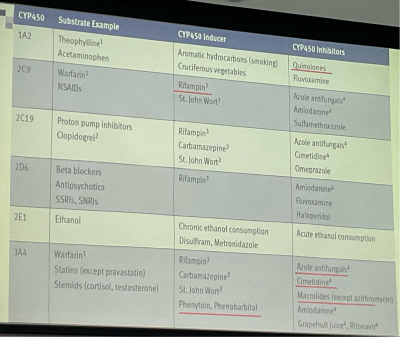
肝药酶诱导剂： [[利福平]]（结核病人吃避孕药仍易孕）、 [苯妥英钠](苯妥英钠)、[苯巴比妥](苯巴比妥.md)
肝药酶抑制剂： [[喹诺酮]]、azole antifungal唑类抗真菌药、 [[西咪替丁]]（甲腈咪胍，抗消化性溃疡药)、（except [azithromycin](阿奇霉素.md)）[[大环内酯类]]（[[阿奇霉素]]除外）
##### 具有一定的容量限制
饱和现象： [Paracetamol](扑热息痛.md) 通过葡萄糖醛酸或细胞色素P450酶代谢，产生的中间有毒产物与谷胱甘肽结合转化为无毒物质。 若过量服用，中间的有毒产物没有足够的谷胱甘肽结合，发生中毒
#### 排泄
药物以原型或代谢产物的形式经机体的排泄器官或分泌器官排出体外的过程。
药物消除 ：代谢 + 排泄，使体内药量减少。
<mark style="background-color: #705A16; color: white">药效终止：代谢、排泄、再分布。</mark>
器官：肾脏（最重要），胆道，肠道，唾液 ，乳汁（乳汁的pH略低于血浆弱碱性药物易从乳汁排泄） ，汗液，泪液，肺（挥发性药物）
##### 肾排泄的特点
##### 肾小球滤过：游离型药物及其产物
肾小管分泌：主动转运 ——逆浓度梯度、需要载体，存在竞争、饱和现象
i.<mark style="background-color: #1A4F10; color: white">青霉素G</mark>[[青霉素G]]与<mark style="background-color: #705A16; color: white">丙磺舒</mark>合用，丙磺舒竞争肾小管分泌青霉素的载体，使<mark style="background-color: #1A4F10; color: white">PG在体内留存时间更长</mark>。
ii.<mark style="background-color: #705A16; color: white">噻嗪类利尿药</mark>与<mark style="background-color: #705A16; color: white">尿酸</mark>竞争排出受体，会有引起痛风的不良反应
##### 肾小管重吸收
碱化尿液有利于排出酸性药物，酸化尿液有利于排出碱性药物。
消化道排泄：切断胆汁的肠肝循环可以大大缩短某些药物的半衰期，使得药物的作用时间增长。
##### 胆汁排泄
肝肠循环（Hepato-Enteral Circulation）：有的药物在肝细胞内与葡萄糖醛酸结合后分泌到胆汁中，随后排泄到小肠中被水解，游离药物再吸收进入体循环的过程 。因肠肝循环，使得血药浓度维持时间延长。
###### <mark style="background-color: #705A16; color: white">有肠肝循环的一些药物，血药浓度具有双峰</mark>
##### 影响因素
##### 体液流量：血流量增加时排泄的药物量增加
体液pH： pH升高时弱酸性药物解离增加、排泄增加，弱碱性药物解离减少、排泄减少
#### 小结——药物效应终止的途径 ：代谢、排泄、再分布
### （三）速率过程（Rate Process）
#### 时量曲线：组成和意义
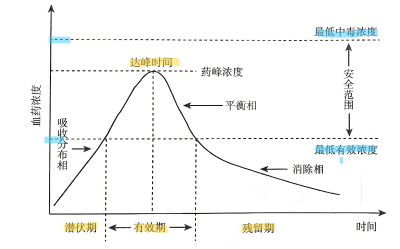
#### <mark style="background-color: #705A16; color: white">药物浓度-时间曲线（concentration-time curve,C-t）</mark>：给药后药物浓度随时间迁移而变化。以药物浓度（对数浓度）为纵坐标、时间为横坐标绘制曲线图得到的曲线
#### <mark style="background-color: #3F4B5E; color: white">先纵向看</mark>
#### 吸收相：吸收>消除，血药浓度逐渐上升
> 静脉注射时量曲线没有吸收相。
#### 峰浓度：吸收=消除
#### 消除相：吸收<消除，血药浓度逐渐下降
最低有效浓度、最低中毒浓度、安全范围（最低有效浓度——最低中毒浓度之间）
#### 平衡相
#### <mark style="background-color: #3F4B5E; color: white">再横向看</mark>
#### 潜伏期、有效期、残留期：按是否大于<mark style="background-color: #705A16; color: white">最低有效浓度划分</mark>
半衰期：血浆中药物浓度下降（至峰浓度的）一半所需要的时间。
#### 曲线下面积（Area Under the Curve AUC）
药物浓度-时间曲线和横坐标围的区域，表示一段时间内进入 血液循环 的总药量（药物在血浆中的相对累积量），是衡量药物吸收的相对数量的指标。
#### 计算生物利用度
#### 比较不同给药途径对药物吸收的影响
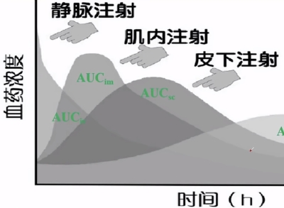
##### 不考虑首过消除（口服多给点量）：AUC相等
##### 峰浓度、起效时间：v m c o
##### 维持时间：o c m v
#### <mark style="background-color: #705A16; color: white">药物消除动力学</mark>——聚焦C-t曲线消除相
#### 关注消除相的“下降斜率”
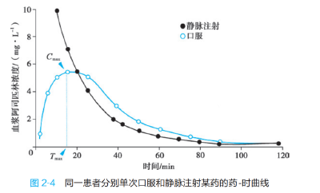
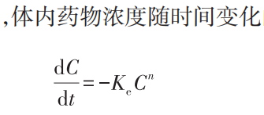
<mark style="background-color: #705A16; color: white">主要按n来划分类型</mark>：n=1时为一级消除动力学；n=0时为零级消除动力学。
C为微分时间段的初始体内药物浓度；t为时间；负号表示<mark style="background-color: #3F4B5E; color: white">降低</mark>。
#### Ke ：消除速率常数
#### <mark style="background-color: #705A16; color: white">消除速率类型</mark>
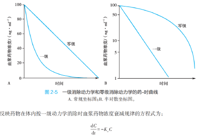
##### 一级速率消除（恒比消除）
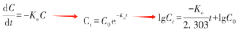
药物消除的速度（单位时间内消除的药量）与血浆药物浓度成正比， 每一次的消除量和当时的药物浓度是恒比的。“我每次就拿一半”
<mark style="background-color: #705A16; color: white">大部分药物</mark>在体内按一级速率消除。
Ke ：消除速率常数，反映体内各种途径消除药物的总和。
基本恒定，依赖于药物本身的理化性质和消除器官的功能状态。(基本上药定了Ke也就定了)
###### 数值大小反映药物在体内消除的速率
注意与“半衰期”概念相互理解：把“单位时间”中的“单位”看作药量消除一半时的时间，代入一级速率消除概念
时量曲线在半对数坐标纸上为直线，截距：lgC0。
##### <mark style="background-color: #3F4B5E; color: white">特点</mark>
###### 实时消除速率与实时药物浓度成正比“每次纳税与工资成正比”
###### C-t图指数衰减曲线，lgC-t图直线
一级速率半衰期恒定，与剂量无关，等于 ln2/Ke（消除速率常数）.积分后取对数，t=0时得到C0，再代入C=1/2C0，解得t1/2
一次给药的药时曲线下面积(AUC)与剂量成正比。
一次给药时,药物消除的百分率取决于半衰期，经4-6个t1/2药物基本消除。
定时定量多次给药时平均稳态血药浓度与剂量成正比。
##### 零级反应动力学（恒量消除）
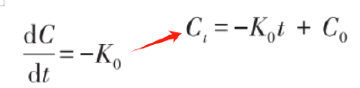
单位时间药物浓度按恒定的量消除。
原因：药物浓度 *（相比于机体对它的固有消除能力来说）* 太高，<mark style="background-color: #705A16; color: white">机体消除能力达饱和。</mark>
##### <mark style="background-color: #3F4B5E; color: white">特点</mark>
###### 消除速率与初始浓度无关“每个人无论工资纳税相同”
###### 时量曲线是直线，y截距：C0
###### 零级速率变化药物的半衰期随浓度变化而改变，等于 0.5C0/K
混合消除动力学（米—曼方程）
##### 取决于机体消除药物能力和体内药量的相对大小关系
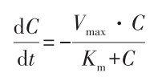 公式形态：鸡在河上飞
药物浓度高： C>><mark style="background-color: #705A16; color: white">Km</mark>，体内药量>><mark style="background-color: #705A16; color: white">机体代谢能力</mark>，忽略Km—→方式：零级消除动力学
药物浓度低 ：Km>>C，机体消除能力>>药量，忽略分母C—→方式：一级消除动力学
[苯妥英钠](苯妥英钠.md)、水杨酸、乙醇(酒喝太多：先零级，恒量消除；再一级，恒比消除)
#### 半衰期（Elimination half-life）
> 概念和意义

（从给药开始计时），血浆中药物浓度 下降（至峰浓度的） 一半所需要的时间。
##### 一级速率半衰期
##### 与血药浓度无关，恒等于<mark style="background-color: #1A4F10; color: white">0.693/Ke</mark>
##### <mark style="background-color: #3F4B5E; color: white">意义</mark>
###### ①药物分类：短效、中效、长效
②估计连续给药后达稳态所需时间（5个t1/2） 稳态血药浓度（steady-state concentration Css）/坪值（plateau）；
③估计停药后药物从体内消除所需时间（5个t1/2）。
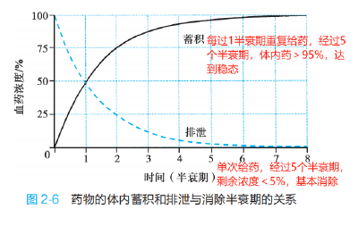
##### 零级速率变化药物的半衰期
等于0.5 C0/ K。
##### 不存在一级速率半衰期的几个意义
影响因素：肝肾功能、清除率、遗传因素（酶的活性）、疾病、药物间不良反应
#### 稳态血药浓度（steady-state concentration Css）/坪值（plateau）
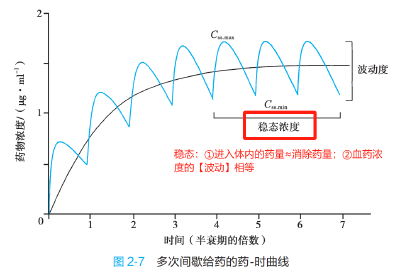
连续多次恒量（单位1，100%）给药，当给药速度与消除速度平衡时，达到的稳定浓度Css 。
##### 达到<mark style="background-color: #705A16; color: white">稳定状态</mark>（Css）的时间：仅取决于半衰期
##### 与给药量、间隔、给药途径均无关系
给药量、间隔、给药途径可以影响稳态浓度，但是不能影响达到时间：血药浓度的 波动幅度 取决于 给药间隔 。间隔长，波动大；间隔小，波动小. 坪值高低取决于给药剂量 。
相当于改变了等比数列求和公式中的C，但我们需要的Css是一个不含C的百分比。绝对浓度数值上去了，但反映状态稳定性和波动性的百分比不受影响。
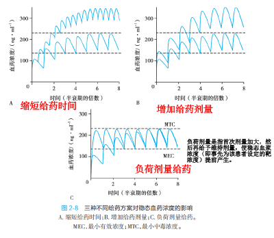
负荷剂量（loading dose）:首次剂量加大，然后再给予维持剂量，提前达到稳态血浆浓度（即事先为该患者设定的靶浓度）（但不能提前“稳定”，即不能提前达到稳态）。
按半衰期为间隔时间给药时，首次剂量加倍，可在用药后立刻达到稳态浓度（静脉注射时为1.44倍口服时为2倍），但此时不是稳态
##### <mark style="background-color: #705A16; color: white">C desired * Vd = loading dose</mark>
##### 药物剂量设计和优化
靶浓度：指有效而不产生毒性反应的治疗浓度范围(理想的Css范围)。确定靶浓度→计算给药剂量→制定给药方案维持量
维持量：进入体内的药物速度=体内药物消除速度。此时，给药速度=给药量/给药间隔时间
负荷量：口服给药的负荷量:首剂加倍、每隔1个半衰期给药一次；静脉滴注的负荷量:首剂1.44倍
首剂加倍：第一次用药量是常规剂量的2倍（200%），可使血药浓度迅速达到坪值。口服首剂加倍，静注1.44倍
#### <mark style="background-color: #705A16; color: white">药动学模型</mark>
#### 房室模型（Compartment Model）
#### 根据药物在体内转运速率的一致性可分为一室模型、二室模型、多室模型
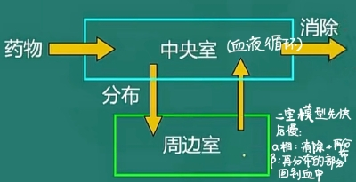
一室模型（one compartment model）：药物吸收入体后，迅速分布、很快在血液与各组织脏器之间达到动态平衡，即药物在全身各组织部位的转运速率相同或相似，此时把整个机体视为一个房室。
不是所有身体各组织在任何时刻的药物浓度都一样，而是各组织药物水平能随血浆药物浓度的变化平行地发生变化 。
二室模型（two compartment model）：药物吸收进入体内后，很快进入机体的某些部位，但在另一些部位，需要一段时间才能完成分布。从速率论的观点将机体划分为药物分布均匀程度不同的两个独立系统。
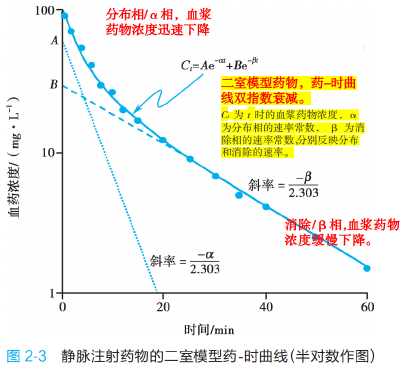
中央室（central compartment）：血流丰富、药物分布能瞬时达到与血液平衡的部分。
血管分布丰富、血液流速快、血流量大的组织器官：如血液、心脏、肝、脾、肺、肾等；
周边室（peripheral compartment）：血液供应较少，药物分布达到与血液平衡时间较长的部分。
##### 如骨骼、脂肪、肌肉等
多室模型（multiple compartment model） ：若在上述二室模型的基础上还有一部分组织、器官或细胞内药物的分布更慢，则可以从周边室中划分出第三房室，由此形成三室模型。针对在体内分布速率有多种水平的药物。
#### 药代动力学参数
##### 吸收指标
##### 达峰浓度（Cmax）、达峰时间（Tmax）
血管外给药后药物在血浆中的最高浓度值/峰值出现的时间，表示药物吸收程度/速度
###### 血管外给药途径、药物制剂均可影响药物吸收的程度和速度
临床上可应用缓释剂、控释剂、速释剂、透皮吸收贴剂控制药物释放，达到平稳的血药浓度和治疗效果
##### 曲线下面积（Area Under the Curve AUC）
药物浓度-时间曲线和横坐标围的区域，表示一段时间内进入血液循环 的总药量（药物在血浆中的相对累积量），是衡量药物吸收的 相对数量的指标。
不同公司相同剂量的相同药物AUC可能有较大差异——相对生物利用度，评价药物质量
###### 相同药物相同周期、不同剂量，AUC也不同
生物利用度（Bioavailibility BA/F）<mark style="background-color: #705A16; color: white">（“吸收入血度”）</mark>
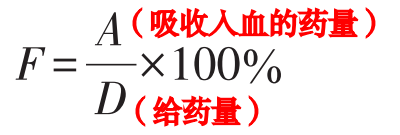
药物经 血管外给药 后能被吸收进入 体循环（血液循环） 的份量与速度。通常用<mark style="background-color: #705A16; color: white">绝对生物利用度</mark>表示，即吸收入血的药物量与给药量的比值，或血管外、内给药的曲线下面积的比 。
###### 衡量药物吸收入血的 速率和效果
从药量/药量→面积/面积
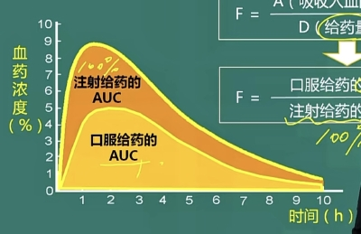
###### 绝对生物利用度F：评价药物吸收程度、速度（曲线陡缓）
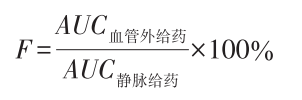
###### 相对生物利用度F’：药物是否合格，评价质量
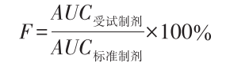
##### 生物等效性（ Bioequivalence BE/F’ ）
比较同一种药物的相同或者不同剂型，在相同试验条件下，活性成分吸收程度和速度是否相近。通常用<mark style="background-color: #705A16; color: white">相对生物利用度</mark> 表示。
评价药品制剂之间、生产厂商之间、批号之间的吸收药物量是否相近。
##### 分布指标
表观分布容积（Apparent Volume of Distribution Vd）
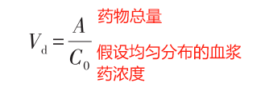
等于静注【给药量】D（mg）与C0零时血药最高【初始浓度】）mg/L的比
定义：假设当药物在体内按血药浓度 均匀分布时，需占有的体液容积。单位：L或L/kg。
是由药物本身决定的常数，反映药物的跨膜转运能力。
###### [Vd](表观分布容积.md)的<mark style="background-color: #3F4B5E; color: white">意义</mark>
<mark style="background-color: #3F4B5E; color: white">① 可以进行血药浓度与药量的换算</mark>；
###### <mark style="background-color: #705A16; color: white">调节临床用药剂量：</mark><mark style="background-color: #705A16; color: white">D=Vd x C</mark>
已知药量D1，Vd，推测血浆浓度；已知
###### <mark style="background-color: #3F4B5E; color: white">②反映药物在体内的分布情况</mark>
例：一个体重70kg的人，42L体液，其中药物依次接触到的是：血浆4L，组织液10L，细胞内液42L；
###### Vd 3-5L说明主要分布在血浆
例：[[甘露醇]] Vd=0.06L/kg. 乘以体重，得到体内共需要占据体液=0.06 x 70kg=4.2L,在血浆中利尿。
###### Vd 10-20L说明主要分布于细胞外液中
例：[[链霉素]] Vd=0.25L/kg. 乘以体重，得到体内共需要占据体液17.5L,在血浆和组织间液抗菌，对胞内细菌无效。
###### Vd 40L说明主要分布于全身体液中
例：[[异烟肼]] Vd=0.067L/kg. 乘以体重，得到体内共需要占据体液46.9L,在全身分布广泛，可以杀死胞内菌，抗结核杆菌首选药。
例：[[利福平]] Vd=0.97L/kg. 乘以体重，得到体内共需要占据体液67.9L,在脂肪+体液中。
###### Vd 100L全身+某一特定器官/组织中富集
###### 例：氯喹Vd=115L/kg. 肝肺脾
###### V d越大越难以排出
<mark style="background-color: #3F4B5E; color: white">③ 可以判断药物排泄速度</mark>。
Vd越大——药物体内分布越广——排泄越慢。
##### 消除指标
##### 消除速率常数（Ke）
单位时间内消除药物的分数，即一定血药浓度下药物消除速度与药物浓度的比。
反映药物在体内各种途径消除的总速率。基本恒定，只依赖于药物本身的理化性质与消除器官的功能
药物消除速率常数=0.5时，不代表半衰期为1h。半衰期为ln2/Ke因为计算半衰期时要考虑药物浓度随着清除而不断下降
##### 半衰期（Elimination half-life）
##### 清除率（CL）
单位时间内多少毫升血浆中的药物被清除。是肝清除率、肾清除率和其他消除途径清除率的总和 。
意义：反映肝肾功能。
肾脏清除率可以反映肾脏排泄药物的方式。若肾脏清除率>125mL/min说明存在额外的分泌；若<125mL/min说明存在重吸收
###### 一种药物清除率往往固定
###### 一级反应清除率=消除速率常数·表观分布容积
稳态血药浓度（steady-state concentration Css）/坪值（plateau）
