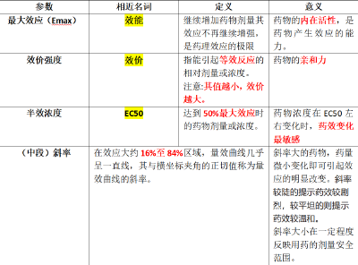
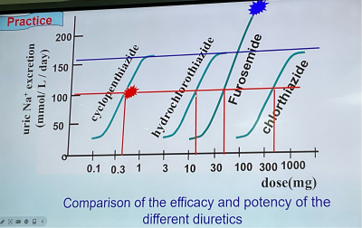

---
tags:
  - pharmacology
---
### 量反应

①形状：直方双曲线（<mark style="background-color: #1A4F10; color: white">原形</mark>） or S型曲线（<mark style="background-color: #1A4F10; color: white">对数形</mark>）
②斜率（多取量效曲线中段）：高斜率往往提示药物的药效剧烈、治疗窗较窄， “较小的药物剂量改变引起较大的效应变化 ”
> 曲线越陡，人们用药的剂量差别越小、越相似；曲线越平缓，人与人之间用药起效的剂量<mark style="background-color: #705A16; color: white">个体差别越大</mark>。

③最大效应/效能（maximal effect/efficacy, Emax） ： ~~*随着剂量或浓度的增加，效应也增加；*~~ 当效应增加到一定程度后，若<mark style="background-color: #705A16; color: white">继续增加药物浓度或剂</mark>量，效应不再继续增强，这一药理效应的极限称为最大效应或效能。
药物的效能主要取决于药物的 <mark style="background-color: #1A4F10; color: white">内在活性</mark> ：药物的特性、受配体亲和性
④半数最大效应浓度（EC50）：量反应中能引起50%最大效应的浓度
> 注意纵坐标投影也不在同一高度
##### ⑤效价强度（Potency Intensity）
能引起等效反应（ *纵坐标投影同一高度，* 一般 为50%效应量）的相对浓度或剂量。该剂量值越小，提示药物的效价强度越大。
与药物的亲和性、药物与受体的结合有关。
###### 药物的最大效应与效价强度无关
hydrochlorothiazide的效价强度大于furosemide，而后者的最大效应强于前者

> “药效有多强，和微量药物作用敏感度无关”

⑥个体差异性（Individual Variability）：相同剂量下不同个体的差异
⑦最小有效剂量/阈值剂量（minimal effective dose）：刚能引起效应的最小药物剂量或浓度
##### ⑧极量（最大有效量）、最小中毒量、最小致死量

##### ---
### 质反应

①形状：频率分布直方图；对称S型曲线（累计频率）
②斜率：人群差异性。斜率大表示人群差异性小
③半数有效量（Median Effective Dose, ED50）：能引起50%的实验动物（群体中半数个体）出现阳性反应时的药物剂量
区分： 半数最大效应浓度（EC50）： 量反应中能引起50%最大效应的浓度
④半数致死量（Median Lethal Dose, LD50）：能引起50%的实验动物死亡的药物剂量。 <mark style="background-color: #1A4F10; color: white">致死量越大，药物越安全</mark>
