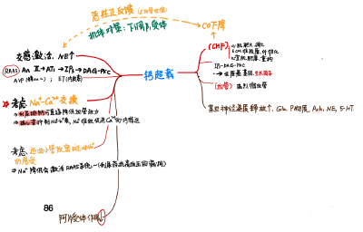
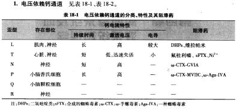
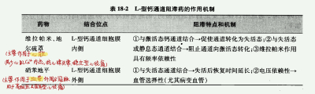
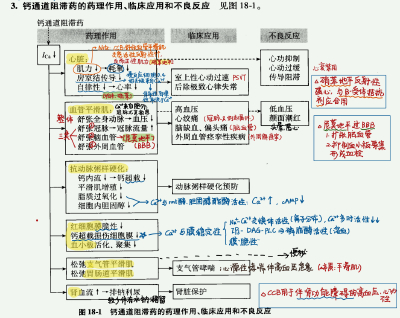
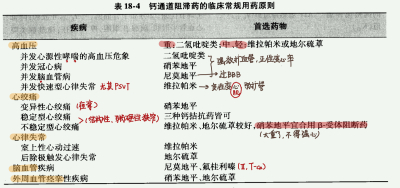
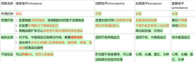

---
tags:
  - pharmacology
---
### 钙拮抗药（1）
#### 一、钙离子的生理意义、 钙通道的类型 与分子结构，钙拮抗药的分类。
##### 1. 钙离子的生理意义（看图）

Ca2+内流引起心肌兴奋-收缩偶联和 血管收缩；外钙诱导内钙释放；维持心室肌2相平台期
##### 钙超载引起细胞损伤
##### Na+-Ca2+交换作用
##### 2. 钙通道分类： 主要考虑L、T型
##### *钙通道特性*

（1）电压依赖性（不同亚型激活电阈不同）；（2）激活速度比钠慢；（3）对离子选择性低
##### 3. 钙拮抗药的分类
##### I类：选择L型

> Ia扩血管，Ib Ic稳心脏

Ia --二氢吡啶类 （dihydropyridines， DHPs ）：硝苯地平（nifedipine）、尼卡地平（nicardipine）、氨氯地平（amlodipine）
Ib--地尔硫䓬类 （benzothiazepines， BTZs ）：地尔硫䓬 （diltiazem）、克仑硫䓬（clentiazem）、二氯呋利（diclofurime）等。
Ic--苯烷胺类 （phenylalkylamines， PAAs ）：[[维拉帕米]] （verapamil）
II类：选择其它—— T型：米贝地尔 （mibefradil）
##### III类：非选择性
### 二、钙拮抗剂的作用 & 应用 & 不良： 对血管的作用 ；对其他平滑肌的作用；改善组织血流的作用；其他作用。

> 其实看我这个图就够了
1. 对心肌的作用——①负性肌力、负性频率、负性传导；②心肌缺血时保护作用
i.负性肌力作用：通过对于钙离子通道的阻滞使得心肌细胞的兴奋-收缩脱耦联 ，用此降低心肌耗氧量。但是钙通道阻滞剂可以舒缓血管平滑肌<mark style="background-color: #705A16; color: white">降低血压，从而反射性地引起交感神经的活性增强</mark>，抵消部分负性肌力作用，而硝苯地平因为此作用较强甚至可以表现出轻微的正性肌力
ii. 负性频率与负性传导作用：阻断钙离子通道，使得窦房结细胞0期和4期钙离子的内流速度减慢，因而减缓心率，减慢传导。
#### 2.对血管的作用
i.血管平滑肌：血管收缩时所需要的钙离子主要来自于细胞外，所以血管平滑肌对于钙通道阻滞药的作用很敏感，该药物作用于血管平滑肌的特点是使得血管明显舒张，同时<mark style="background-color: #3F4B5E; color: white">主要舒张动脉</mark><mark style="background-color: #3F4B5E; color: white">，对于静脉的相对影响较小</mark>。尤其是冠状动脉较为敏感，脑血管也较为敏感，而钙通道阻滞药同时还可以舒张 <mark style="background-color: #1A4F10; color: white">外周血管，解除痉挛</mark><mark style="background-color: #1A4F10; color: white">。</mark>
ii. 其他平滑肌的作用：对于<mark style="background-color: #3F4B5E; color: white">支气管平滑肌的松弛作用较为明显</mark>，较大剂量也能松弛胃肠道，输尿管以及子宫平滑肌
#### 3. 抗动脉粥样硬化的作用
i. 减少钙离子内流，降低钙超载导致的动脉壁损害
##### ii. 抑制平滑肌增殖和动脉基质蛋白的合成，增加血管壁的顺应性
##### iii. 抑制脂质的过氧化，保护内皮细胞
iv.<mark style="background-color: #705A16; color: white">[[硝苯地平]]</mark>可以增加细胞内cAMP的含量，提高溶酶体和胆固醇的水解活性，有助于动脉壁脂蛋白的代谢，从而降低细胞内的胆固醇水平。
#### 4.对红细胞以及血小板结构和功能的影响
> 减轻红细胞损伤、抑制血小板聚集

i. 对于红细胞的影响：抑制钙离子内流，减轻钙离子超负荷时对于红细胞的损伤
ii. 对于血小板活化的抑制作用：能够抑制血小板聚集
5.对于肾脏功能的影响：舒张血管和降低血压的作用<mark style="background-color: #705A16; color: white">不伴有水钠潴留、反而增加肾血流量</mark>，因而对肾功能有保护作用。
### 三、常用钙拮抗药：[[硝苯地平]]、氨氯地平、尼莫地平（L-Ia）、地尔硫卓（L-Ib）、[[维拉帕米]]（L-Ic）等的作用特点。

> 稳定型心绞痛又称为劳累型心绞痛；不稳定型心绞痛是因冠状动脉粥样硬化斑块形成、破裂、张力增高引起，千万不得强心。

高血压兼有冠心病、肾病/需要保护肾（[[硝苯地平]]），伴<mark style="background-color: #3F4B5E; color: white">脑血管病</mark><mark style="background-color: #3F4B5E; color: white">（尼莫地平、氟桂利嗪）</mark>，伴<mark style="background-color: #3F4B5E; color: white">快速性心律失常</mark><mark style="background-color: #3F4B5E; color: white">（[[维拉帕米]]）</mark>
> link：※[[维拉帕米]]、地尔硫卓见“抗心律失常药-IV类”；硝苯地平见“抗高血压药”。
#### Ia扩血管、正变心，Ib、Ic负变心
#### <mark style="background-color: #705A16; color: white">硝苯地平交感反射性强心，应与β受体拮抗剂合用</mark>
地平比较：注意硝苯地平短效，氨氯长效；仅硝苯地平降压太强，反射性心动过速

### *四、药物相互作用*
药代动力学：血浆蛋白结合率高；口服均能够吸收，首过效应较强，生物利用度很低，<mark style="background-color: #1A4F10; color: white">氨氯地平</mark>是其中生物利用度最高、<mark style="background-color: #705A16; color: white">最长效</mark>的种类
[[地高辛]] ↑ ： CCB提高地高辛血药浓度；维拉帕米减少地高辛经肾小管消除，二者合用可能过度抑制心脏（PPT：维拉帕米与地高辛合用应减少地高辛的剂量）
#### 克拉霉素 x ：不得与CCB合用，肾损伤、低血压
#### [[西咪替丁]] ↑： C CB使其半衰期延长
#### [[奎尼丁]] <mark style="background-color: #3F4B5E; color: white">↓</mark> ：硝苯地平降低奎尼丁血药浓度
