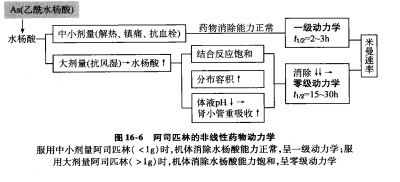
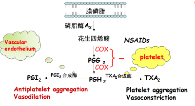
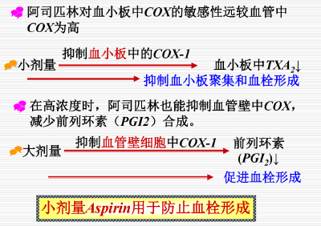
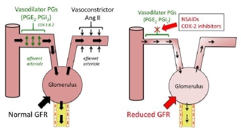
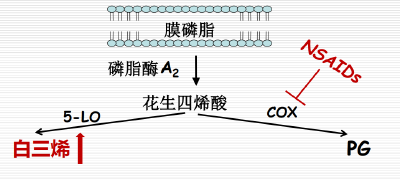

---
aliases:
  - Aspirin
tags:
  - pharmacology
---
### 体内过程
#### 注意几个特点
#### 吸收 ：
<mark style="background-color: #3F4B5E; color: white">口服</mark>迅速吸收，边吸收边代谢，迅速被<mark style="background-color: #3F4B5E; color: white">水解</mark>为水杨酸（因此<mark style="background-color: #3F4B5E; color: white">血药浓度低</mark>，t1/2为15min）；
> 吸收的过程中就在快速被代谢
#### 分布 ：
血浆蛋白结合率高达80~90%；可与其他药物竞争蛋白结合位点（△ 药物相互作用的药理学基础 ）
#### 代谢 ：
主要肝脏；<mark style="background-color: #1A4F10; color: white">非线性动力学</mark>

##### 混合动力学模式
<mark style="background-color: #1A4F10; color: white">中小剂量解热镇痛抗炎</mark>：口服Aspirin≤1g时，按一级动力学消除（恒比消除），t1/2= 2-3 h
<mark style="background-color: #1A4F10; color: white">大剂量抗风湿</mark>：口服Aspirin≥1g时，按零级动力学消除(恒量消除)，t1/2=15-30 h （容易中毒）
大剂量治疗风湿、类风湿时，应根据患者的反应及血药浓度监测确定给药的剂量及间隔时间
#### 排泄：
##### <mark style="background-color: #705A16; color: white">尿液的pH</mark>对水杨酸盐的排泄影响很大
药物过量中毒时，①可利用NaHCO3碱化尿液，使排泄加速，降低血药浓度；<mark style="background-color: #1A4F10; color: white">②可改变分布</mark>
### 药理作用与临床应用：
##### 解热、镇痛、抗风湿、抑制血小板聚集作用
###### 解热、镇痛：有较强的[解热](解热.md)、[镇痛](镇痛.md)作用
> 常与其他解热镇痛药配成复方，用于<mark style="background-color: #3F4B5E; color: white">头痛、牙痛、肌肉痛、痛经、感冒发热、神经痛</mark>；
##### 抗炎、抗风湿 ：作用<mark style="background-color: #1A4F10; color: white">较强</mark>
用于急性风湿热，有鉴别诊断、治疗作用；
也是<mark style="background-color: #705A16; color: white">治疗类风湿性关节炎的首选</mark><mark style="background-color: #705A16; color: white">药</mark>物；
用于抗风湿时，最好用至<mark style="background-color: #3F4B5E; color: white">最大耐受剂量</mark>，一般成人每日3～5g，分4次于饭后服用
##### 影响血小板的功能
###### ～不可逆、小剂量、治疗 <mark style="background-color: #705A16; color: white">妊娠高血压（减少TXA2生成）</mark>
> 注意对血小板影响不可逆；剂量平衡

<mark style="background-color: #705A16; color: white">不可逆地</mark>抑制COX，血小板 无细胞核，不能再合成新的 COX，因此<mark style="background-color: #3F4B5E; color: white">血小板中COX</mark>对阿司匹林的<mark style="background-color: #3F4B5E; color: white">敏感性</mark>要远比血管内皮中的COX高
###### 注意PGI2与TXA2的相互拮抗本来是构成了一个平衡
低浓度，不可逆地抑制血小板中的COX→血小板中TXA2生成↓→<mark style="background-color: #3F4B5E; color: white">抑制血小板聚集和血栓生成</mark>；
高浓度，也抑制血管内皮细胞中的COX→PGI2生成↓→促进血栓生成。
因此，小剂量的阿司匹林可用于防止血栓生成

### 不良反应和应用注意
> 记：COX-1的几个作用——肾、胃、血管凝血；再加上三个特殊反应：水杨酸反应、瑞夷综合征、阿斯匹林哮喘、过敏。

用于解热镇痛时剂量较小，短期应用不良反应较轻；<mark style="background-color: #1A4F10; color: white">用于抗风湿时剂量较大，长期应用不良反应多且重</mark>
#### 胃肠道反应
> 直接刺激、减少PGE2保护

发生率<mark style="background-color: #3F4B5E; color: white">高</mark>，表现为恶心、呕吐、上腹不适；较大剂量/长期服用易诱发[胃炎](胃炎.md)、[胃溃疡](胃溃疡.md)、胃出血
##### 机制
<mark style="background-color: #3F4B5E; color: white">口服</mark>直接刺激胃黏膜；（弱酸性）
<mark style="background-color: #3F4B5E; color: white">浓度高</mark>时，刺激延髓催吐化学感受区（CTZ），引起[呕吐](呕吐.md)；
抑制了PG（PGE2）对胃黏膜的保护作用。
#### 凝血障碍
※<mark style="background-color: #3F4B5E; color: white">严重肝病、低凝血酶原血症、维生素K缺乏、血友病患者禁用，产前/手术前禁用</mark>
一般剂量引起<mark style="background-color: #705A16; color: white">TXA2/PGI2比值</mark>下降，抑制血小板聚集，延长出血时间；
较大剂量/长期应用还可引起凝血障碍，加重出血倾向。
###### 机制
不可逆地抑制COX，对血小板合成TXA2有强大、持久的抑制作用，合成TXA2能力恢复需到新生血小板补充；血管内皮有合成COX的能力，因此阿司匹林对PGI2的合成抑制弱而短暂，使PGI2的作用占优势。
##### 对肾脏的影响
对正常人群影响小，对特殊人群（老年人及心、肝、肾功能受害者）易导致水肿、多尿等肾小管功能受损的表现
机制：病人原本体内存在隐性肾脏损害和肾小球灌注不足，抑制PGs合成，<mark style="background-color: #1A4F10; color: white">取消了前列腺素的代偿扩肾血管机制</mark>，而出现水肿等症状

##### 水杨酸反应（中枢症状）
> 碳酸氢钠解救

<mark style="background-color: #1A4F10; color: white">用量过大</mark>时，可引起<mark style="background-color: #3F4B5E; color: white">头痛、恶心、呕吐、视听减退</mark>等症状，总称为水杨酸反应；
严重时可出现<mark style="background-color: #3F4B5E; color: white">过度换气、酸碱失衡、精神错乱</mark>。
治疗：立即停药，静滴<mark style="background-color: #1A4F10; color: white">碳酸氢钠溶液</mark>以碱化尿液，加速排泄；对症支持治疗
某些哮喘患者服用后可诱发“阿司匹林哮喘”（<mark style="background-color: #3F4B5E; color: white">并非抗原-抗体反应为基础的过敏反应</mark>，而与PG合成受抑制有关）
> 抗组胺、糖皮质激素解救

机制：因PG合成受阻 ，由AA生成的白三烯及其他<mark style="background-color: #705A16; color: white">脂氧酶</mark>代谢产物增多，内源性支气管收缩物质占优势（<mark style="background-color: #3F4B5E; color: white">使用</mark><mark style="background-color: #705A16; color: white">抗组胺药和糖皮质激素</mark><mark style="background-color: #3F4B5E; color: white">治疗</mark>）

##### 过敏反应
少数患者可出现荨麻疹、血管神经性水肿、过敏性休克等症状
###### <mark style="background-color: #3F4B5E; color: white">※哮喘、鼻息肉、慢性荨麻疹患者禁用</mark>
##### <mark style="background-color: #705A16; color: white">瑞夷综合征</mark><mark style="background-color: #705A16; color: white">*Reye’s syndrome*</mark>
> 病毒发热儿童肝性脑病？换用对乙酰氨基酚。

病毒感染伴发热的儿童服用该药后，偶可发生严重的<mark style="background-color: #705A16; color: white">肝衰合并脑病</mark>的表现（惊厥、谵妄、[昏迷](昏迷.md)，死亡率较高，少见但预后恶劣）
<mark style="background-color: #3F4B5E; color: white">※病毒感染患儿（流感、水痘、麻疹、流行性腮腺炎等）不宜使用，换用</mark><mark style="background-color: #1A4F10; color: white">对乙酰氨基酚</mark>
