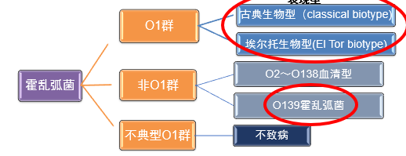

---
tags:
  - infection
---
霍乱是由霍乱弧菌引起的烈性肠道传染病，是我国甲类传染病
#### 病原学
霍乱弧菌是<mark style="background-color: #1A4F10; color: white">革兰阴性</mark>弧形或逗点状杆菌，<mark style="background-color: #1A4F10; color: white">无芽孢</mark>，仅 O139 型有荚膜，有鞭毛，运动活跃。
最适温度是 37℃，在碱性环境中生长较快 对热、干燥、酸性环境及消毒剂敏感。自然环境中存活时间较长。
含有菌体抗原“O”（特异性高、分群和型的基础）鞭毛抗原“H”（共有）
##### 霍乱弧菌的两种生物型和三种血清型
三种血清型：稻叶型（原型）小川型（异型）彦岛型（中间型）
两种生物型：古典生物型、埃尔托生物型
> 仅 O1 群和非 O1 群中的 O139 血清型才能引起霍乱

[Open: Pasted image 20260928091549.png](attachments/a13e8ef4492bff64834804f5621bcadf_MD5.jpg)

#### 流行病学
1817 年以来七次霍乱大流行：
- 1-5：古典生物型 
- 6：El Tor 生物型 
- 7：El Tor+O139
地方性：存在地方性疫源地（古典型 印度恒河三角洲 El Tor 型 苏拉威西岛） 我国沿海。
季节性：夏秋季，以 7-10 月为多
周期性：国内无明显周期性
##### 传染源、传播途径和易感人群
传染源：带菌者；病人（排菌时间<mark style="background-color: #1A4F10; color: white">5 d，最长 2 周</mark>；重型病人排菌量大，是重要传染源）
传播途径：<mark style="background-color: #1A4F10; color: white">粪口</mark>传播（水、食物、苍蝇、生活接触）
易感人群：普遍易感
#### 发病机制和病理变化
发病取决于自身免疫力（胃酸分泌）、霍乱弧菌的入侵数量及致病力（毒素协同调节菌毛 TcpA—定居；<mark style="background-color: #1A4F10; color: white">霍乱肠毒素（CT）</mark>）
##### 发病过程：
霍乱弧菌突破胃酸屏障进入小肠➡️穿过肠黏膜的肠黏液层（鞭毛+蛋白酶）➡️黏附于小肠上段的黏膜上皮细胞（TcpA+血凝素）（不侵及肠黏膜下层）➡️小肠碱性环境中大量繁殖，产生霍乱肠毒素引起小肠粘膜功能失调（致病关键）
<mark style="background-color: #1A4F10; color: white">肠毒素</mark>：A1 亚单位促进细胞内 cAMP 大量产生➡️刺激肠黏膜隐窝细胞分泌水、氯化物和碳酸盐并抑制绒膜细胞吸收钠和氯离子➡️水和 NaCl在肠腔积聚➡️<mark style="background-color: #1A4F10; color: white">米泔水样便</mark>（等渗高钾高碳酸氢盐）、水和电解质紊乱、酸中毒
##### 病理变化：
- 严重脱水表现（皮肤干燥、皮下组织肌肉干瘪、实质脏器缩小）；
- 脏器实质损害轻；
- 小肠明显水肿
#### 临床表现
<mark style="background-color: #705A16; color: white">潜伏期</mark>：一般为 1-3 天，分为轻型、中型、重型和爆发性（中毒型/干性霍乱=暴发型）
<mark style="background-color: #705A16; color: white">泻吐期</mark>：剧烈[腹泻](腹泻.md)：量多次频，粪臭不明显，少有腹痛（O139 型除外）；无里急后重，<mark style="background-color: #1A4F10; color: white">“米泔水”样便</mark>；剧烈[呕吐](呕吐.md)（喷射性，不伴恶心，吐“米泔水”样）
<mark style="background-color: #705A16; color: white">脱水期</mark>：脱水（霍乱[面容](面容.md)、循环衰竭、洗衣工手、舟状腹）；肌肉痉挛（腹直肌和腓肠肌明显）；低血钾（肌张力下降、腱反射消失、鼓肠、心律失常）；[尿毒症](尿毒症.md)、酸中毒（呼吸加快伴意识障碍）；循环衰竭：低血容量性[休克](休克.md)
<mark style="background-color: #705A16; color: white">恢复期</mark>：脱水纠正，症状消失，体温上升（内毒素入血，1-3 d 自行消退）

| 临床表现       | 轻型                   | 中型                    | 重型                   |
| ---------- | -------------------- | --------------------- | -------------------- |
| 便次与性状      | 10次以下有粪质             | 10-20次无粪质米泔样          | 20次以上                |
| 意识         | 正常                   | 淡漠                    | 烦躁                   |
| 皮肤         | 正常或弹性略低              | 干燥，缺乏弹性               | 无弹性                  |
| 眼窝 / 指纹    | 稍陷 / 不皱              | 下陷 / 皱瘪               | 深陷 / 干瘪              |
| 肌痉挛        | 无                    | 有                     | 严重痉挛                 |
| 脉搏         | 正常                   | 细速                    | 微弱而速                 |
| 收缩期血压      | 正常                   | 70~90mmHg             | 70mmHg 以下            |
| 24小时尿量     | 略少                   | <500ml                | <200ml 或无尿           |
| 脱水程度（相当体重） | 成人 2~3%   儿童 5%以下 | 成人 4~9%   儿童 5~10% | 成人 8%以上  儿童 10%以上 |
#### 实验室检查
##### 一般检查：
血常规：感染血象、血液浓缩象（红细胞、血红蛋白增加）；
血生化：电解质紊乱（低钾、低碳酸氢根、酸中毒）、急性肾衰竭（尿素氮、肌酐增加）；
尿常规：少许蛋白，红、白细胞和管型；
大便常规：水样便，可有黏液，少许红细胞、白细胞。
##### 病原学检查
大便涂片：可见革兰阴性弧菌，呈“鱼群状”排列；
动力试验：暗视野镜下见“穿梭运动”（<mark style="background-color: #1A4F10; color: white">制动试验</mark>：加O1群、O139群抗血清，活动下降）；
大便培养：分离鉴定菌型（碱性，pH 8.6）；
快速辅助检测：胶体金快速检测法（测<mark style="background-color: #1A4F10; color: white">O1群、O139群抗原</mark>成分）；
PCR检测：测毒素基因；
血清学：<mark style="background-color: #1A4F10; color: white">抗凝集素抗体</mark>四倍升高（双份）有意义，可用于流行病学的追溯诊断和粪便培养阴性可疑病人的诊断.
#### 并发症
急性肾衰竭：低血容量休克引起肾小管缺血性坏死；
急性肺水肿：代谢性酸中毒致肺循环高压和肺水肿。
#### 诊断
流行地区和流行季节时任何腹泻患者均应考虑，均需大便检查排除；
- 疑似病例：典型表现但无病原学证据，或密切接触史伴腹泻呕吐的，应报告隔离消毒，大便培养二次阴性可以否定；
- 确诊病例（满足一条）：腹泻且大便培养阳性；流行地区、流行季节、典型症状且血清凝集试验抗体四倍升高；无相关症状但粪便培养阳性，且在粪检5天前有腹泻表现；
- 带菌者：无临床症状但粪便、呕吐物或肛拭子培养阳性。
#### 鉴别诊断
##### 细菌性食物中毒
主要病原菌包括副溶血性弧菌、葡萄球菌、变形杆菌、蜡样芽胞杆菌等，由于细菌在食物中产生肠毒素，人进食后发病。起病急骤，有食用海（水）产品或不洁食物史，潜伏期短，常先吐后泻，排便前往往有肠鸣、阵发性腹部剧痛，粪便为黄色水样便，偶带脓血。收集患者粪便、呕吐物或可疑食物可检出相应的病原菌。
##### 急性[细菌性痢疾](细菌性痢疾.md)
由志贺菌侵袭肠黏膜，引起肠黏膜炎症及溃疡，并排出炎性渗出物。临床表现以发热、腹痛、腹泻、里急后重、黏液脓血便为主要特征，有全身中毒症状。急性中毒性细菌性痢疾可出现高热，在儿童患者早期出现烦躁、谵妄、惊厥等，初期肠道症状不明显，成人患者主要表现为脓血便频繁、循环系统症状明显。从粪便或肛拭子等标本中检出志贺菌可确诊。
##### 大肠埃希菌性肠炎
分为：①产肠毒素大肠埃希菌性肠炎，潜伏期四至二十四小时，有发热、恶心呕吐及腹部绞痛，黄水或清水样便，无脓血便，严重腹泻者亦可产生重度脱水，婴幼患儿常因此而危及生命；②肠致病性大肠埃希菌性肠炎，主要症状为腹泻，粪便为黄色或黄绿色蛋花样便，量较多，常有特殊腥臭味，重者也会有脱水及全身症状。两者粪便培养均可获得相应的大肠埃希菌。
##### 病毒性肠炎
常见病原体为人轮状病毒，侵犯各年龄组，多见于婴幼儿，好发于秋冬季，可呈流行性，部分患者同时伴有上呼吸道感染症状及发热，中毒症状轻，常为自限性，粪便稀软或黄水样，临床表现与轻型霍乱相似。粪便培养霍乱弧菌阴性，轮状病毒检查阳性。其他如诺如病毒、腺病毒、冠状病毒和星状病毒等也可引起腹泻。
#### 治疗方法
严格隔离：甲类传染病隔离，确诊疑似分别隔离至症状消失且隔日大便培养连续二次阴性；补液治疗：早期、迅速、足量。
<mark style="background-color: #1A4F10; color: white">口服补液</mark>适用于轻度脱水或病情稳定呕吐停止的重症患者，使用口服补液盐补液，最初六小时，成人每小时七百五十毫升，幼儿每小时每公斤十五至二十五毫升；之后每六小时按前六小时泻吐量一点五倍补液。
<mark style="background-color: #1A4F10; color: white">静脉补液</mark>适用于中重度脱水和呕吐不能口服补液的患者，使用541液（五克氯化钠、四克碳酸氢钠、一克氯化钾），先盐后糖、先快后慢、纠酸补钙、见尿补钾（补钾浓度不能超过0.3%）。

| |轻型|中型|重型|
|---|---|---|---|
|**成人 ml/d**|3000-4000|4000-8000|8000-12000|
|**儿童 ml/kg**|100-150|150-200|200-250|
|**速度 ml/min**|3-5|5-10|初 40-80 后 20-30|
抗菌治疗：仅作为液体治疗的辅助治疗，环丙沙星、诺氟沙星、多西环素、复方新诺明。
对症治疗：纠酸、低血钾、[休克](休克.md)，<mark style="background-color: #1A4F10; color: white">抗肠毒素</mark>（[氯丙嗪](氯丙嗪.md)、黄连素），抗肺水肿、心衰。
#### 预后
受霍乱菌型、病情轻重、治疗与病人情况影响，常死于循环衰竭和[急性肾功能衰竭](急性肾功能衰竭.md)。
#### 预防措施
管理传染源：建立健全肠道门诊，隔离病人，检索好疫源，接触者观察五天，留便培养和服药预防；切断传播途径：饮水消毒，食品管理，环境卫生；保护易感人群：流行时接种霍乱疫苗。
