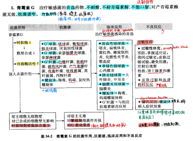
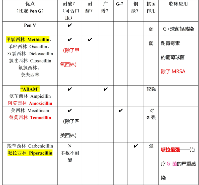
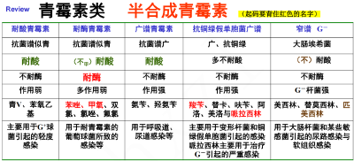
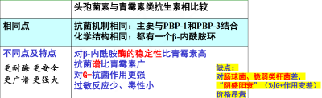
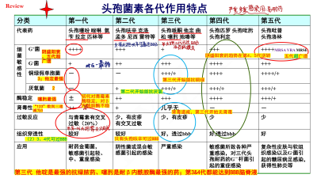
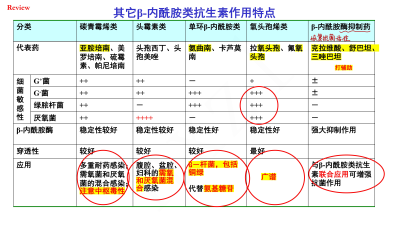
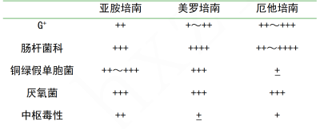
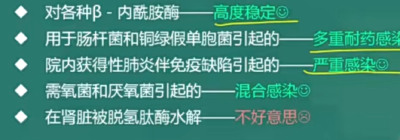
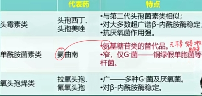
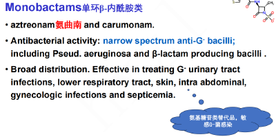

---
aliases:
  - penicillin
  - penicillins
tags:
  - pharmacology
  - infection
---
### β-内酰胺类抗生素特殊药
本章特殊药：青霉素G与<mark style="background-color:#fef3c7;"> 丙磺舒 </mark>合用时→ 竞争性抑制青霉素在肾小管的分泌→延长作用时间 
本章“首选”与“最”：<mark style="background-color:#fef3c7;"> 哌拉西林Piperacillin </mark> 对铜绿假单胞菌的抗菌作用<mark style="background-color:#fef3c7;"> 最强 </mark> ，但不耐酶——合用  克拉维酸 
#### 1 <u>.青霉素G(penicilline-G)</u>

#### <u>（1）理化特性、体内过程</u>
即配即用：易溶于水水溶性稳定性差；抗原性（降解产物易过敏，link过敏性休克原理）
#####  不耐酸、不耐酶、 不能口服，易被消化酶破坏
吸收：不宜口服， 注射 给药；
分布：主要分布于细胞外液。炎症时可进入脑脊液 （aka脑膜炎可用青霉素） 、房水。
##### 排泄：90%由 肾小管 分泌排出，PAE短
当与<mark style="background-color:#fef3c7;"> 丙磺舒 </mark>合用时→ 竞争性抑制青霉素在肾小管的分泌→延长作用时间 
为延长青霉素G作用时间——采用水溶性弱的普鲁卡因青霉素（procainebenzyl penicillin）和长效苄星青霉素（benzathine benzylpenicillin）只用于轻症和预防
#### <u>（2）抗菌作用</u>
##### 抗菌力：  杀菌 ，繁殖期
抗菌谱—— <mark style="background-color:#fef3c7;"> 记“G+球G+杆G-球G-杆 + 其它”，后面的药就依次打叉 </mark>
G+球菌 ——链球菌、葡萄球菌、肺炎球菌；（金葡易耐药）
G+杆菌——白喉杆菌、炭疽杆菌、破伤风梭菌、产气荚膜梭菌、肉毒杆菌、乳酸杆菌等；
G-球菌——脑膜炎球菌、淋球菌
 对G-杆菌很弱/无效（~窄谱）——打不了铜绿假单胞菌 
其他病原体—— 螺旋体 、放线菌
#### <u>（3）临床用途：敏感菌（革兰阳性球菌、杆菌 ；革兰阴性球菌 ；螺旋体）感染的</u> <mark style="background-color:#fef3c7;"> <u>首选药</u> </mark>
##### 链球菌感染（Streptococcal Infection）
溶血性链球菌：猩红热  咽炎扁桃体炎败血症 蜂窝组织炎丹毒
######  草绿色 链球菌：心内膜炎（青霉素+链霉素）
###### 肺炎链球菌：大叶性肺炎
##### 脑膜炎奈瑟菌
###### 大剂量用药使用三代头孢
##### 螺旋体感染（ Spirochete Infection ）
###### 钩端螺旋体病梅毒 回归热
###### 注意赫氏反应
G+杆菌感染：破伤风白喉炭疽需同时合用相应的 抗毒素血清 ！
#### <u>（4）不良反应——过敏性休克及防治</u>
#####  过敏反应 
严重者引起过敏性休克（Anaphylactic Shock） ——循环衰竭、呼吸衰竭、中枢抑制
原因：青霉素溶液不稳定，降解产物易引起过敏（现配现用），形成高分子聚合物。立即发生。
含不稳定的β-内酰胺环，可发生降解反应（生成青霉噻唑蛋白、青霉烯酸等降解产物）和聚合反应（青霉素G生成6-APA等高分子聚合物）。这些具有致敏性的反应产物，与体内蛋白质结合形成抗原。
抢救：停药，皮下或肌内注射 肾上腺素 ，必要时加入糖皮质激素、抗组胺药
预防：  现用现配  ；使用前详问使用病史；必须皮试；避免在饥饿时注射，使用后留观；现配现用
#####  赫氏反应（Herxheimer Reaction） 
青霉素治疗[[螺旋体]]时出现症状加重、寒战发热。这是由于青霉素杀死大量螺旋体， 螺旋体毒物释放入体内 引起的免疫反应
##### 局部刺激（注射部位疼痛）
 脑毒性  ：大剂量青霉素  钾盐  ，小儿癫痫惊厥青霉素脑病。老年人高血钾心脏骤停。
#### 2、半合成青霉素类（Semisynthetic Penicillin）

耐  酸  青霉素 / 口服（青霉素V penicillin V）：对酸稳定、可以口服。抗菌活性略差，用于轻症感染
耐  酶  青霉素（  甲氧  西林Methicillin、  苯唑  西林Oxacillin、双氯西林Dicloxacillin氯唑西林Cloxacillin氟氯西林、奈夫西林）：“家养笨坐氯毛奈夫（耐酶）犬”：用于耐青霉素酶细菌感染，对其他作用反而弱；但 无法抗MRSA（耐甲氧西林金黄色葡萄球菌） 
 *link：可能跟头孢放在一起考，问肾衰患者得耐酶感染，不选头孢一代，应选苯唑西林* 
广谱青霉素（ [[氨苄西林]] [[阿莫西林]] ）： 耐酸不耐酶； 对铜绿假单胞菌（G-杆）仍不敏感 ；谱广效弱
##### 阿莫西林：口服吸收更好，适用于呼吸道、胃肠道、尿道感染
##### 氨苄西林：口服效果一般，但对肠球菌效果更好
 *link：可能跟头孢放在一起考，问对铜绿有效，则选头孢三代* 
抗G-杆菌青霉素（美西林Mecillinam  替莫  西林Temocillin）
<u>抗铜绿假单胞菌青霉素</u> （  羧苄  西林Carbenicillin  哌拉西林Piperacillin  ）：与铜绿假单胞菌生存必需的PBPs结合，且穿透力强
哌拉西林对铜绿假单胞菌的抗菌作用<mark style="background-color:#fef3c7;"> 最强， </mark> 但不耐酶——合用  克拉维酸 
##### 哌拉西林治疗G-菌引起的严重感染
### <u>三、头孢菌素类(Cephalosporins)</u>

##### 对铜绿：1 、2代头孢无效，3、4代有效
##### 过BBB： 2代开始可以
头孢4代： 阴盛阳衰、长广强稳、无肾毒性、抗绿脓！
#####  五代头孢速记cepha/cef/ceft 
一代：“噻吩和拉定的儿子叫噻啶，他暗中性情大变去做零”—— 头孢噻吩、头孢拉定，头孢噻啶，头孢氨苄，头孢唑林
二代：“梦到幸福的生活在洛克王国”—— 头孢孟多，头孢呋辛，头孢克洛
三代：“我噻，他定会派同克我(崆峒)，我要去送(人头)了”—— 头孢噻肟(wo)，头孢他定，头孢哌酮，头孢克肟，头孢曲松
四代：“一匹骡子比我贵”—— 头孢匹罗，头孢比肟
五代：“洛林酯开皮普车抽陀螺”—— 头孢洛林酯，头孢吡普，头孢托罗
<u>各代头孢菌素的临床应用及不良反应——</u>  <u>先记左边第一列，哪些维度比较；再记各行特点/趋势描述</u> 

一代：头孢噻吩（Cephalothin）头孢唑林（Cephazolin）头孢氨苄（Cephalexin）头孢拉定（Cephradine）头孢匹林（Cephapirin）
二代：头孢呋辛（cefuroxime）头孢克洛（cefaclor）头孢孟多（cefamandole）头孢尼西（cefonicid）头孢雷特（ceforanide）
三代：头孢哌酮（cefoperazone）头孢他定（ceftazidime）头孢噻肟（cefotaxime）头孢唑肟（ceftizoxime）头孢曲松（ceftriaxone）头孢克肟（cefixime）头孢地嗪（cefodizime）
四代：头孢匹罗（cefpirome）头孢吡肟（cefepime）
五代：头孢吡普（ceftobiprole）头孢洛林（Ceftaroline）
##### 头孢不良反应
（1）过敏 ：发生率远低于青霉素，初代可能与青霉素G交叉过敏
##### （2） 肾毒 ：主要是第一代， 不能与氨基糖苷类合用 
（3） 二重感染 ：主要是第3代，广谱。较轻的感染在可用其他抗菌药治疗时不宜使用三代头孢菌素。
（4） 双硫仑反应 ：含有甲硫四氮唑侧链的头孢菌素抑制乙醛脱氢酶的活性。建议用药后间隔7-15d饮酒
解救：（1） 抗氧化剂vitC ，对抗乙醇所致氧化还原反应；（2）类似抗过敏：地塞米松，缩血管药；（3）纳洛酮
（5） 血液系统： 头孢孟多和头孢哌酮可杀死人体正常菌群，导致<mark style="background-color:#fef3c7;"> 低凝血酶原血症 </mark> 、出血  。 ——口服 维生素K 
### 四、非典型 β-内酰胺类抗生素

<u>碳青霉烯类（Carba</u>  <u>penem</u>  <u>s） ——“</u>  <u>培南</u>  <u>” penem</u>

碳青霉烯类包括<mark style="background-color:#fef3c7;"> 亚胺培南（imipenem） </mark> 美罗培南（meropenem）帕尼培南（panipenem）硫霉素（thienamycin）

 抗菌谱最广 的抗生素之一；对G+ G-  铜绿假单胞菌  多重耐药菌均有效
##### 问作用机制：同青霉素
活性强， 耐酶 ，对 β-内酰胺酶高度稳定
注意亚胺培南的 中枢毒性 。 亚胺培南不适用于 [中枢神经系统感染](中枢神经系统感染.md)
泰宁——亚胺培南+ 西司他丁 （cilastatin） （ 肾脱氢肽酶 抑制药，延长亚胺培南作用时间。否则亚胺培南易被体内脱氢肽酶水解）
##### 可引起意识障碍、肝损伤、肾毒性
<u>β-内酰胺酶抑制剂——</u> 克拉维酸（clavulanic acid）舒巴坦（sulbactam）三唑巴坦（tazobactam）
•  本身没有抗菌活性 或只有很弱；
抑制β-内酰胺酶， 增强别人 β-内酰胺的抗菌作用；对不产酶的细菌无增强效果；
#####  三种药物对不同细菌的β-内酰胺酶有选择性 
克拉维酸——金葡菌、肠杆菌、嗜血杆菌属、淋球菌效果较好；
舒巴坦——抗菌作用更强
他唑巴坦——强于克拉维酸和舒巴坦，对 铜绿假单胞菌 、金葡菌产生的β-内酰胺酶有一定抑制作用
头霉素类（Cephamycins） —— 头孢西丁（cefoxitin）头孢美唑（cefmetazole）
抗  厌氧菌  作用强于三代头孢菌素临床用于需氧和厌氧菌的混合感染

